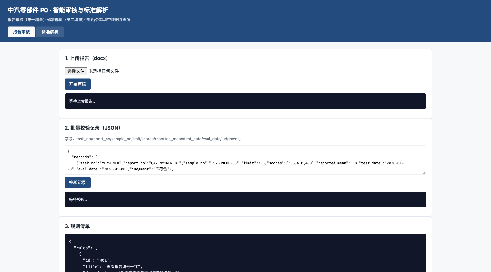
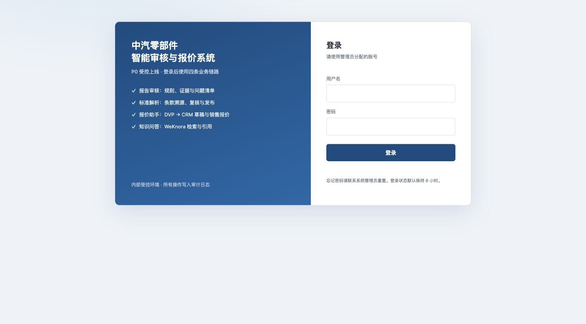
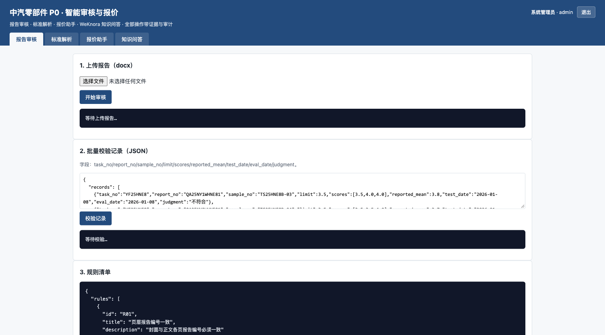
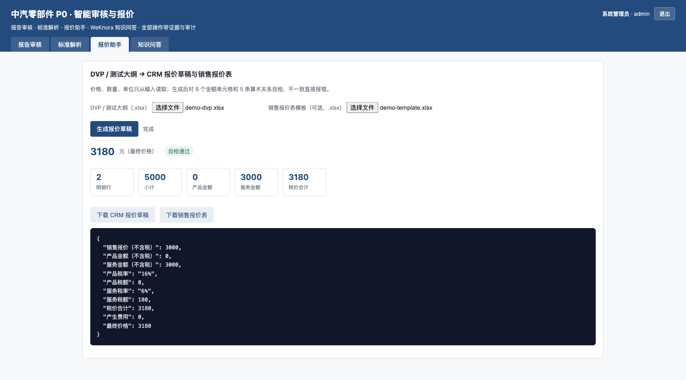
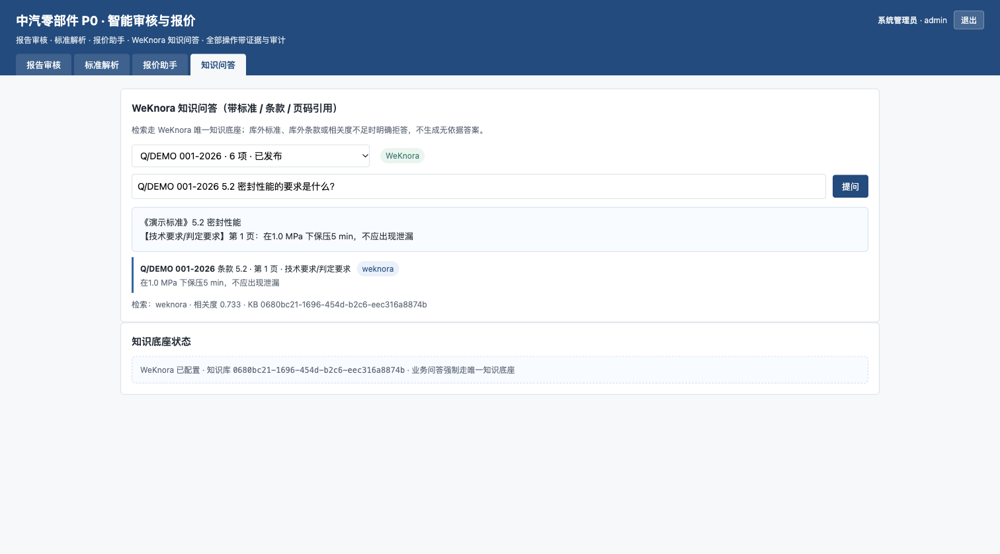

# P0 收口（11/14 受控上线）· 视觉与验收证据

## 1. 对比口径

| 项 | Before | After |
|---|---|---|
| 代码 | `main` @ `a207b6a`（含 PR #3；PR #4 的 P1 代码，v0.4.0） | 本分支 `agent/closeout-p0-f17b0777940b`，v0.5.0 |
| 入口 | 本机 `127.0.0.1:8099`（无公网、无登录） | `https://zhongqi.yunanht.com/p0/`（HTTPS + 登录） |
| 登录 | 无 | 账号密码 + 8 小时签名会话；未登录 303/401 |
| 业务页 | 2 个页签：报告审核、标准解析 | 4 个页签：报告审核、标准解析、报价助手、知识问答 |
| 知识底座 | 本地条款索引 / bge-m3（生产未接 WeKnora） | WeKnora 专用 KB；发布与问答都走 WeKnora |
| 截图 | `before-workbench.png`（1512×838） | `after-login.png`、`after-workbench.png`、`after-weknora-qa.png`、`after-quote.png`（1512×838） |

Before 截图来自基线代码的本地运行（同一浏览器、同 1512×838 视口、同一浅色主题）；
After 截图来自公网 HTTPS 入口的真实登录与业务操作，未使用 mockup。

## 2. Before



- 无登录页、无用户信息、无退出；
- 只有“报告审核 / 标准解析”两个页签；
- 页面标题“P0 · 智能审核与标准解析”，不含报价与知识问答入口；
- 生产部署 0.2.0，公网无业务入口。

## 3. After

### 3.1 登录



- `https://zhongqi.yunanht.com/p0/` 未登录 303 → `/p0/login`；
- 未登录访问 `/p0/api/*` 返回 401；
- 登录成功设置 HttpOnly、SameSite=Lax、Secure、Path=/p0 的会话 Cookie；
- 登录失败限流 8 次 / 5 分钟；登录事件写审计。

### 3.2 四条链路工作台



- 报告审核、标准解析、报价助手、知识问答四个页签；
- 右上角显示当前用户与退出；
- 所有 API 调用经同一登录会话，并写入 `data/audit/audit.jsonl`。

### 3.3 报价助手（自检通过）



- 输入：合成演示 DVP（2 行，无客户/价格信息）+ 演示销售报价模板；
- 输出：CRM 草稿 + 已填销售报价表；
- 9 个金额单元格 + 5 条算术关系自检全部通过；
- 演示金额：销售报价 3,000.00；服务金额 3,000.00；服务税额 180.00；
  税价合计/最终价格 3,180.00。

### 3.4 WeKnora 引用问答



- 选择演示标准 `Q/DEMO 001-2026`，提问 5.2 密封性能；
- 返回引用：第 1 页技术要求，标准号/条款/页码/类型/原文片段齐全；`source=weknora`；
- 检索元数据：`mode=weknora`、`top_score≈0.733`、P0 业务 KB ID；
- 库外标准（ISO 9001）、库外条款（5.9.9）、无关问题（天气）均明确拒答。

## 4. 验收命令与结果（2026-11-02）

```text
pytest -q（本地）             36 passed, 2 skipped
pytest -q（/opt/cq-ai-p0）    36 passed, 2 skipped
GET /p0/health                200 {"version":"0.5.0","auth":"enabled","weknora":"configured"}
GET /p0/                      303 -> /p0/login
GET /p0/login                 200
GET /p0/api/v1/rules（未登录） 401
POST /p0/api/v1/auth/login    200（设置 Cookie）
GET /p0/api/v1/auth/me        200（admin / 系统管理员）
POST /p0/api/v1/reports/audit 200（11 项：6 fail / 5 pass）
POST /p0/api/v1/quotes/generate 200（演示 DVP 2 行，自检通过，3,180.00）
POST /p0/api/v1/standards/{id}/publish 200（演示标准 6 项 → 12 片段写入 WeKnora）
POST /p0/api/v1/standards/ask 200（演示标准 5.2 带引用回答）
```

WeKnora 侧（P0 业务专用知识库）：

```text
知识库：中汽标准库（P0业务）  ID 0680bc21-1696-454d-b2c6-eec316a8874b
已发布：Q/DEMO 001-2026（演示标准）
        另一份已发布标准（客户标准，名称与正文不在此仓库展示）
状态：parse_status=completed；检索走 hybrid-search（向量+关键词）
```

HTTPS：

```text
http://zhongqi.yunanht.com/p0/ -> 301 https://...
证书：Let's Encrypt，CN=zhongqi.yunanht.com（沿用现有证书）
WeKnora 管理端：https://zhongqi.yunanht.com/ 仍正常
```

## 5. 已知限制（与 PR 描述一致）

- 未新增独立子域名：`p0.yunanht.com` 等子域无 DNS 记录，因此使用同域名 `/p0/` 路径；
  登录、API、下载均已在 HTTPS 下验证。若后续增加子域，只需改 nginx `server_name` 与 `P0_ROOT_PATH`。
- 登录是 P0 级本地账号（PBKDF2 + 签名 Cookie），不是 P1 的 SSO/RBAC 全量方案；
- 审计为追加 JSONL，未接集中日志/告警；
- WeKnora 摘要模型为空，`summary_status=failed` 不影响检索与引用；P1 再配置摘要模型；
- 发布接口同步等待索引最多 30 秒；较大标准（数十项）实测索引时间超过等待窗口，
  接口返回 `parse_status=processing`，随后在 WeKnora 侧完成；P1 改为异步任务 + 进度。
- 报价助手仍不做 CRM 写回/审批流；折扣不自动推断；
- 本目录截图不含客户原始报告/标准正文，只有界面与演示/报价汇总数字。
