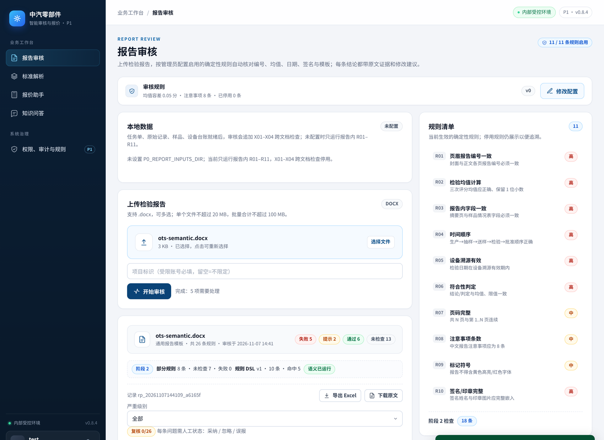
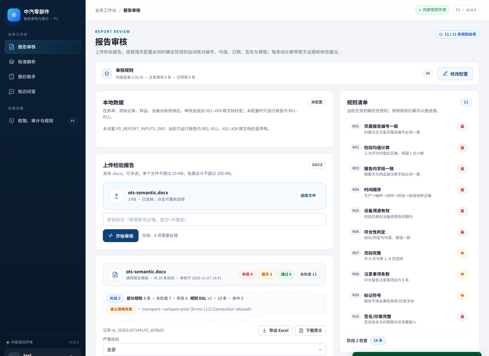

# 阶段 2 门禁指标（语义 + 部分规则 + 规则 DSL）

> **状态（2026-11-07）**：阶段 2 **门禁已过（合成基线）**；T202/T203 接入已随 PR #62 合并（`main` @ `7417c72`）。
> D5 已确认（2026-11-06），语义启用的本机自测见 §7；客户验收仍需 D3 20–30 份正式报告；T204 第二主机厂仍 blocked（D2）。

> **样本口径**：语义用例是**合成的、无客户报告原文**的 44 条用例（S01–S04 各 8 条 + 12 条干净对照）；不是客户金标准。阶段 2 门禁的客户验收仍需 20–30 份正式报告（D3）和 DeepSeek 合规确认（D5）。

## 1. 语义召回 / 误报

- 模型：`deepseek-chat`；调用：实时 DeepSeek；缓存命中 0。
- 用例：44/44 条已评测。

| 分组 | 用例 | 期望缺陷 | 检出 TP | 漏检 FN | 误报 FP | 召回 |
|---|---:|---:|---:|---:|---:|---:|
| S01 | 8 | 8 | 8 | 0 | 0 | 100.00% |
| S02 | 8 | 8 | 8 | 0 | 0 | 100.00% |
| S03 | 8 | 8 | 8 | 0 | 0 | 100.00% |
| S04 | 8 | 8 | 8 | 0 | 0 | 100.00% |
| clean | 12 | 0 | 0 | 0 | 0 | 100.00% |

| 指标 | 值 | 门禁 | 结论 |
|---|---:|---:|---|
| 语义召回（缺陷级） | 100.00% | ≥80% | 通过 |
| 误报率（告警级 FP/(TP+FP)） | 0.00% | ≤15% | 通过 |
| 精确率（TP/(TP+FP)） | 100.00% | — | — |
| 干净用例误报率 | 0.00%（0/12） | — | — |
| 规则分类准确率 | 96.88% | — | — |

**语义门禁结论：通过（合成基线）。** 该结论只证明语义链路在合成用例上的召回/误报，不等于客户报告验收通过。

## 2. 部分规则（T202）

- 12 份草稿已跑通：12 份；8 条部分规则均已接入主审核链路。

| 规则 | 数据要求 | 12 份草稿状态分布 |
|---|---|---|
| P01 任务单编号一致 | 任务单导出 | skip 12 |
| P02 目录页码完整 | 目录与页脚解析 | pass 12 |
| P03 单项检验时间 | 检验起止日期 | pass 12 |
| P04 数值单位 | 结构化单位列 | skip 12 |
| P05 平行样 | 平行样编号/结果 | skip 12 |
| P06 照片/设备标签/印章 | 视觉模型（本期未接入） | skip 12 |
| P07 标记符号 | 报告样式解析 | fail 12 |
| P08 第二主机厂模板 | 吉利/非吉利样例 | skip 12 |

## 3. 规则 DSL（T203）

- 版本：v1；规则数：10；校验错误：0。
- 已跑草稿：12 份；命中：{'D06': 12, 'D08': 12}；跳过：{'D09': 12}。

| 规则 | 名称 | 数据源/字段 | 严重级别 |
|---|---|---|---|
| D01 | 委托单位必填 | report.client | high |
| D02 | 样品数量必填 | report.sample_qty | high |
| D03 | 样品编号前缀 | report.sample_no | medium |
| D04 | 检验依据 | report.basis | medium |
| D05 | 检验项目 | report.item | low |
| D06 | 判定为不符合 | report.judgment | low |
| D07 | 均值上限 | report.reported_mean | medium |
| D08 | 限值 | report.limit | low |
| D09 | 任务单样品编号 | inputs.sample_no | high |
| D10 | 目录页码 | report.toc_first_page | low |

## 4. 回归保护

- R01–R11 判定 diff：空（12 份草稿）。
- 阶段 2 三层只追加 findings，不改变确定性规则结论。

## 5. 门禁结论与未达项

- **阶段 2 门禁：已过（合成基线）**。语义召回 100.00%（≥80%）、误报 0.00%（≤15%）；T202 八条部分规则已接入；T203 v1/10 条校验 0 错误；R01–R11 判定 diff 为空。
- **口径限制**：44 条语义用例是合成的，且用例与提示词在同轮迭代中确定，指标偏乐观；12 份草稿是同一报告的模板变体。两者都只作链路/口径基线，不能据此宣称客户验收通过。
- **客户验收**：待 D3 20–30 份正式报告；待客户业务专家给出金标准并在验收记录上签字。
- **语义启用**：D5 已确认（2026-11-06）；本机自测通过（44/44 实时调用、主审核 API、工作台「语义已运行」、失败降级，见 §7）。测试环境部署仍需配置 `DEEPSEEK_API_KEY` / `P0_SEMANTIC_ENABLED=1`；未配置时工作台显示「语义未启用」，不返回 `pass`。
- **部分规则**：缺任务单/单位/平行样/视觉模型的数据项按 `skip` 处理，不返回 `pass`；P06 视觉项固定「未自动审核」。
- **规则 DSL**：10 条示例规则已接入；业务自建规则走配置文件，管理端目前只读展示，在线编辑未做。
- **缺口**：D3 20–30 份正式报告金标准、D5 DeepSeek 合规确认、D1 XG 变更样例（T105 C 类）、D2 第二主机厂样例（T204）。
- **阶段 3 准备**：D1–D5 清单、3 类报告验收标准与模板见 `docs/stage3-acceptance/README.md`。

## 6. 复现

```bash
cd p0
# 合成语义用例 + 12 份草稿回归（需要 DEEPSEEK_API_KEY 和 P0_SEMANTIC_ENABLED=1）
python -m eval.stage2_metrics --samples ../samples/byd --out ../docs/eval-stage2.md
```


## 7. 语义启用自测（2026-11-07，T306）

> 目的：D5 已确认后，记录“开关打开”的完整链路自测：44 条合成用例 → 主审核 API → 工作台显示 → 失败降级。
> 本节在本机测试实例上执行，不是客户验收；测试数据为合成报告（`ots-semantic.docx`，无客户原文）。
> 测试环境部署检查（2026-11-07）：`GET https://zhongqi.yunanht.com/p0/health` 返回 0.8.4；
> `/api/v1/config/effective` 的 `stage2.semantic` 仍为 `enabled=false / configured=false`。
> 在服务器配置 `DEEPSEEK_API_KEY`、`P0_SEMANTIC_ENABLED=1` 后才会启用；本机无服务器权限，未改测试环境。

### 7.1 44 条合成用例（实时调用）

```bash
cd p0
# 提供 DEEPSEEK_API_KEY（不写入仓库、不打印）
export DEEPSEEK_API_KEY=<key>
P0_SEMANTIC_ENABLED=1 .venv/bin/python -m eval.stage2_metrics \
  --cases eval/semantic_cases.json --samples /nonexistent \
  --cache /tmp/stage2-cache-fresh.json \
  --out /tmp/eval-stage2-live.md --json-out /tmp/eval-stage2-live.json
```

结果：缓存命中 0，44/44 实时返回 `status=ok`；与 2026-11-06 基线一致。

| 分组 | 用例 | TP | FP | FN | 召回 |
|---|---:|---:|---:|---:|---:|
| S01 | 8 | 8 | 0 | 0 | 100.00% |
| S02 | 8 | 8 | 0 | 0 | 100.00% |
| S03 | 8 | 8 | 0 | 0 | 100.00% |
| S04 | 8 | 8 | 0 | 0 | 100.00% |
| clean | 12 | 0 | 0 | 0 | 100.00% |

| 指标 | 值 | 门禁 | 结论 |
|---|---:|---:|---|
| 语义召回 | 100.00% | ≥80% | 通过 |
| 误报率 | 0.00% | ≤15% | 通过 |
| 规则分类准确率 | 96.88% | — | — |

### 7.2 主审核 API 返回语义结果

本机启动测试实例（`P0_AUTH_DISABLED=1` 仅用于自测，现网仍开启登录）：

```bash
P0_SEMANTIC_ENABLED=1 P0_AUTH_DISABLED=1 \
  .venv/bin/python -m uvicorn app.main:app --host 127.0.0.1 --port 8098
curl -s -X POST http://127.0.0.1:8098/api/v1/reports/audit \
  -F "file=@/tmp/t306/ots-semantic.docx"
```

实际响应（摘要）：

```json
"stage2": {
  "partial": {"count": 8, "statuses": {"fail": 0, "warn": 0, "pass": 1, "skip": 7}},
  "dsl": {"version": 1, "rules": 10, "total": 10, "hits": {"D01": 1, "D02": 1, "D03": 1, "D04": 1, "D05": 1}, "skipped": {"D09": 1}},
  "semantic": {"status": "ok", "reason": "", "model": "deepseek-chat", "findings": 1}
}
```

语义 finding：`S01 fail 结论中出现错别字“符和”，应为“符合”。` 语义层以 `layer=semantic` 追加，
不改变 R01–R11 判定；`stage2.semantic.status` 是工作台展示依据。

### 7.3 工作台显示「语义已运行」



浏览器实测（Chromium headless，本机 8098 实例，合成报告）：上传 → 开始审核 → 报告卡片下的
`阶段 2` 条显示 `语义已运行`。语义关闭/失败时同一位置分别显示 `未启用` / `调用失败`，不会显示为通过。

### 7.4 失败降级

| 场景 | 配置 | `stage2.semantic` 实际值 | 工作台 | 是否返回通过 |
|---|---|---|---|---|
| 未启用 | `P0_SEMANTIC_ENABLED=0` | `status=skipped, reason=semantic_disabled` | 未启用 | 否（SEM finding = skip） |
| 传输失败 | `P0_SEMANTIC_BASE_URL=http://127.0.0.1:9` | `status=error, reason=transport: ... Connection refused` | 调用失败 | 否（SEM finding = warn） |
| 非法 JSON | 本地 stub 返回非 JSON | `status=error, reason=schema: Expecting value...` | 调用失败 | 否（SEM finding = warn） |

三种情况审核 API 均返回 HTTP 200（确定性审核正常完成），语义层单独降级；`semantic.status != ok`
时不产生 `pass`，符合 T201 验收要求。



### 7.5 限制与下一步

- 自测为本机 + 合成报告，不是客户报告验收；D3 正式报告的语义召回仍需客户金标准。
- 测试环境（zhongqi）尚未配置语义开关；部署时加 `DEEPSEEK_API_KEY` 与 `P0_SEMANTIC_ENABLED=1`，
  模型接入保持可切换（`P0_SEMANTIC_BASE_URL` / `P0_SEMANTIC_MODEL`）。
- 客户本地部署换本地模型后，复跑 §7.1 与 §7.2；不需要改代码。
