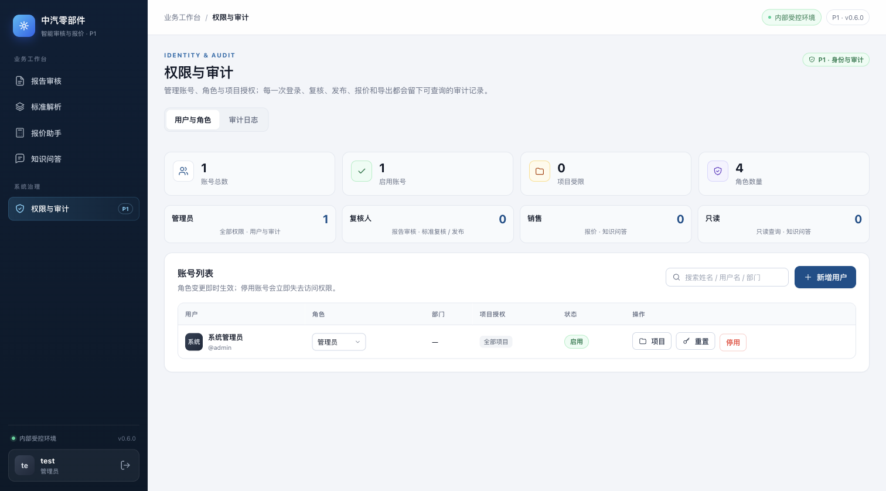
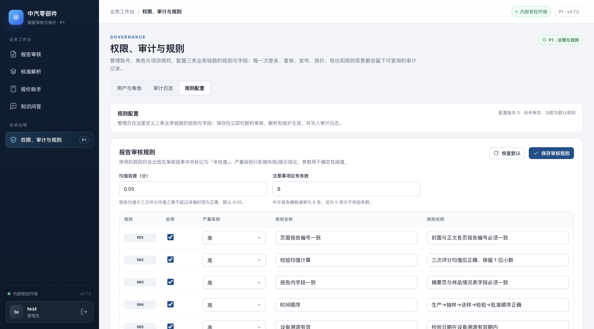
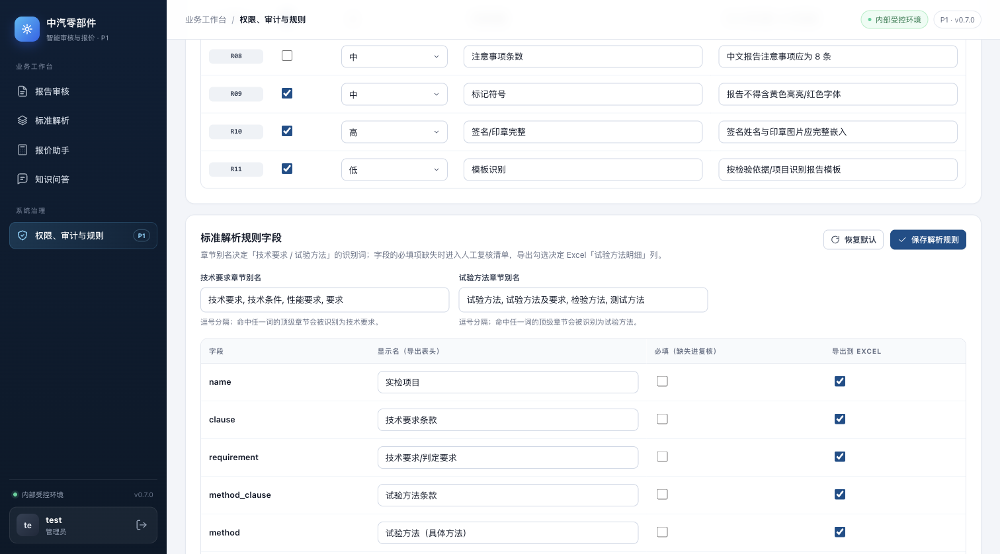
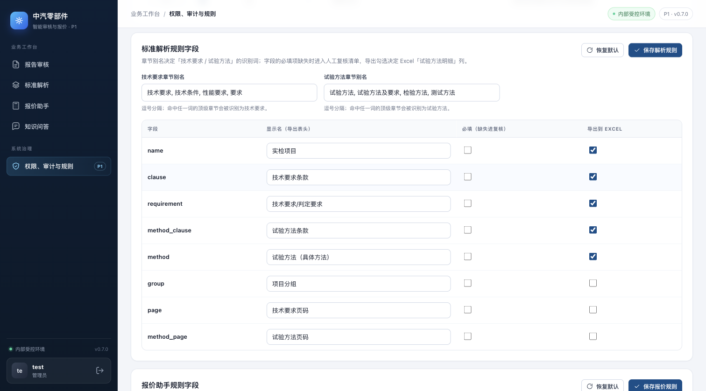
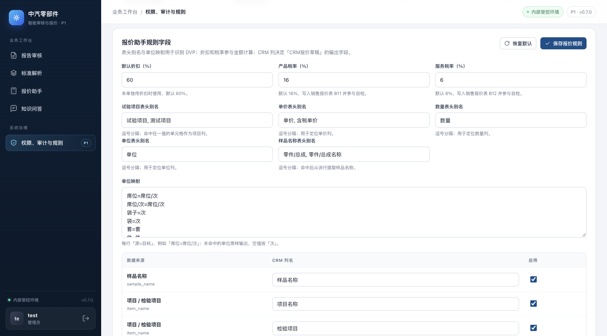

# 管理端规则配置（0.7.0）

## 变更范围

管理员在「权限、审计与规则 → 规则配置」页签中定义三条业务链路的规则与字段，保存后对新的请求立即生效：

| 分区 | 可配置项 | 生效位置 |
|---|---|---|
| 报告审核规则 | 逐条启用/停用 R01–R11、规则名称与说明、严重级别；均值容差、注意事项应有条数 | `audit_report()` / `/api/v1/reports/audit` / `/api/v1/rules` / 记录校验 |
| 标准解析规则字段 | 「技术要求」「试验方法」章节别名；解析字段显示名、必填、Excel 导出列 | `parse_standard()`、`review_fields` 复核清单、`export.xlsx` 明细列 |
| 报价助手规则字段 | 项目/单价/数量/单位/样品表头别名、单位映射、默认折扣、产品/服务税率、CRM 草稿列 | `parse_dvp()` / `parse_quote_bytes()`（Excel/PDF/图片）、金额计算、销售报价表税率单元格、CRM 报价草稿 |

安全与留痕：

- 只有 `admin` 可访问 `GET /api/v1/admin/config`（`config:read`）和写接口（`config:manage`）；
- 保存前按分区校验：规则必须完整覆盖 R01–R11，严重级别/税率/折扣/别名/字段来源均有白名单和范围限制；
- 配置写入 `data/config/rules.json`（0600，原子替换），`revision` 递增，并写 `admin_config_updated` / `admin_config_reset` 审计事件；
- 文件不存在或损坏时回退默认规则；管理员可在页面「恢复默认」。

## 接口

- `GET /api/v1/admin/config` → `{config, path, warning, sections}`
- `PUT /api/v1/admin/config/{report|standard|quote}`（JSON 分区配置）→ 校验、保存并返回最新配置
- `POST /api/v1/admin/config/{report|standard|quote}/reset` → 恢复该分区默认值
- 未配置时，三个业务链路行为与 0.6.0 一致；`/api/v1/rules` 增加 `enabled` / `severity` 字段与 `enabled/total` 统计

配置文件示例（节选）：

```json
{
  "schema_version": 1,
  "revision": 1,
  "updated_at": "2026-11-02T11:37:06+00:00",
  "updated_by": "admin",
  "report": {
    "mean_tolerance": 0.05,
    "expected_notices": 8,
    "rules": [{"id": "R01", "enabled": true, "severity": "high", "title": "...", "description": "..."}]
  },
  "standard": {
    "section_aliases": {"技术要求": ["技术要求", "技术条件"], "试验方法": ["试验方法", "检测方法"]},
    "fields": [{"key": "name", "label": "实检项目", "required": false, "export": true}]
  },
  "quote": {
    "default_discount": 60,
    "product_tax_rate": 0.16,
    "service_tax_rate": 0.06,
    "headers": {"item": ["试验项目", "测试项目"], "price": ["单价", "含税单价"], "quantity": ["数量"], "unit": ["单位"], "sample": ["零件/总成"]},
    "unit_map": {"席位": "席位/次"},
    "crm_columns": [{"source": "sample_name", "label": "样品名称", "enabled": true}]
  }
}
```

## Before / After

基线：`main` @ `2c08ffc`（0.6.0，管理端只有「用户与角色」「审计日志」两个页签）。
改动：本分支（0.7.0），新增「规则配置」页签与三个分区。

| Before | After |
|---|---|
|  管理端只有两个页签 |  新增「规则配置」页签与报告审核规则 |
| — |  停用 R08 并保存后版本递增，规则仍显示但标记停用 |
| — |  标准章节别名、字段显示名、必填与导出列 |
| — |  报价表头别名、单位映射、折扣税率与 CRM 列 |

截图场景：本机 1512×838 视口、浅色主题、`P0_AUTH_DISABLED=1` 的管理员视图；同一页面、同一页签与同一数据源，仅代码版本不同。

## 验证

```bash
cd p0
pytest -q tests/test_admin_config.py
pytest -q
```

结果：`tests/test_admin_config.py` 8 passed；合并 #13 多格式报价解析后，全量 `69 passed, 2 skipped`（2 个跳过为需要真实样例的解析/审核用例）。

覆盖内容：

- 默认配置与 admin-only 权限；
- 报告规则停用/改级别/改名称、均值容差与 `/api/v1/rules`、审计事件、配置文件 revision；
- 非法严重级别/折扣返回 400，恢复默认值；
- 标准章节别名识别、必填字段进入复核清单、导出列跟随字段配置；
- 报价表头别名/单位映射/折扣/税率生效，CRM 列启停与改名；
- 合并 #13 后，自定义表头/单位/税率/CRM 列同样作用于 Excel、PDF、图片三条解析路径。

## 限制

- 配置是开关、阈值、别名和字段定义，不是任意规则脚本/DSL；不能新增 R12 或编写自定义判定逻辑；
- 单文件 JSON（0600），无审批流、无按时间点回滚；误改后可恢复默认或从备份快照恢复；
- 规则变更只影响保存后的新请求，已生成的审核结果、已解析标准、已有报价不重算；
- 「报告审核规则」页签对停用规则仍展示并标记为 `skip`，便于审计口径可解释。
