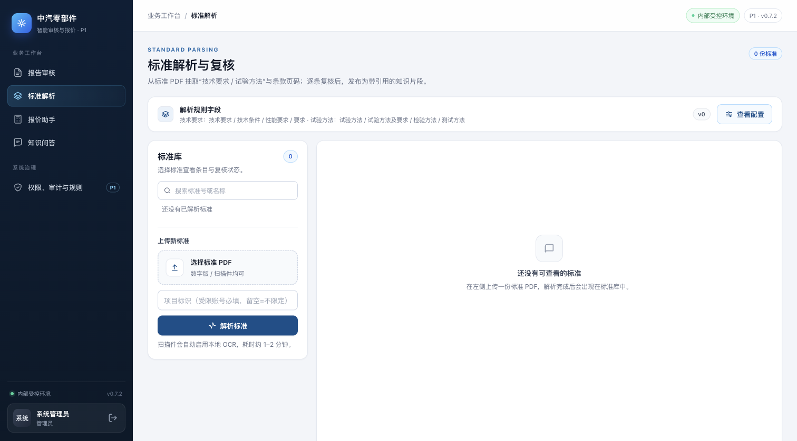
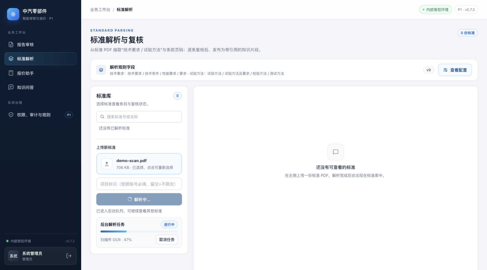

# P1-2 异步任务：OCR / 解析 / 发布

> 状态：代码与测试完成；默认关闭，`P0_TASKS_ENABLED=1` 且 `P0_STORE=postgres` 时启用。
> 依赖 P1-1 数据层（任务表与对象存储）。

## 1. 目标

P0 的扫描件 OCR 在请求内同步执行，44 页扫描约 1.5–2 分钟，期间单进程服务无法响应
`/health` 和其他 API。本增量把耗时工作移出请求：

- `POST /api/v1/standards/parse` 对大文件/扫描件返回 `202 + task_id`；
- `POST /api/v1/standards/{id}/publish` 在启用时返回 `202 + task_id`；
- 新增 `GET /api/v1/tasks/{id}`、`GET /api/v1/tasks`、`POST .../cancel`、`POST .../retry`；
- 任务状态：`queued / running / succeeded / failed / cancelled`，带阶段与进度；
- 进程内 worker 线程池（默认并发 1，可配 1–4）；PostgreSQL `FOR UPDATE SKIP LOCKED`
  领取任务，租约超时后重启可恢复；
- 前端标准解析/发布显示阶段、进度、失败原因，并可取消。

小于 `P0_TASKS_ASYNC_MIN_MB` 且文本层正常的 PDF 仍走同步路径，保持原有 API 行为。

## 2. 架构

```
POST /standards/parse
  ├─ 小文本 PDF ──────────────── 同步：extract -> parse -> standard_store.create -> 200
  └─ 大文件/扫描件 ── 写 origin 到对象存储 -> tasks 表 queued -> 202
                                                    │
tasks 表 (PostgreSQL)  <── claim (SKIP LOCKED) ── worker 线程
  queued/running/...         lease/heartbeat          │
                                                      ├─ extract
                                                      ├─ OCR
                                                      ├─ parse
                                                      ├─ standard_store.create
                                                      └─ succeeded + result
GET /api/v1/tasks/{id}  ← 前端轮询（1s）→ 进度条/阶段/取消
```

- `tasks.payload` 保存 `file_id`、文件名、项目、创建人；PDF 字节在 `files` 表 + 对象存储，
  所以 worker 重启后仍能继续。
- `attempts / max_attempts` 记录尝试次数；失败后由用户点“重试”重新入队。
- `lease_until` 为 worker 租约：启动时 `recover_stale()` 把过期 `running` 任务改回
  `queued`（已请求取消的改成 `cancelled`），避免进程崩溃丢任务。
- 任务结果：解析返回 `standard_id / items / pages`，发布返回 `chunks / published_at / weknora`。

### 并发与取消

- 默认 `P0_TASKS_CONCURRENCY=1`；两个任务同时提交时第二个排队，完成后自动开始。
- worker 在阶段切换、每页 OCR 回调与心跳时检查 `cancel_requested`；取消在页间生效，
  但不会强杀当前页的识别调用。
- 服务停止时最多等待 5 s；未完成任务保留 `running` 租约，下次启动回收已过期租约
  （默认租约 900 s，可用 `P0_TASKS_LEASE_SECONDS` 调整）。

## 3. 配置

```bash
P0_STORE=postgres                    # 任务队列只在 PostgreSQL 模式启用
P0_TASKS_ENABLED=1                   # 总开关；默认 0
P0_TASKS_CONCURRENCY=1               # 1–4
P0_TASKS_PARSE_ASYNC=1               # 解析大文件/扫描件入队
P0_TASKS_PUBLISH_ASYNC=1             # 发布入队
P0_TASKS_ASYNC_MIN_MB=5              # 超过该大小直接入队；0=全部解析入队
P0_TASKS_MAX_ATTEMPTS=2              # 任务记录的最大尝试次数
P0_TASKS_LEASE_SECONDS=900           # worker 租约；OCR 长时间无心跳也能恢复
P0_TASKS_POLL_SECONDS=0.5            # 空闲轮询间隔
P0_TASKS_LOG_TRACEBACK=0             # 1=失败时打印堆栈（调试）
```

`P0_TASKS_ENABLED=1` 但 `P0_STORE!=postgres` 时队列不会启动，解析回退同步；
`/health` 的 `tasks` 字段为 `off`。

## 4. API

```http
POST /api/v1/standards/parse
Content-Type: multipart/form-data
file=<pdf>&project=P1
→ 202 {"task_id":"task_20261103080034_d110cfa0","status":"queued",
        "status_url":"/api/v1/tasks/task_20261103080034_d110cfa0"}

GET /api/v1/tasks/task_20261103080034_d110cfa0
→ {"id":..., "kind":"standard_parse", "status":"running", "stage":"ocr",
   "progress":25, "error":"", "attempts":1, "max_attempts":2,
   "file_name":"scan.pdf", "created_at":..., "updated_at":...}

POST /api/v1/tasks/{id}/cancel
POST /api/v1/tasks/{id}/retry
GET  /api/v1/tasks?limit=10          # 当前用户最近任务（管理员可看全部）
```

- 任务查询/取消/重试只允许创建人或管理员；受限项目账号还要通过项目校验。
- 任务接口在队列未启用时返回 503，不会静默排队。
- 同步路径的响应字段与 P1-1 完全一致。

## 5. 前端

标准解析页上传区新增任务卡：阶段、百分比、状态、取消按钮、失败原因；发布按钮下方
新增发布任务进度。刷新页面会恢复最近一个解析任务；完成后自动加载新标准。

静态回归测试在 `tests/test_ui_tasks.py`。浏览器实测（1512×838，浅色主题，同一管理员会话）：

Before（0.7.3，无任务卡）：



After（任务进行中，阶段/百分比/取消）：



## 6. 验证

- 全量测试（PostgreSQL 16 / 本地 14）：`86 passed, 2 skipped`；
- 新增 6 项任务集成测试：202 入队、`/health` 在任务运行期间保持 < 500 ms、
  发布任务、取消/重试、并发领取、租约过期恢复、失败重试；
- 44 页扫描件（同一份两页扫描件复制为 44 页，706 KB，OCR DPI 200）端到端 **176 s**，
  上传立即返回 202，任务 `succeeded`（44 页）；
- 同一任务运行期间 `/health` 三次：`0.011 s / 0.072 s / 0.015 s`，均 < 500 ms；
- 2 页扫描件 UI 实测：任务卡显示「扫描件 OCR · 47%」→「已完成」，见上方 After 截图。

## 7. 限制

- worker 与 API 同进程；单机单实例部署下工作正常。多 uvicorn worker 时数据库领取仍
  安全，但每个进程都会启动线程池，需按 CPU/内存设置 `P0_TASKS_CONCURRENCY`。
- OCR 阶段进度按页更新（25%→70%），但阶段标签仍是「扫描件 OCR」，没有每页文本预览。
- 取消不能中断已进入的 OCR 调用，只能阻止后续阶段。
- 任务结果/错误保留在 `tasks` 表；尚无自动清理策略，后续按审计保留期增加清理。
- 解析任务依赖 P1-1 对象存储；本地开发用 `P0_OBJECT_STORE=local`，生产用 MinIO。
