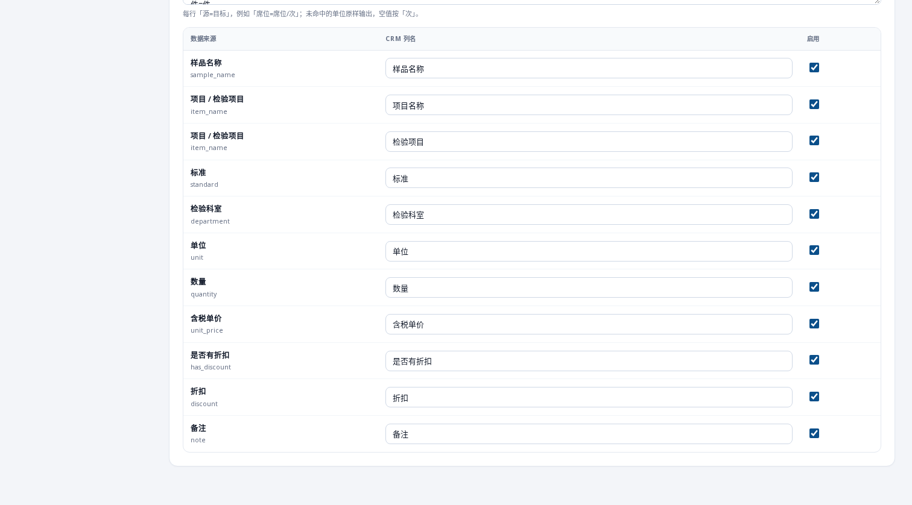
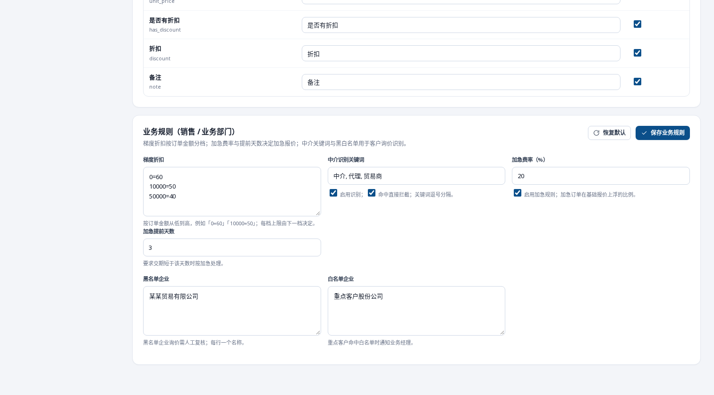
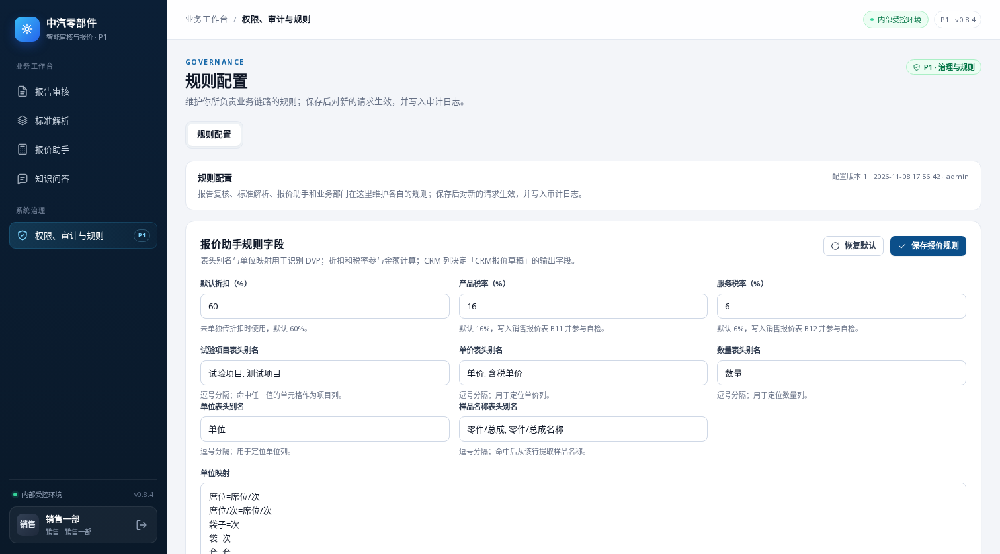

# 业务规则配置（CS-7.1 / CS-7.2）

「权限、审计与规则 → 规则配置」新增「业务规则」分区：销售/业务部门自助维护梯度折扣、加急费率与提前天数、中介识别关键词及黑白名单。保存前校验，保存后写审计日志；规则等客户接口到位后由报价/客服流程消费。

权限按分区拆分：报告审核/标准解析归复核人，报价助手/业务规则归销售，管理员保留全部，只读角色不可读写。CS-7.2 的认可清单与 CRM 基础报价库沿用 CS_BASE 的 `BaseDataStore` 接口；黑白名单为精确全称列表。

## Before / After

基线 `origin/main` @ `b0f3b94`（PR base `c191183` 仅含 verify 变更，UI 相同），改动为本分支；视口 1512×838、浅色主题、同一数据目录。

| Before | After |
|---|---|
|  报价分区后没有业务规则 |  新增业务规则分区 |
| — |  销售账号只看到自己可维护的分区 |

`cd p0 && pytest -q tests/test_admin_config.py`（12 passed）；全量 `pytest -q` 与浏览器冒烟（保存回读、分区可见性、越权 403）见 PR。
