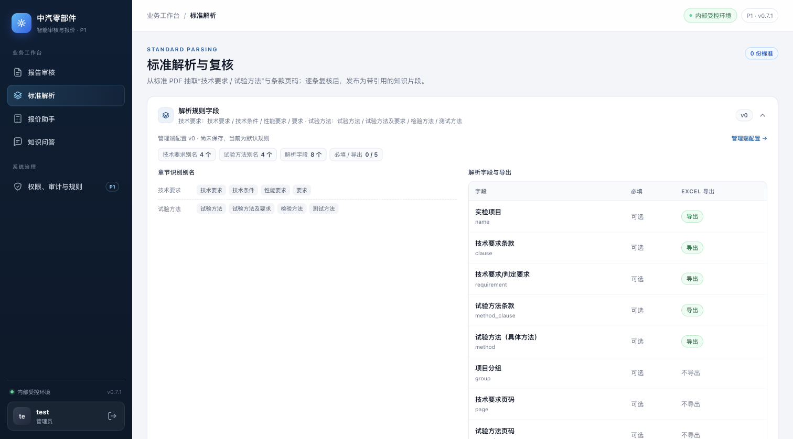
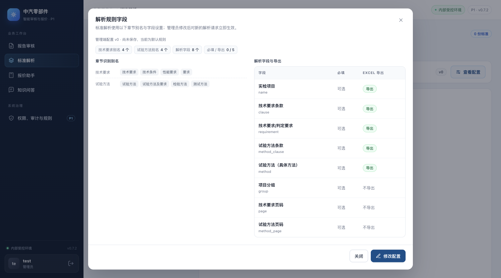
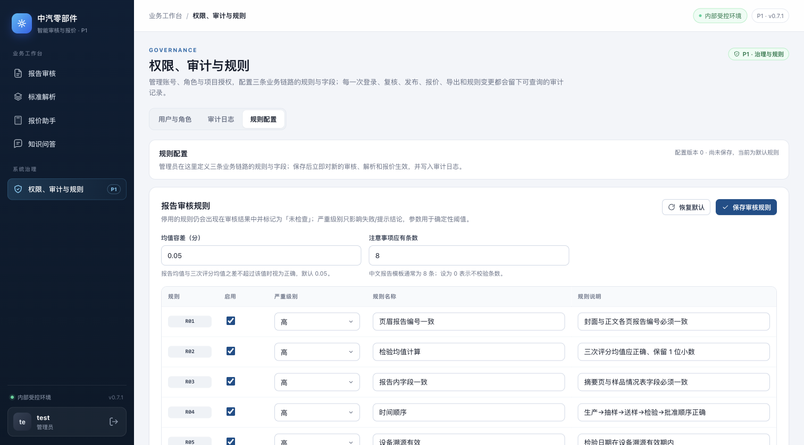
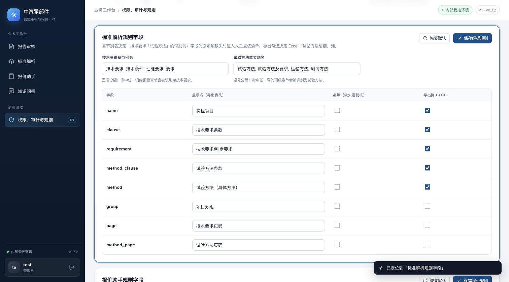
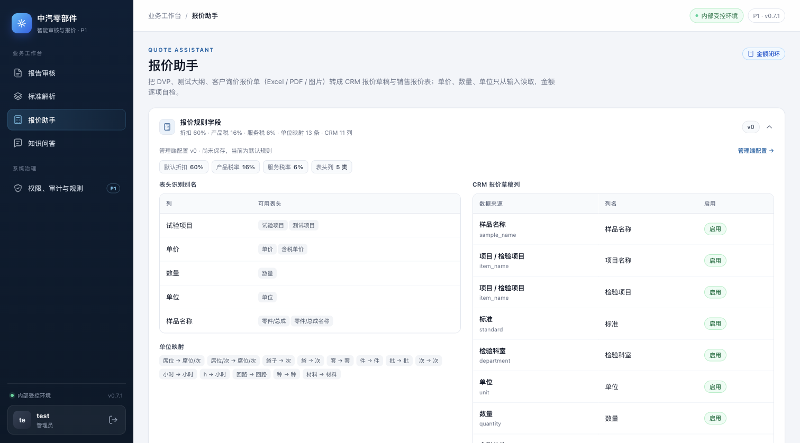
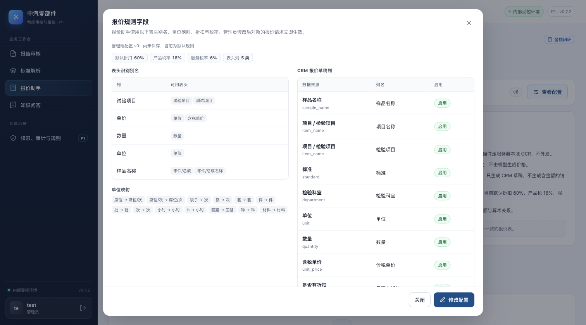
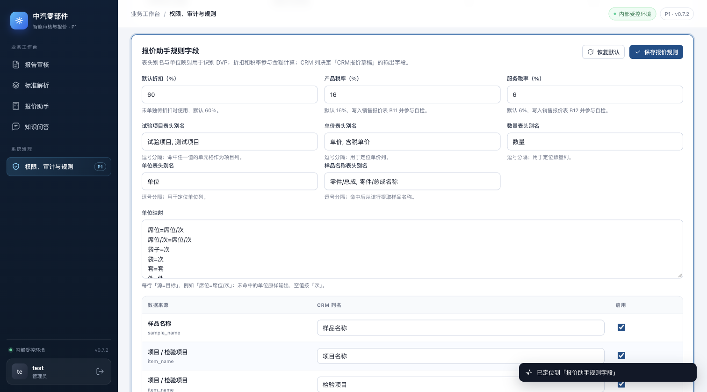

# 模块配置入口与精准跳转（0.7.2）

## 对比口径

| 项 | Before | After |
|---|---|---|
| 代码 | `c1871dc`（0.7.1，已含模块页只读配置卡） | 本分支新增提交（0.7.2） |
| 页面 | 标准解析 / 报价助手 / 管理端规则配置 | 同左 |
| 视口 / 主题 | 1512×838、浅色主题、管理员视图 | 同左 |
| 数据 | 本机临时数据目录；同一份默认配置 v0（未保存过自定义规则） | 同左 |
| 截图方式 | 实际启动应用后用 Chromium 截图，非 mockup | 同左 |

## 变更

- **明显入口**：标准解析 / 报价助手顶部规则卡的右侧，由原来的 `v0` + 折叠箭头改为整高「查看配置」按钮（滑杆图标 + 文案），汇总信息仍在卡片左侧直接可见。
- **配置弹窗**：点「查看配置」打开对应模块的配置弹窗，展示配置版本 / 更新时间、章节别名、字段必填与导出状态、报价表头别名 / 单位映射 / CRM 列等完整生效配置。
- **修改配置**：管理员在弹窗底部可见「修改配置」按钮；非管理员只看到「由管理员维护」与「关闭」。
- **精准跳转**：点「修改配置」关闭弹窗并进入管理端「权限、审计与规则 → 规则配置」，自动定位到「标准解析规则字段」或「报价助手规则字段」分区；目标分区短暂高亮，并提示「已定位到 …」。
- **落点稳定**：先等待管理端配置数据渲染完成，再等两帧布局后滚动；目标分区设置 `scroll-margin-top: 76px`，不会被 60px 顶栏遮挡。页面布局完成后目标分区顶部位于视口 73–76px。
- **可回访链接**：跳转后 URL 记录 `?tab=admin&view=config&section=standard|quote`，刷新或直接打开该链接仍会定位到对应分区；切换管理端页签时清理 `view` / `section` 参数。
- 报告审核页原有的「管理端配置 →」链接保留，并同步改为定位到「报告审核规则」分区。

## Before / After

### 标准解析

| Before（0.7.1） | After（0.7.2） |
|---|---|
|  入口是 `v0` + 折叠箭头，不显眼 |  右侧整高「查看配置」按钮 |
|  需先展开折叠卡，才能看到「管理端配置 →」 |  点按钮打开弹窗，底部有「修改配置」 |
|  点原链接只到管理端配置页顶部（报告审核规则） |  直接定位到「标准解析规则字段」并高亮 |

### 报价助手

| Before（0.7.1） | After（0.7.2） |
|---|---|
|  同样是 `v0` + 折叠箭头 |  右侧整高「查看配置」按钮 |
|  展开后才看到配置明细与链接 |  弹窗展示完整配置，底部有「修改配置」 |
| — |  定位到「报价助手规则字段」并高亮 |

## 验证

```bash
cd p0
pytest -q
```

- 本分支结果：`73 passed, 2 skipped`（2 个跳过为需要真实样例的解析 / 审核用例）。新增 `tests/test_ui_config_entry.py` 2 项静态回归检查，锁定配置入口按钮、管理端分区锚点与脚本映射。
- 浏览器实测（实际应用、1512×838）：
  - 标准解析 → 查看配置 → 修改配置 → 目标分区顶部 75px、URL `?tab=admin&view=config&section=standard`、高亮生效；
  - 报价助手 → 查看配置 → 修改配置 → 目标分区顶部 73px、URL `?tab=admin&view=config&section=quote`、高亮生效；
  - 直接打开 `?tab=admin&view=config&section=quote` 刷新后同样定位到报价规则分区；
  - 弹窗「关闭」按钮与 `Esc` 均能关闭；管理端页签切换会清理 `section` 参数；
  - 只读角色可打开配置弹窗，但「修改配置」按钮隐藏，弹窗元信息显示「由管理员维护」。
- 截图只访问本机临时数据目录，不读取或外发客户标准 / 报价文件。

## 限制

- 配置弹窗保持只读；编辑仍只在管理端规则配置页完成。
- 长页面平滑滚动到报价规则分区约需 2 秒，最终落点准确；截图是在滚动完成后拍摄。
- 报告审核页不在本次「明显入口」改造范围内，仍使用原有文字链接，但跳转落点已同步精准化。
