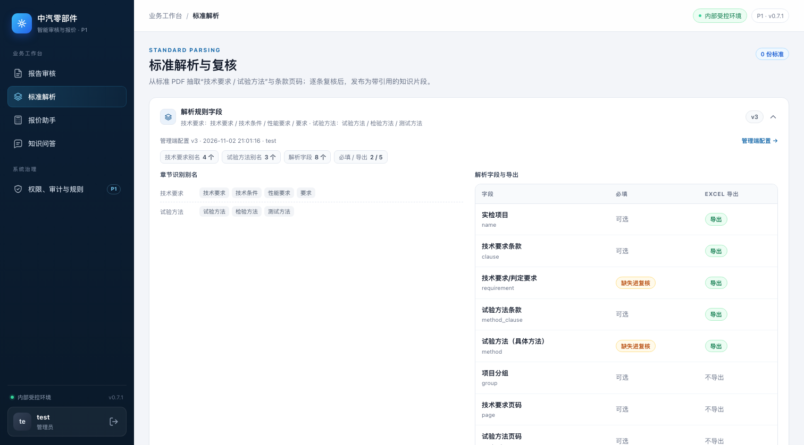
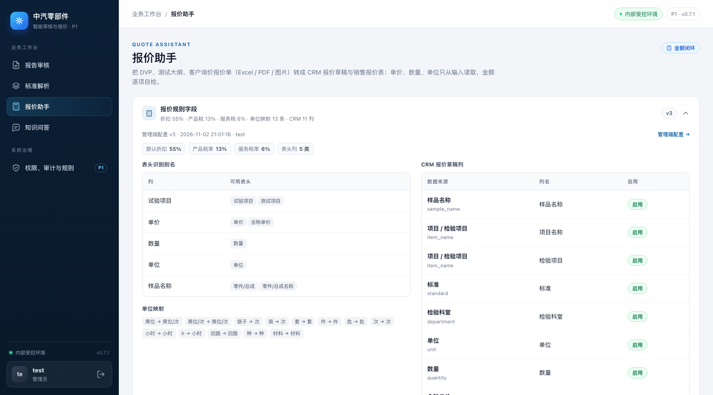
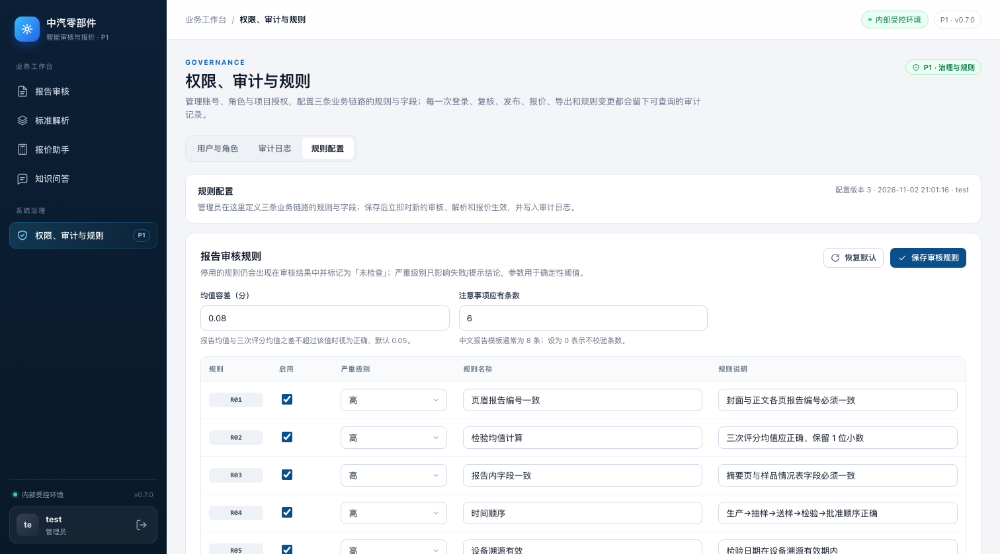

# 模块页内规则配置展示（0.7.1）

> 0.7.2 起标准解析 / 报价助手的折叠卡改为「查看配置」按钮 + 配置弹窗，并支持跳转管理端对应分区；见 [配置入口与精准跳转](../p1-config-entry/README.md)。

## 对比口径

| 项 | Before | After |
|---|---|---|
| 代码 | 本分支 `76498b7`（0.7.0，已含管理端规则配置） | 本分支新增提交（0.7.1） |
| 页面 | 报告审核 / 标准解析 / 报价助手 / 管理端规则配置 | 同左 |
| 视口 / 主题 | 1512×838、浅色主题 | 同左 |
| 数据 | 本机 `P0_AUTH_DISABLED=1` 管理员视图；同一份已保存配置（v3，`updated_by=test`） | 同左 |
| 截图方式 | 实际启动应用后用 Chromium 截图，非 mockup | 同左 |

演示配置：报告审核均值容差 0.08、注意事项 6 条、停用 R08、R09 严重级别为低；标准解析技术要求别名 4 个、试验方法别名 3 个、`requirement` / `method` 为必填；报价默认折扣 55%、产品税率 13%、服务税率 6%。

## 变更

- 报告审核页右侧「审核规则」卡增加配置版本 / 更新时间 / 更新人、均值容差、注意事项条数、停用条数、每条规则的严重级别；管理员可点「管理端配置 →」回到原配置页签。0.8.4 起配置入口上移为顶部配置条的「修改配置」，右侧卡改为「规则清单」，见 [报告审核页配置入口](../p1-report-config-entry/README.md)。
- 标准解析页顶部增加「解析规则字段」折叠卡：默认摘要直接展示技术要求 / 试验方法别名，展开后展示别名 chips 与字段的显示名、必填、Excel 导出状态。
- 报价助手页顶部增加「报价规则字段」折叠卡：默认摘要展示折扣、产品 / 服务税率、单位映射与 CRM 列数量，展开后展示表头别名、单位映射和 CRM 草稿列；右侧「计算口径」中的折扣 / 税率改为读取当前配置，不再写死 60% / 16% / 6%。
- 三个模块页只读展示，不提供编辑入口；管理端「权限、审计与规则 → 规则配置」页签原样保留。
- 新增 `GET /api/v1/config/effective`，对拥有 `rules:read` 的角色返回生效配置，响应不含配置文件的内部路径。

## Before / After

### 报告审核

| Before | After |
|---|---|
|  只有规则名称 / 说明，没有配置版本、阈值和严重级别 |  展示管理端配置 v3、阈值、停用数量与每条规则严重级别 |

### 标准解析

| Before | After |
|---|---|
|  页面没有解析规则字段信息 |  顶部折叠卡摘要直接展示章节别名与配置版本 |
| — |  展开后展示别名 chips 与字段必填 / 导出状态 |

### 报价助手

| Before | After |
|---|---|
|  计算口径写死「默认 60%」，与实际配置可能不一致 |  顶部规则卡展示当前折扣 / 税率 / 单位映射 / CRM 列，计算口径同步当前值 |
| — |  展开后展示表头别名、单位映射与 CRM 草稿列 |

### 管理端规则配置（保留）

| Before | After |
|---|---|
|  0.7.0 的管理端规则配置页签 |  0.7.1 保持原页签与编辑能力 |

## 验证

```bash
cd p0
pytest -q tests/test_admin_config.py
pytest -q
```

- `tests/test_admin_config.py`：覆盖模块页只读接口对非管理员可读、不返回 `path`、管理员保存后生效配置同步。
- 本分支结果：`tests/test_admin_config.py` 10 passed；全量 `71 passed, 2 skipped`（2 个跳过为需要真实样例的解析/审核用例）。
- 截图脚本只访问本机 `127.0.0.1`，使用临时数据目录，不读取或外发客户标准 / 报价文件。

## 限制

- 配置展示是只读的；编辑仍只在管理端规则配置页完成。
- 页面在切换页签时重新拉取生效配置；另一个浏览器会话保存配置后，当前页面不会实时推送，切换页签或刷新即可看到新值。
- 知识问答页没有管理端可配置规则分区，因此不增加规则配置卡。
