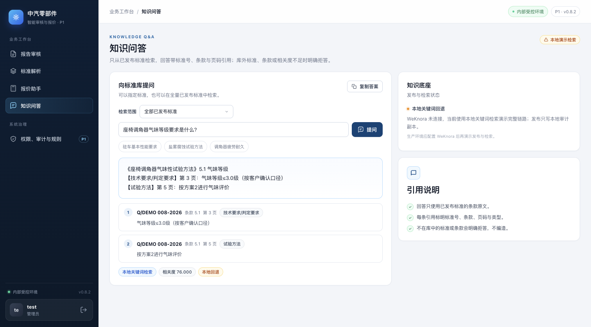
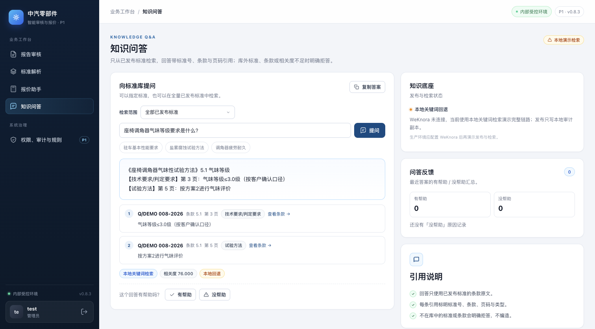
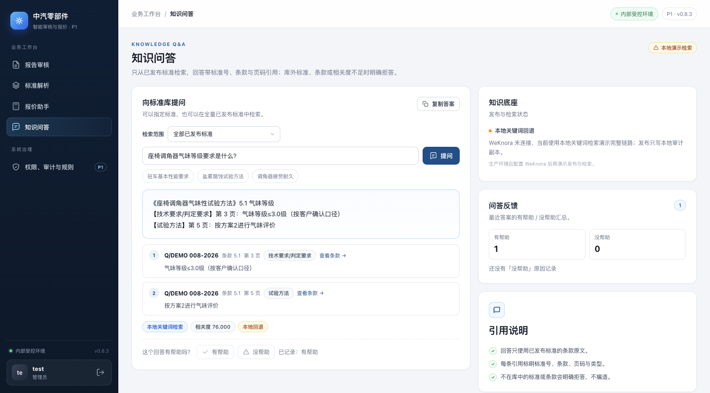
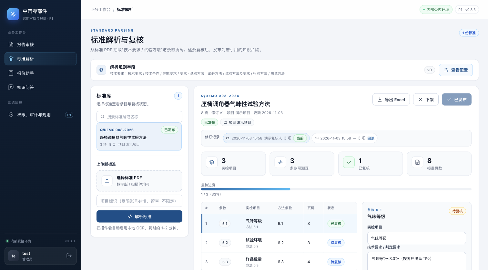

# 知识问答反馈与引用跳转（0.8.3）

> 基线：`main` @ `d1d2110`（0.8.2，报价历史）。本增量补 `docs/p1-plan.md` §3.5
> 「知识问答：引用跳转、反馈」中尚缺的两项，不改检索与拒答口径。

## 1. 改动

### 反馈采集

- `POST /api/v1/standards/ask/feedback`（`standard:ask`，四角色均可评）：
  - 字段：`question`、`answer`、`rating`（`helpful` / `not_helpful`）、`reason`、`comment`、
    `standard_id`、`clause`、`retrieval_mode`、`citations`（最多 10 条，保留标准 ID + 条款）；
  - 服务端截断长文本（问题 1000、答案 2000、备注 500 字）并校验 rating，其它值 422；
  - 若带 `standard_id`，沿用项目行级校验，并记录该标准的项目标签；
  - 写审计事件 `standard_ask_feedback`。
- 文件模式追加 `P0_FEEDBACK_DIR/qa.jsonl`；`P0_STORE=postgres` 写新表 `qa_feedback`
  （at/rating/project 建索引）。无需迁移旧数据。

### 管理员汇总

`GET /api/v1/kb/feedback`（`feedback:read`，仅 admin）返回：

- `totals`：总数、有帮助、没帮助；
- `reasons`：没帮助原因 Top 6（按 `reason` 计数）；
- `items`：最近反馈（问题、答案摘录、引用、检索方式、用户/时间），支持 `limit`/`offset`。

### 引用跳转

- 答案引用卡改为可点击按钮；点击后切到「标准解析」，加载对应标准并选中该条款（右侧复核面板显示条款内容）。
- 无 `standard_id` 的引用保持只读展示。

### 前端

- 答案下方新增「这个回答有帮助吗？」：有帮助 / 没帮助，提交后显示「已记录」，并刷新管理员汇总；
- 知识问答右栏新增「问答反馈」卡（管理员可见）：有帮助/没帮助计数与「没帮助」原因；
- 版本 0.8.3。

## 2. 验证

```bash
cd p0
pytest -q
# 带临时 PostgreSQL 时额外覆盖 qa_feedback
P0_TEST_DATABASE_URL=postgresql+psycopg://postgres@127.0.0.1:55432/p0_test pytest -q
```

覆盖：

- `tests/test_qa_feedback.py`：反馈落库与 JSONL、项目标签、管理员汇总、rating 校验（422）、
  viewer 可评分但不可读汇总（403）；
- `tests/test_store_postgres.py::test_qa_feedback_roundtrip`：PostgreSQL 往返；
- `tests/test_ui_qa_feedback.py`：反馈入口、汇总卡、引用跳转与样式的静态断言。

结果：带 PostgreSQL 全量 `137 passed, 2 skipped`。

浏览器实测（1512×838、浅色、真实应用）：
提问「座椅调角器气味等级要求是什么？」→ 回答带 2 条引用；点「有帮助」后汇总变为 1；
点第 1 条引用跳到标准解析并选中条款 5.1，右侧显示该条款内容。

## 3. Before / After

- **Before**：`main` @ `d1d2110`（0.8.2），同一问题、同一已发布标准；
- **After**：本分支（0.8.3），同视口/主题/数据。
- 截图来自实际启动的应用，使用合成演示标准与本地关键词回退，不含客户材料。

| Before（0.8.2） | After（0.8.3） |
| --- | --- |
|  |  |

提交反馈后的管理员汇总：



点击引用跳到标准条款：



## 4. 限制与后续

- 反馈界面只区分有帮助/没帮助；`reason`/`comment` 字段已开放给 API，界面暂未提供原因选择。
- 反馈按“一次回答”记录，不按单条引用记录；引用只保留标准 ID 与条款。
- 管理员汇总只取最近若干条且不做项目过滤（仅 admin 可见）；后续可加日期/项目筛选与导出。
- 引用跳转依赖 `standard_id`；历史 WeKnora 结果缺该字段时保持只读。
- 检索/拒答逻辑未变；本地无 WeKnora 时仍按既有本地回退演示。
