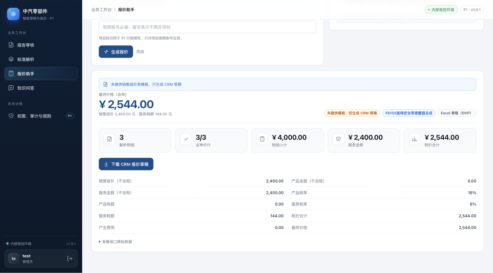
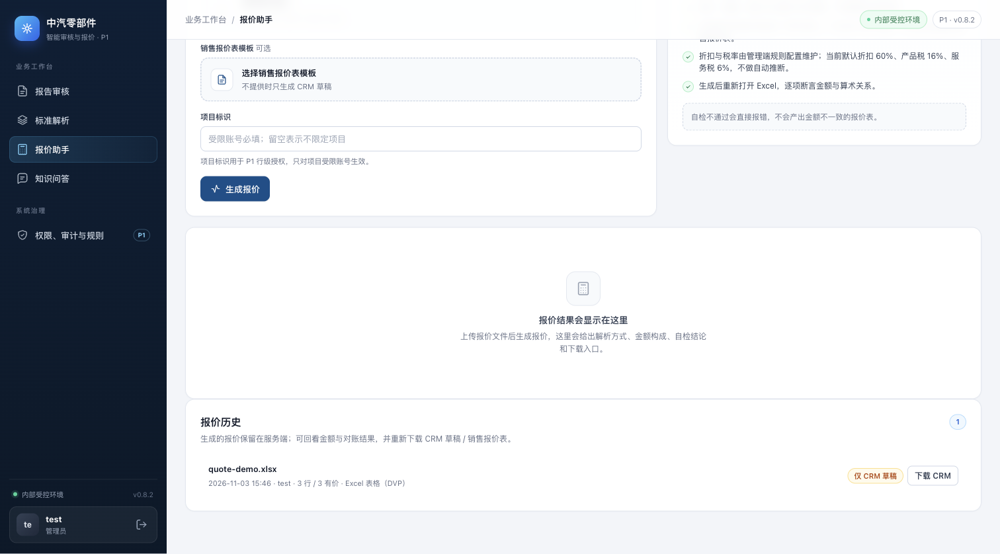
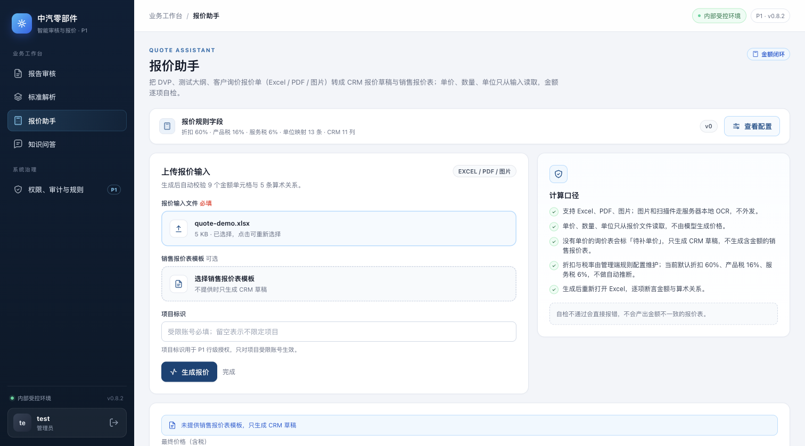

# 报价历史与重新下载（0.8.2）

> 基线：`main` @ `88e1471`（0.8.1，标准发布治理）。本增量补报价工作台的日常使用缺口：
> 生成过的报价只存在于当前页面，离开页面后无法再找到下载入口。

## 1. 改动

### 服务端

- 报价生成时把可回看的信息写进 `meta`：金额汇总、是否全部有价、CRM 对账结果
  （mode/matched/missing/price_mismatch）、是否生成销售报价表、自检是否通过、跳过原因。
- 新增 `GET /api/v1/quotes`（`quote:download`，admin/sales）：
  - 返回 `quotes`/`total`/`limit`/`offset`，按 `created_at` 倒序；
  - 按项目授权过滤（复用 `can_access_project`，跨项目不可见）；
  - 支持 `limit`/`offset` 与 `q`（按源文件名/项目模糊匹配）。
- 数据来源：文件模式扫描 `P0_QUOTE_DIR/*/meta.json`；`P0_STORE=postgres` 读 `quotes` 表。
  下载继续走既有 `/api/v1/quotes/{id}/crm.xlsx` 与 `/sales.xlsx`（项目校验不变）。

### 前端

报价页新增「报价历史」卡片：

- 展示最近 20 条：源文件、时间、生成人、项目、行数/有价行数、解析方式；
- 状态 pill：`仅 CRM 草稿` / `销售表` / `销售表·自检通过`；CRM 开启时显示对账 `matched/lines`；
- 每条可直接「下载 CRM」「下载销售表」（有销售表时才显示后者）；
- 生成成功后自动刷新历史；无权限角色看不到上传、结果与历史卡片。

## 2. 验证

```bash
cd p0
pytest -q
# 带临时 PostgreSQL 时额外覆盖 quotes 列表
P0_TEST_DATABASE_URL=postgresql+psycopg://postgres@127.0.0.1:55432/p0_test pytest -q
```

覆盖：

- `tests/test_quote_history.py`：列表排序/搜索、生成后 meta 落库（summary/CRM/销售表标记）、
  项目隔离（P1/P2 销售账号各自只能看到自己的报价，跨项目下载 403）；
- `tests/test_store_postgres.py::test_quote_history_roundtrip`：PostgreSQL 列表往返；
- `tests/test_ui_quote_history.py`：历史卡、加载与下载入口、样式的静态断言。

结果：带 PostgreSQL 全量 `130 passed, 2 skipped`。

浏览器实测（1512×838 视口、浅色主题、真实应用）：上传 `quote-demo.xlsx` 生成报价（3 行 / 3 有价、
仅 CRM 草稿），历史卡出现该记录并可下载；刷新页面后历史仍在。

## 3. Before / After

- **Before**：`main` @ `88e1471`（0.8.1），同一份报价生成后的页面；
- **After**：本分支（0.8.2），同一份输入、同一视口/主题。
- 截图来自实际启动的应用，使用合成演示报价（`quote-demo.xlsx`），不含客户材料。

页面底部（同一滚动规则，Before 只能看到结果末尾，After 多了报价历史）：

| Before（0.8.1） | After（0.8.2） |
| --- | --- |
|  |  |

同一场景顶部（生成结果，Before 没有任何历史入口）：

| Before（0.8.1） | After（0.8.2） |
| --- | --- |
|  |  |

## 4. 限制与后续

- 历史只存元数据与两个产物，不保存原始报价输入，因此暂不支持“基于历史再生成”；需要重新上传输入。
- 本版本之前生成的报价没有新增的 summary/CRM 字段：仍可列出和下载，状态显示退化为「仅 CRM 草稿」。
- UI 固定取最近 20 条（接口支持 `limit`/`offset`），暂无分页控件与保留期清理。
- CRM 对账仅在生成时计算并记录摘要；历史页不重新对账，避免用今天的 CRM 数据改写当时结论。
