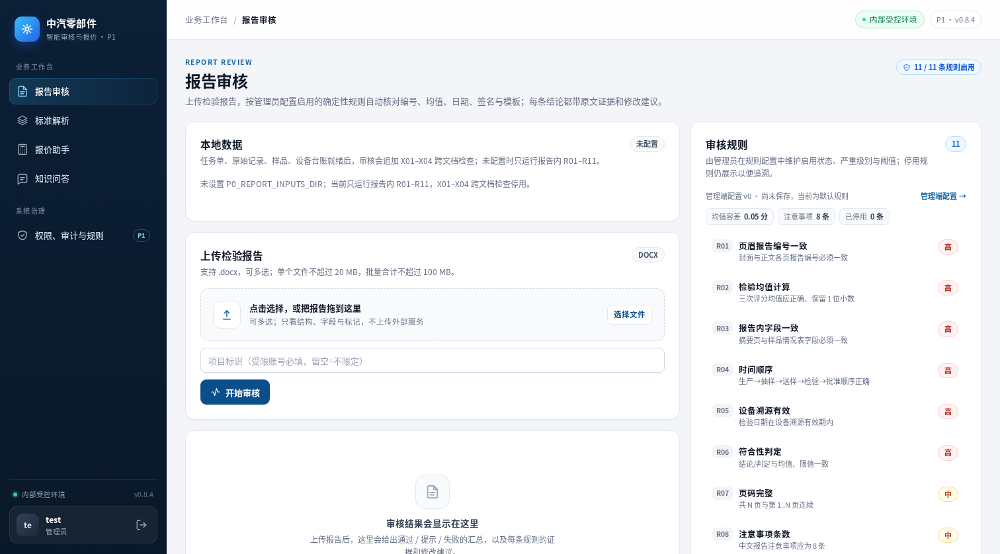
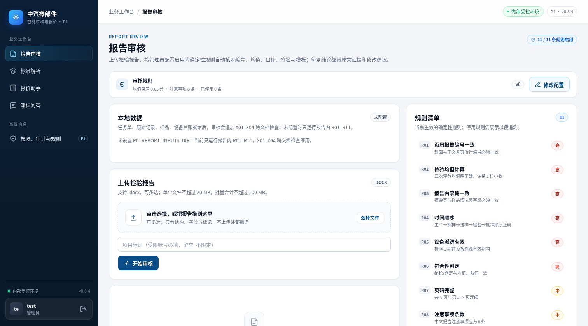
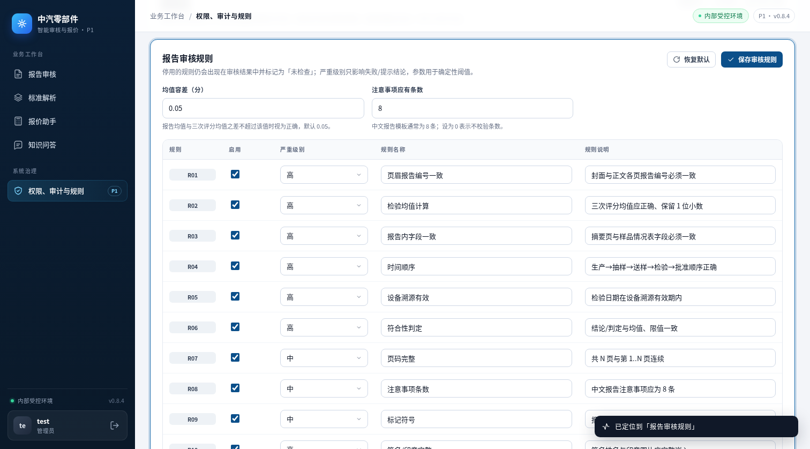

# 报告审核页配置入口与模块页排版对齐（0.8.4）

## 对比口径

| 项 | Before | After |
|---|---|---|
| 代码 | `bab83a9`（main，0.8.4；报告审核页静态资源与 `f56d85b` 相同） | 本分支 `agent/align-review-config-8fa97a4ed502`（rebase 到 main 后，0.8.4） |
| 页面 | 报告审核 | 同左 |
| 视口 / 主题 | 1512×838、浅色主题、管理员视图 | 同左 |
| 数据 | 本机临时数据目录；默认规则配置 v0（未保存过自定义规则） | 同左 |
| 截图方式 | 实际启动应用后用 Chromium 截图，非 mockup | 同左 |

## 变更

- **配置入口上移**：报告审核页原来放在右侧「审核规则」卡里的「管理端配置 →」文字链接，改为页头下方的整宽规则配置条，结构与标准解析、报价助手顶部配置条一致：图标 + 标题 + 生效摘要 + 配置版本 + 右侧操作按钮。
- **改为「修改配置」**：操作按钮使用编辑图标并显示「修改配置」，仅对拥有 `config:manage` 的管理员显示；点击后进入管理端「权限、审计与规则 → 规则配置」，自动定位到「报告审核规则」分区，目标分区短暂高亮并提示「已定位到 …」。
- **右侧卡片职责收敛**：右侧原「审核规则」卡改为「规则清单」，只保留当前生效的 11 条规则与严重级别；配置版本、均值容差、注意事项条数与停用条数移到顶部配置条的版本标签与摘要中，避免与配置入口重复；更新时间 / 更新人仍在管理端配置页查看。
- **版本**：rebase 到 main 后不再单独提升版本号，侧边栏 / 顶栏与 API 版本保持 `v0.8.4`；配置条右侧的版本标签显示当前配置 `revision`。

## Before / After

### 报告审核页

| Before（main `f56d85b`，0.8.4） | After（本分支，0.8.4） |
|---|---|
|  配置入口是右侧卡片内的「管理端配置 →」文字链接，页面顶部没有规则配置条 |  顶部新增整宽「审核规则」配置条，右侧为「修改配置」按钮 |

### 配置入口特写

| Before（main `f56d85b`，0.8.4） | After（本分支，0.8.4） |
|---|---|
|  「审核规则」卡内的文字链接 |  顶部配置条：规则摘要 + 版本 + 「修改配置」 |

### 管理端落点



点「修改配置」后进入管理端规则配置，定位到「报告审核规则」，URL 记录 `?tab=admin&view=config&section=report`。

## 验证

```bash
cd p0
pytest -q tests/test_ui_config_entry.py
pytest -q
```

- 本分支结果：`229 passed, 22 skipped`（跳过项为需要真实样例 / 外部服务的用例）；`tests/test_ui_config_entry.py` 3 项静态回归检查，锁定三个模块页的配置条结构、报告页「修改配置」入口与「管理端配置 →」旧文案移除。
- 浏览器实测（实际应用、1512×838、浅色主题、管理员视图）：
  - 报告审核页顶部配置条摘要为「均值容差 0.05 分 · 注意事项 8 条 · 已停用 0 条」，配置版本 `v0`，页头版本 `P1 · v0.8.4`；
  - 点「修改配置」后 URL 为 `?tab=admin&view=config&section=report`，目标分区顶部约 73px、高亮生效，提示「已定位到「报告审核规则」」；
  - 页面保留 11 条规则清单，停用规则样式与之前一致；
  - 「修改配置」按钮由既有 `config:manage` 权限控制（`applyConfigAccessory` 统一切换 `hidden`），非管理员不显示；顶部配置摘要与 11 条规则清单仍正常显示；
  - 配置条与标准解析 / 报价助手使用同一套 `module-config-bar` / `config-open-btn` 样式；按钮是否显示由既有 `config:manage` 权限控制。
- 截图只访问本机临时数据目录，不读取或外发客户标准 / 报价文件。

## 限制

- 报告审核页的配置条只提供跳转修改，不提供只读配置弹窗；规则明细仍在页面右侧「规则清单」中直接可见。标准解析 / 报价助手因配置字段较多，继续使用「查看配置」弹窗 + 弹窗内「修改配置」的两步入口。
