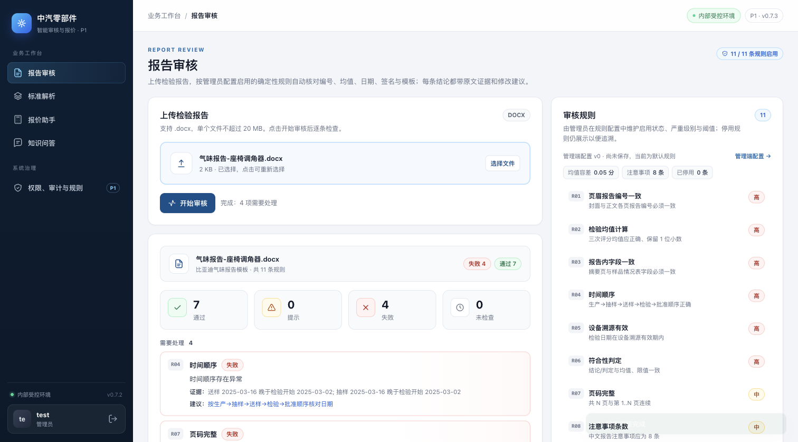
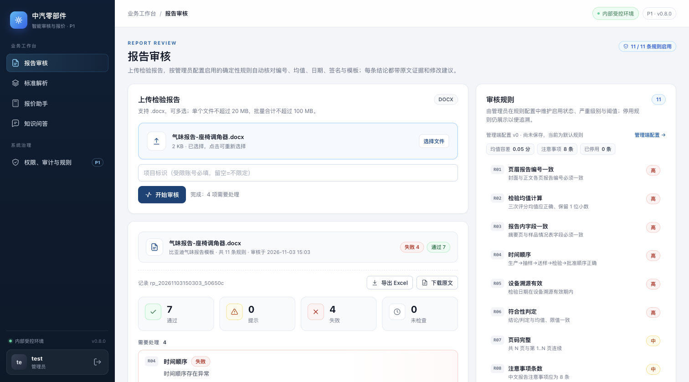
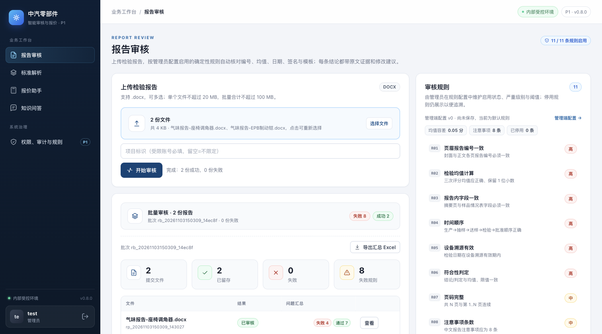
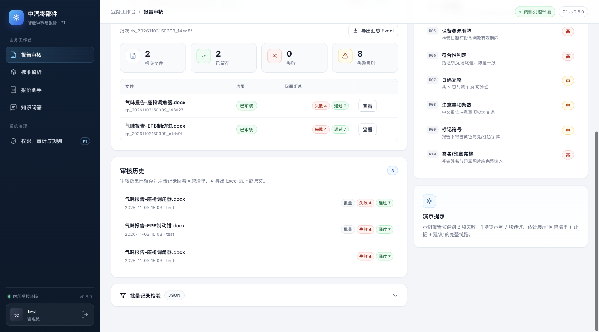

# P1 报告审核台：审核历史、批量审核与项目隔离（0.8.0）

> 基线：`main` @ `bc11ac2`（0.7.3，六项 P1 增量）。本增量对应
> `docs/p1-plan.md` §3.5「报告审核台：问题清单、证据定位、批量、导出、复核留痕」中
> 尚未落地的部分；只补报告审核链路，不改解析、报价、问答的既有行为。

## 1. 范围

报告审核之前每次只返回结果，关掉页面就丢；导入同事的 12 份真实报告只能一份一份点；
受限账号也无法按项目隔离报告。这次补齐：

- **审核历史**——每次审核的结果、规则版本、审核人、项目、批次与原文都留存；
  工作台展示最近 20 条，点开可回看完整问题清单；
- **批量审核**——一次选择多份 `.docx`（默认最多 20 份、合计 100 MB），逐份审核并汇总
  成功/失败与规则问题；单份解析失败只影响该份，不中断整批；
- **导出**——单份导出「审核汇总 + 问题清单」Excel，批量导出汇总 Excel；原文可下载；
- **项目隔离**——报告带项目标签，受限账号只能看到/打开/下载授权项目内的报告；
  受限账号创建时必须填写有权限的项目。

## 2. 数据与接口

### 存储

| 模式 | 位置 | 说明 |
| --- | --- | --- |
| `P0_STORE=json`（默认/回滚） | `P0_DATA_DIR/reports/<id>/{meta,result}.json` + `source.docx` | 与标准/报价的 JSON 目录一致，可直接回滚 |
| `P0_STORE=postgres` | 表 `report_audits`（`project`/`created_by`/`batch_id`/`created_at` 建索引） | 完整记录在 `data` JSONB；原文进对象存储，`files.owner_type=report` |

`report_audits` 由 `ensure_schema()` 自动建表；不需要迁移旧数据（旧版本本来就不留审核结果）。

### 接口

| 方法/路径 | 权限 | 说明 |
| --- | --- | --- |
| `POST /api/v1/reports/audit` | `report:audit` | 原有单份审核；新增 `project` 表单字段，返回 `report_id`/`project`/`created_at`，并留存结果 |
| `POST /api/v1/reports/batch` | `report:audit` | 多文件 `files` + `project`；返回批次汇总与逐份结果；上限 `P0_REPORT_BATCH_MAX`（默认 20）、`P0_REPORT_BATCH_MB`（默认 100） |
| `GET /api/v1/reports` | `report:read` | 按项目过滤的审核记录；支持 `limit`/`offset`/`q`/`batch_id` |
| `GET /api/v1/reports/{id}` | `report:read` | 完整记录（含 findings）；跨项目 403 |
| `GET /api/v1/reports/{id}/export.xlsx` | `report:read` | 单份 Excel：审核汇总 + 问题清单 |
| `GET /api/v1/reports/{id}/source.docx` | `report:read` | 下载原文；跨项目 403 |
| `GET /api/v1/reports/batch/{batch_id}/export.xlsx` | `report:read` | 批次汇总 + 问题清单 |

`report:read` 授予 admin/reviewer（与 `report:audit` 一致），viewer/sales 不开放审核历史。
所有新增动作写审计事件：`report_audited`（含 report_id）、`report_batch_audited`、
`report_exported`、`report_batch_exported`、`report_source_downloaded`。

## 3. 前端

报告审核页新增：

- 上传区支持多选（选择/拖拽），显示文件数与合计大小；
- 「项目标识」输入框（受限账号必填，留空=不限定）；
- 结果卡在汇总下显示记录 ID、审核人、导出/原文按钮；
- 批量结果显示文件表、逐份状态与问题数、批次导出；
- 「审核历史」卡片：最近记录、批次标记、失败/提示/通过 pills，点击回看详情并高亮当前记录；
- 非复核人/管理员不显示审核上传、历史与导出入口（沿用既有角色隐藏逻辑）。

## 4. Before / After 视觉证据

- **Before**：`main` @ `bc11ac2`（0.7.3），`docs/p1-report-workbench/before-report.png`；
- **After**：本分支（0.8.0），`after-report.png`（同一场景：单份 `气味报告-座椅调角器.docx`
  审核完成、同一 1512×838 视口、浅色主题）；`after-batch.png`（两份批量）、
  `after-history.png`（三条历史记录）。
- 截图来自实际启动的应用（`P0_AUTH_DISABLED=1` 的本地管理员视图），使用仓库内脚本生成的
  合成演示报告，不含客户真实材料；没有 mockup。

| Before（0.7.3） | After（0.8.0） |
| --- | --- |
|  |  |

批量与历史（0.8.0）：





## 5. 验证

本地（Python 3.12）：

```bash
cd p0
pytest -q
# P0_TEST_DATABASE_URL 指向临时 PostgreSQL 时额外覆盖 report_audits 往返
P0_TEST_DATABASE_URL=postgresql+psycopg://postgres@127.0.0.1:55432/p0_test pytest -q
```

覆盖：

- `tests/test_report_workbench.py`：单份审核留存/列表/详情/导出/原文、批量成功与失败隔离、
  项目隔离（受限账号跨项目列表不可见、详情/导出/原文 403、越权项目创建 400）；
- `tests/test_store_postgres.py::test_report_audit_roundtrip`：PostgreSQL 行、对象存储原文、
  JSON 镜像与列表字段；
- `tests/test_ui_reports.py`：多选上传、项目输入、历史卡、批量与导出入口的静态断言。

结果：带 PostgreSQL 的全量 `114 passed, 2 skipped`；不配 PostgreSQL 时为 `102 passed, 14 skipped`
（跳过的是需要真实数据库/真实样例的既有用例）。

浏览器实测（真实应用、同一 1512×838 视口）：

- 单份审核：`气味报告-座椅调角器.docx` → 失败 4 / 通过 7，出现记录 ID、导出与原文按钮；
- 批量：两份 `.docx` → 2 份成功、0 份失败、8 条失败规则，表格逐份可点开；
- 历史：3 条记录（含 2 条批量），点击回看内容与刚审核时一致；导出/原文按钮可用。

## 6. 限制与后续

- 批量审核在当前请求内顺序执行并已限制文件数/总大小；更大的批量应接 P1-2 任务队列，
  本轮没有把报告审核塞进队列；
- 审核历史 UI 只取最近 20 条（接口已支持 `limit`/`offset`），暂未做分页控件与保留期清理；
- 原文会按 `MAX_UPLOAD_MB`（默认 20 MB/份）留存，历史增长后的容量与清理策略待定；
- 项目标识仍是自由文本（与标准/报价一致），项目主数据要等 CRM 字段契约；
- WeKnora/模型与审核无关；本增量没有接触客户接口。
