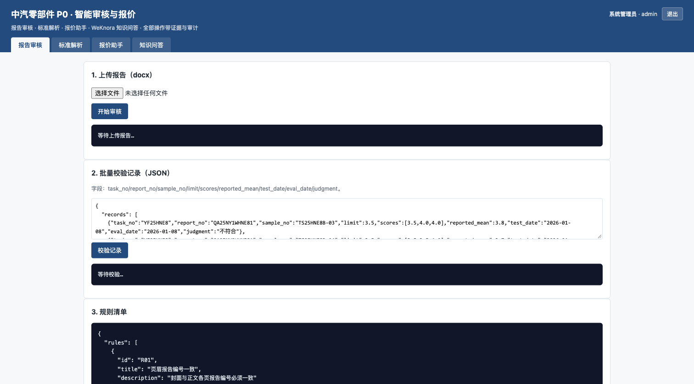
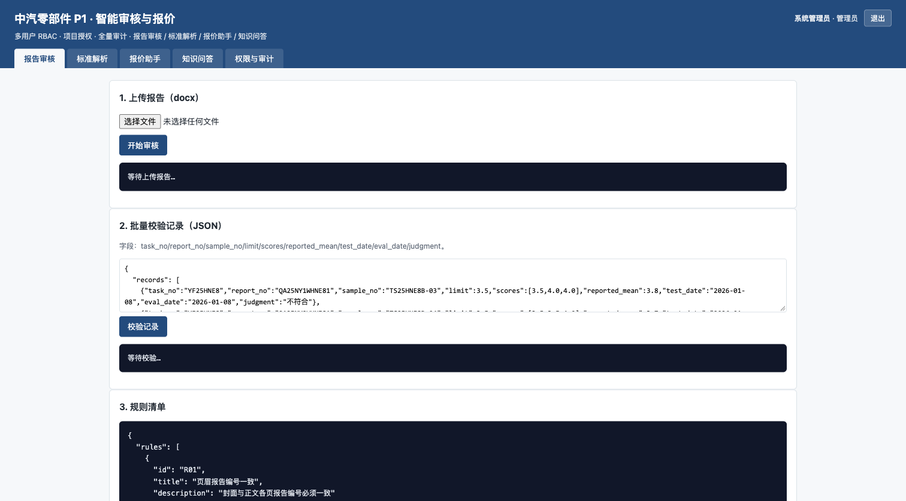
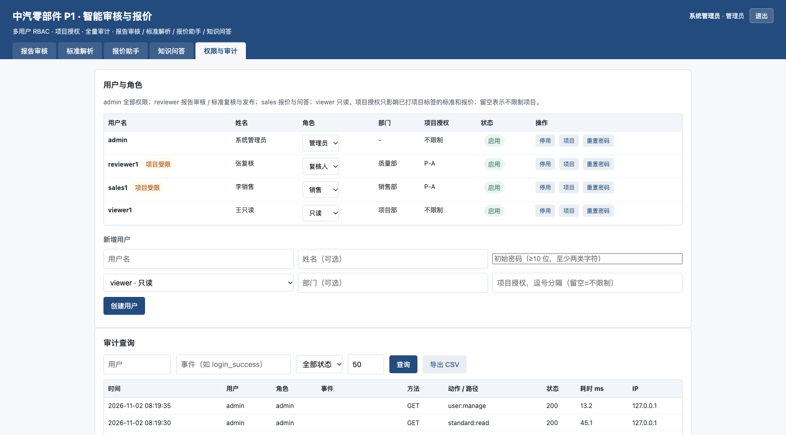

# P1-S1 第一个增量：身份、权限与审计（0.6.0）

## 1. 范围与基线

P1 计划见仓库 `docs/p1-plan.md`。本增量对应 §3.1「身份、权限与审计」中不依赖客户接口的部分，先把多用户生产化的底座落地，后续数据层迁移、异步任务、业务集成按 P1-S1 → S4 继续推进。

| 项 | 内容 |
|---|---|
| 变更前 | `main` @ `aaccfe4`（P0 收口 0.5.0，`auth.py` 只有登录门禁和 admin/viewer/reviewer 三角色） |
| 变更后 | 本分支 `agent/development-p1-89f02d557951`，0.6.0 |
| 入口 | 本机 `127.0.0.1:8123`，管理员账号登录，同一 1512×838 视口 |
| 视觉证据 | `before-workbench.png`（变更前）、`after-workbench.png` / `after-admin.png`（变更后） |

## 2. 权限矩阵

| 角色 | 报告审核 | 标准解析/复核/发布 | 标准读取/导出 | 报价 | 问答 | 用户管理 | 审计查询/导出 |
|---|---|---|---|---|---|---|---|
| admin | ✓ | ✓ | ✓ | ✓ | ✓ | ✓ | ✓ |
| reviewer | ✓ | ✓ | ✓ | - | ✓ | - | - |
| sales | - | - | ✓（只读） | ✓ | ✓ | - | - |
| viewer | - | - | ✓（只读） | - | ✓ | - | - |

所有业务 API 在入口显式调用 `require_permission(action)`；权限矩阵集中在 `p0/app/auth.py` 的 `PERMISSIONS`，不再散落在端点内部。越权返回 403 并写审计。

## 3. 账号安全

- 密码策略：≥10 位，至少包含字母/数字/符号中的两类；创建、改密、管理员重置都走同一校验；
- 连续 5 次失败锁定 15 分钟，锁定状态持久化到用户记录，登录返回 423；管理员重置密码会清锁；
- 管理员可启停账号、改角色、改姓名/部门/项目授权、生成一次性临时密码；
- 至少保留一个启用的管理员；管理员不能停用自己或降低自己的角色；
- OIDC/SSO 预留：`P0_OIDC_ISSUER` / `P0_OIDC_CLIENT_ID` 与 `GET /api/v1/auth/providers` 只报告配置状态，当前登录仍走本地账号，避免把未验证的 SSO 当成可用能力。

## 4. 项目级隔离

- 用户 `projects` 为空 = 不限制项目（兼容 P0 老账号）；显式填写 = 项目受限；`*` = 全部项目；admin 始终不受限；
- 标准和报价写入 `project` / `created_by` 标签：
  - 标准：`result.json` 的 `meta.project` / `meta.created_by`；
  - 报价：`data/quotes/<id>/meta.json`；
- 列表、详情、复核、导出、发布、问答、报价下载都做校验：受限账号只能访问授权项目的数据；未打标签的记录只对创建者、无限制账号和 admin 可见；
- 受限账号新建标准/报价必须填写有权限的项目，避免把数据写到隔离区外；
- 历史标准可用 `PATCH /api/v1/standards/{id}/project` 补标签（admin）。旧报价没有 `meta.json` 时按「未打标签」处理。

## 5. 全量审计

请求级审计保留原有字段（用户/角色/方法/路径/状态/耗时/IP），新增 `action`（命中的权限动作）；敏感操作额外写语义事件：

`login_success` / `login_failed` / `login_locked` / `login_throttled` / `logout` / `user_created` / `user_updated` / `user_password_reset` / `password_changed` / `report_audited` / `report_audited_markdown` / `records_validated` / `standard_parsed` / `standard_reviewed` / `standard_exported` / `standard_published` / `standard_project_assigned` / `standard_asked` / `quote_generated` / `quote_downloaded` / `kb_rebuilt` / `audit_exported`。

- `GET /api/v1/audit/events`：按 `user/role/event/method/path/status/date_from/date_to` 过滤，`limit/offset` 分页；
- `GET /api/v1/audit/export.csv`：同样过滤条件导出全部匹配行（CSV）；
- `P0_AUDIT_RETENTION_DAYS`（默认 180）：启动及每日首次写审计时清理过期行；
- 审计不记录密码、临时密码或请求体。

## 6. 接口变化

新增：

- `GET /api/v1/auth/providers`
- `PATCH /api/v1/auth/users/{username}`
- `POST /api/v1/auth/users/{username}/reset-password`
- `GET /api/v1/audit/events`
- `GET /api/v1/audit/export.csv`
- `PATCH /api/v1/standards/{id}/project`

扩展（向后兼容）：

- `POST /api/v1/standards/parse` 增加表单字段 `project`；
- `POST /api/v1/quotes/generate` 增加表单字段 `project`，返回 `project` 并写 `meta.json`；
- `POST /api/v1/auth/users` 增加 `department/projects`；
- `GET /api/v1/system/status` 增加 `auth.roles` 与 `auth.providers`。

所有原接口路径和响应字段保留；未传 `project` 的老调用仍可用（受限账号除外，会返回 400 提示补项目）。

## 7. 验证

```bash
cd p0
pytest -q
```

结果：`44 passed, 2 skipped`（2 个跳过为真实保密样例未入库）。

新增 `p0/tests/test_p1_identity.py` 覆盖：

- 密码策略、角色权限矩阵、403 越权；
- 连续失败锁定、管理员重置解锁；
- 管理员启停/改角色/项目授权、最后一个管理员保护；
- 审计过滤、CSV 导出、保留期清理；
- 标准与报价的项目隔离、受限账号创建校验、历史标准补标签；
- OIDC 配置状态预留。

本地演示实例额外核对：

```text
GET  /health                          200 {"version":"0.6.0"}
GET  /api/v1/auth/providers           200 local + oidc reserved
POST /api/v1/auth/login               200（admin）
GET  /api/v1/auth/users               200（4 个演示账号）
PATCH /api/v1/auth/users/reviewer1    200（项目 P-A）
GET  /api/v1/audit/events?limit=50    200（登录/权限动作/用户事件）
GET  /api/v1/audit/export.csv         200 text/csv
```

## 8. Before / After

**Before**：`main` @ `aaccfe4`，P0 工作台只有 4 个页签，没有用户/权限/审计入口。



**After**：同一管理员账号、同一 1512×838 视口，新增「权限与审计」页签。



**After · 权限与审计**：用户/角色/部门/项目授权、启停/重置、审计过滤与 CSV 导出。



## 9. 未包含 / 下一步

本增量只覆盖 P1-S1 的身份与审计底座；以下仍按 P1 计划推进，不在本 PR 冒称完成：

- PostgreSQL/MinIO 数据层与迁移回滚（§3.2）；
- OCR/解析异步队列、进度、重试、并发控制（§3.3）；
- CRM/任务单/样品接口适配（§3.4，依赖客户接口）；
- 三个工作台的完整 UAT 交互（§3.5）；
- 模型网关、监控告警、CI/CD、等保整改（§3.6–3.7）；
- 部门/客户级授权要等 CRM 字段契约；报告审核不落库，暂不做行级隔离；
- 用户库/审计仍是 JSON 文件，审计查询全量扫描，数据量上来后需随数据层迁移换 DB/索引。
