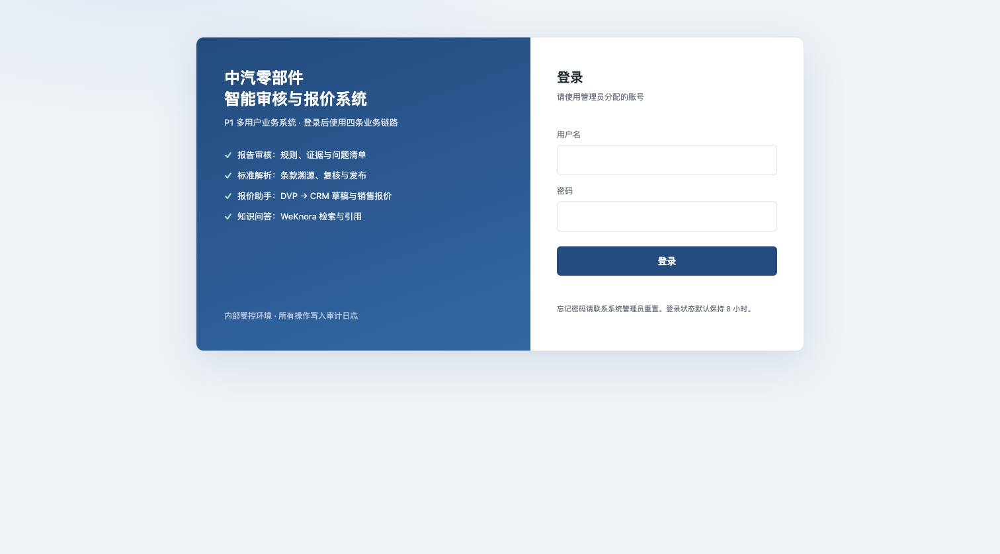
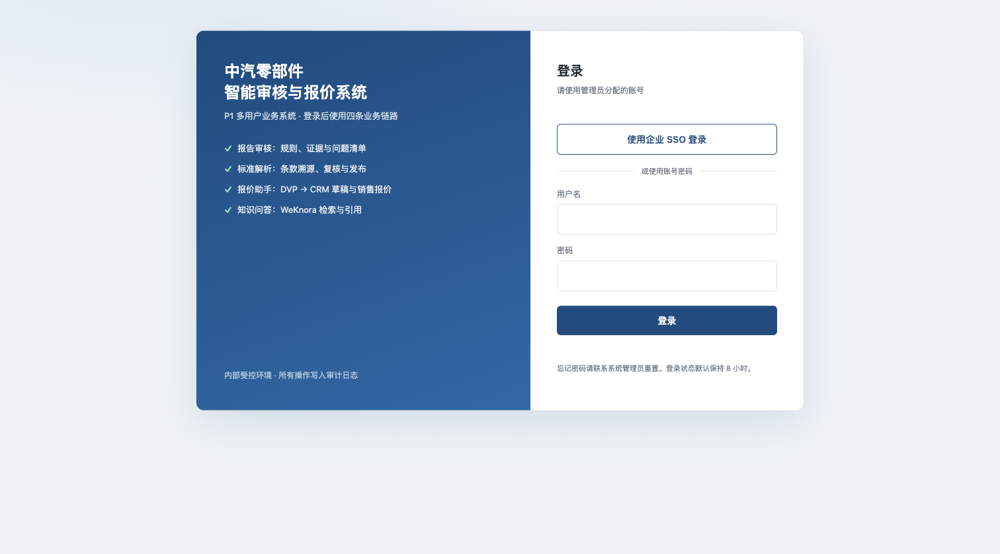

# 企业 SSO（OIDC）登录（0.8.4）

> 默认关闭；配置 `P0_OIDC_ISSUER` + `P0_OIDC_CLIENT_ID` 后，登录页出现
> 「使用企业 SSO 登录」。只把 IdP 身份绑定到**已存在的启用账号**，不自动建号、
> 不改角色；本地账号密码登录始终保留。

## 1. 配置

| 环境变量 | 必填 | 说明 |
| --- | --- | --- |
| `P0_OIDC_ISSUER` | 是 | IdP issuer，例如 `https://login.example.com`；必须与 discovery 的 `issuer` 一致 |
| `P0_OIDC_CLIENT_ID` | 是 | 在 IdP 注册的 client id |
| `P0_OIDC_CLIENT_SECRET` | 视 IdP | confidential client 的 secret；public client 留空 |
| `P0_OIDC_SCOPES` | 否 | 默认 `openid profile email` |
| `P0_OIDC_REDIRECT_URI` | 否 | 显式回调地址，例如 `https://<DOMAIN>/p0/api/v1/auth/oidc/callback`；不填时按请求的 `X-Forwarded-Proto/Host` + `P0_ROOT_PATH` 推导 |
| `P0_OIDC_TOKEN_AUTH` | 否 | `post`（默认）或 `basic`，对应 token 端点的 client 认证方式 |
| `P0_OIDC_ENABLED` | 否 | `0/false/off` 可临时关闭 SSO，即使 issuer/client id 已配置 |

IdP 侧回调地址必须与 `redirect_uri` 完全一致（含 `/p0` 前缀）。`RS256` 签名的 ID token
与 JWKS 是硬性要求（暂不支持 ES256/HS256）。

## 2. 登录流程

1. 登录页读取 `GET /api/v1/auth/providers`，`oidc.enabled=true` 时显示 SSO 按钮；
2. 点击进入 `GET /api/v1/auth/oidc/start?next=<本地路径>`：
   - 生成 state + nonce + PKCE code_verifier，HMAC 签名后写入 `p0_oidc_state` HttpOnly cookie（10 分钟）；
   - 302 到 IdP `authorization_endpoint`；
3. IdP 回调 `GET /api/v1/auth/oidc/callback?code=&state=`：
   - 校验签名 cookie、state、code；
   - 用 code + verifier 换 token；
   - 验证 ID token：RS256/JWKS、`iss`、`aud`、`azp`、`exp`、`iat`、`nonce`；
   - 取 `preferred_username`/`email`，在本地账号中查找（不建号）；找不到或已停用 → 回登录页显示 `sso_error=account`；
   - 成功则创建本地会话并跳回 `next`（仅允许站内路径），写 `sso_login_success` 审计；
4. 失败写 `sso_login_failed`（reason 不暴露 token/secret），回登录页显示对应提示。

## 3. 安全边界

- state/nonce/verifier 在 HMAC 签名的 HttpOnly cookie 中，state 有效期 10 分钟；
- PKCE（S256）+ state 防 CSRF/授权码拦截；`next` 禁止 `http(s)://`、`//` 和反斜杠；
- ID token 签名用 IdP JWKS 验证（缓存 1 小时，未知 kid 时刷新一次）；只接受 RS256；
- 不自动创建账号、不信任 IdP 传来的角色；角色仍由本地管理员维护；
- 会话仍是本地签名 8 小时，退出只清本地会话（暂不调用 IdP end_session）。

## 4. 验证

```bash
cd p0
pytest -q tests/test_oidc.py tests/test_ui_sso.py
# 全量（带 PostgreSQL）
P0_TEST_DATABASE_URL=postgresql+psycopg://postgres@127.0.0.1:55432/p0_test pytest -q
```

覆盖：state 签名/过期/`next` 清洗、authorize URL 的 PKCE/nonce、RS256 有效 token、
错误 nonce/aud/exp/iss、错误签名与非 RS256、回调成功建会话、未知账号、错误 state、
未配置时 404、provider 状态。

本地用**生成 RSA 密钥 + mock JWKS/token 端点**验证，没有连接真实 IdP；上线前需要：
- 在客户 IdP 注册回调地址并配置上述环境变量；
- 用真实账号完成一次登录、失败（停用账号）与回退到本地账号的演练；
- 确认 IdP 的 `preferred_username`/`email` 与本地 `username`（或用户 `email`）一致。

## 5. Before / After

- **Before**：`main` @ PR #28 合并后（0.8.3），登录页只有账号密码；
- **After**：本分支（0.8.4），同一 1512×838 视口、浅色主题，配置 OIDC 后登录页出现 SSO 入口。

| Before（0.8.3） | After（0.8.4） |
| --- | --- |
|  |  |

截图来自实际启动的应用；OIDC 配置使用占位 issuer/client id，仅用于展示入口，未连接真实 IdP。

## 6. 限制

- 只支持 authorization code + PKCE + RS256/JWKS；不支持的 IdP 需先扩展；
- 只按 `preferred_username`/`email` 绑定现有账号，不自动开通、不做 IdP 角色映射；
- 无 refresh token、无 RP-initiated logout、无多 IdP 选择；
- 反代后的回调地址依赖 `P0_OIDC_REDIRECT_URI` 或正确的 `X-Forwarded-*`；配置错误会得到 IdP 的 redirect_uri 报错；
- 本工单没有真实 IdP 凭据，生产验收仍未完成。
