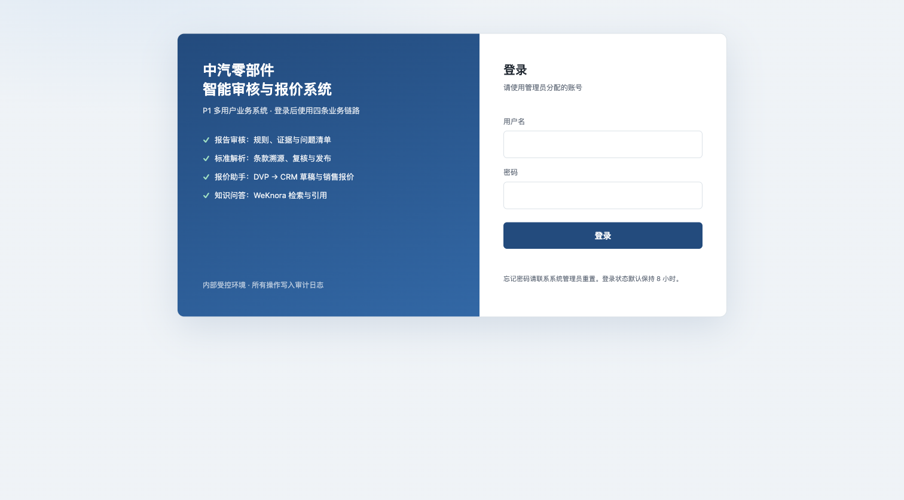
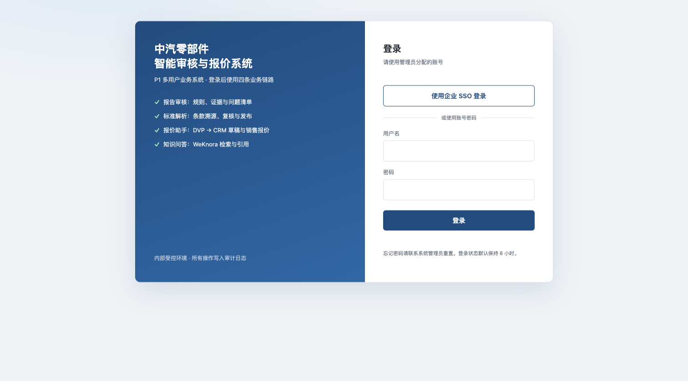

# 企业 SSO（OIDC）登录（0.8.4）

> 默认关闭；配置 `P0_OIDC_ISSUER` + `P0_OIDC_CLIENT_ID` 后，登录页出现
> 「使用企业 SSO 登录」。只把 IdP 身份绑定到**已存在的启用账号**，不自动建号、
> 不改角色；本地账号密码登录始终保留。

## 1. 配置

| 环境变量 | 必填 | 说明 |
| --- | --- | --- |
| `P0_OIDC_ISSUER` | 是 | HTTPS IdP issuer，例如 `https://login.example.com`；必须与 discovery 的 `issuer` 一致 |
| `P0_OIDC_CLIENT_ID` | 是 | 在 IdP 注册的 client id |
| `P0_OIDC_CLIENT_SECRET` | 视 IdP | confidential client 的 secret；public client 留空 |
| `P0_OIDC_SCOPES` | 否 | 默认 `openid profile email` |
| `P0_OIDC_REDIRECT_URI` | 是 | 固定 HTTPS 回调地址，例如 `https://<DOMAIN>/p0/api/v1/auth/oidc/callback`；不从请求或 `X-Forwarded-*` 推导 |
| `P0_OIDC_TOKEN_AUTH` | 否 | `post`（默认）或 `basic`，对应 token 端点的 client 认证方式 |
| `P0_OIDC_ENABLED` | 否 | `0/false/off` 可临时关闭 SSO，即使 issuer/client id 已配置 |

IdP 侧回调地址必须与 `redirect_uri` 完全一致（含 `/p0` 前缀）。`RS256` 签名的 ID token
与 JWKS 是硬性要求（暂不支持 ES256/HS256）。

## 2. 登录流程

1. 登录页读取 `GET /api/v1/auth/providers`，`oidc.enabled=true` 时显示 SSO 按钮；
2. 点击进入 `GET /api/v1/auth/oidc/start?next=<本地路径>`：
   - 生成 state + nonce + PKCE code_verifier，HMAC 签名后写入 `p0_oidc_state` HttpOnly cookie（10 分钟）；
   - 302 到 IdP `authorization_endpoint`；
3. IdP 回调 `GET /api/v1/auth/oidc/callback?code=&state=`：
   - 校验签名 cookie、state、code；
   - 用 code + verifier 换 token；
   - 验证 ID token：RS256/JWKS、`iss`、`aud`、`azp`、`exp`、`iat`、`nonce`；
   - 取已验证 ID Token 的 `(iss, sub)`，按管理员为现有账号设置的显式绑定查找；不以 `preferred_username`、邮箱或用户名匹配，也不建号；未绑定、重复绑定或账号已停用 → 拒绝登录；
   - 成功则创建本地会话并跳回 `next`（仅允许站内路径），写 `sso_login_success` 审计；
4. 失败写 `sso_login_failed`（reason 不暴露 token/secret），回登录页显示对应提示。

## 3. 安全边界

- state/nonce/verifier 在 HMAC 签名的 HttpOnly cookie 中，state 有效期 10 分钟；
- PKCE（S256）+ state 防 CSRF/授权码拦截；`next` 禁止 `http(s)://`、`//` 和反斜杠；
- ID token 签名用 IdP JWKS 验证（缓存 1 小时，未知 kid 时刷新一次）；只接受 RS256；
- 不自动创建账号、不信任 IdP 传来的角色；角色和 `(issuer, sub)` 绑定均由本地管理员维护；
- 会话仍是本地签名 8 小时。退出会撤销当前 P0 会话令牌并清除 Cookie，重放被拒；不会退出其他设备，也暂不调用 IdP `end_session_endpoint`，不会撤销 WeKnora 独立会话。
- JSON 存储使用本地认证目录中的撤销清单；数据库模式写入撤销表。真实 PostgreSQL 专项已在隔离的一次性本机集群通过；客户 IdP 联调仍待完成。

### P0 到 WeKnora 管理台

- P0 知识底座卡片的“打开 WeKnora 管理台”入口只对 `admin` 角色返回；业务经理与技术人员即使能查看系统状态，也拿不到跳转地址。
- 部署时可设置 `P0_WEKNORA_ADMIN_URL=https://<DOMAIN>/api/v1/auth/oidc/start`。服务端只接受 HTTPS、无账号密码、无 query/fragment 且路径精确为该 OIDC 启动端点的地址；无效配置按未配置处理。
- 入口只负责打开 WeKnora OIDC 登录流程，不传递 P0 会话令牌，也不授予 WeKnora 权限。P0 与 WeKnora 的 IdP/账号绑定需分别配置和验收；未配置时隐藏入口。
- WeKnora 本地退出会撤销该用户全部 WeKnora 会话，而 P0 退出只撤销当前 P0 会话；当前没有跨应用全局退出保证。
- 回归用例覆盖：管理员可见、业务经理/技术人员不获得链接、客户角色不获得链接；HTTP、userinfo、query/fragment、错误路径和格式错误 URL 均不生成跳转地址。UI 静态检查确认链接使用转义后的服务端地址及 `noopener noreferrer`。2026-11-26 定向认证用例 9 passed；本地浏览器使用临时合成管理员和技术账号确认管理员看到链接、技术账号没有链接；同日 P0 全量测试 1178 passed、42 skipped、5 warnings。全量测试未配置 PostgreSQL，因此 PostgreSQL 专项在这次运行中跳过；PostgreSQL 专项的既有隔离集群结果另见项目验收记录。浏览器验证只确认入口展示与权限差异，没有访问目标域名或验证真实 IdP 登录。

## 4. 验证

```bash
cd p0
pytest -q tests/test_oidc.py tests/test_ui_sso.py
# 全量（带 PostgreSQL）
P0_TEST_DATABASE_URL=postgresql+psycopg://postgres@127.0.0.1:55432/p0_test pytest -q
```

覆盖：state 签名/过期/`next` 清洗、authorize URL 的 PKCE/nonce、RS256 有效 token、
错误 nonce/aud/exp/iss、错误签名与非 RS256、回调成功建会话、未知账号、错误 state、
未配置时 404、provider 状态。

本地使用生成的 RSA 密钥和**内存合成 IdP**验证 P0 的真实 start/callback 路由：discovery、授权 URL 中 PKCE/nonce/state、授权码换 token、JWKS/RS256 校验，以及 issuer/subject 显式绑定登录；未绑定 subject 即使 `preferred_username` 与已绑定账号相同也被拒绝。合成 IdP 校验 S256 与 verifier 一致性，并拒绝篡改 challenge；RFC 7636 固定向量同时验证测试算法和生产 challenge 算法。还覆盖 HTTP issuer/绑定、HTTP 或非法端口的 discovery endpoint、伪造转发头、缺少固定回调及 128 位 nonce 拒绝/约束。2026-11-26 OIDC 用例 25 passed，P0 全量 1191 passed、42 skipped、5 warnings。它没有连接真实 IdP，也没有在 WeKnora Go 服务中完成联邦登录；上线前需要：
- 在客户 IdP 注册回调地址并配置上述环境变量；
- 用真实账号完成一次登录、失败（停用账号）与回退到本地账号的演练；
- 管理员先根据已核实的 IdP issuer/subject 为目标账号显式绑定；邮箱仅供人工核对，不参与登录匹配。

## 5. Before / After

- **Before**：`main` @ PR #28 合并后（0.8.3），登录页只有账号密码；
- **After**：本分支（0.8.4），同一 1512×838 视口、浅色主题，配置 OIDC 后登录页出现 SSO 入口。

| Before（0.8.3） | After（0.8.4） |
| --- | --- |
|  |  |

截图来自实际启动的应用；OIDC 配置使用占位 issuer/client id，仅用于展示入口，未连接真实 IdP。

## 6. 限制

- 只支持 HTTPS issuer、固定 HTTPS 回调、discovery 返回的 HTTPS authorization/token/JWKS endpoints、authorization code + PKCE + RS256/JWKS；不支持的 IdP 需先扩展；
- 只按管理员显式绑定的 `(issuer, sub)` 查找现有账号，不自动开通、不做 IdP 角色映射；
- 无 refresh token、无 IdP RP-initiated logout、无多 IdP 选择；
- `P0_OIDC_REDIRECT_URI` 必须与 IdP 注册项完全一致；缺失或非 HTTPS 时 SSO 按未配置处理；转发头不会影响 IdP 回调目标；
- WeKnora 当前补丁源码的 OIDC 定向 Go 测试已通过 `service`、`handler`、`repository`、`config` 4 个包；合成 IdP 经真实 Gin `start`/`callback` handler 进入 `LoginWithOIDC` 服务，验证 state/nonce/PKCE cookies、token/JWKS、UserInfo 和显式 issuer/sub 账号映射；新服务与 handler 流程经 `go test -race`；这仍不是 P0 + WeKnora 的同浏览器端到端 SSO 验收；
- 本工单没有真实 IdP 凭据，生产验收仍未完成。

### 2026-11-26 WeKnora ID Token nonce 绑定补强

复核发现 WeKnora 原回调虽在签名 state 与浏览器 cookie 间校验 nonce，却既没有把 nonce 发给 IdP，也没有把它传入 ID Token 校验。补丁现将 nonce 加入授权 URL，并要求授权请求 nonce 与已验签 ID Token 的 nonce 存在且恒定时间相等；缺失或不匹配时在 UserInfo 和账号查找之前拒绝登录，且 UserInfo 中同名安全声明不能覆盖 ID Token 声明。真实 Gin start/callback + `LoginWithOIDC` 合成流程核对授权 URL nonce 与签名 state 相同，并由合成 IdP 按授权请求 nonce 回签 ID Token；有效、缺失和错误 nonce 场景覆盖拒绝路径未查用户、未签发会话 token。固定上游干净重建后，OIDC 定向测试 4 个 Go 包通过；service/handler 合成流的 `go test -race` 通过，独立安全复审确认 nonce 从授权请求到 ID Token 的链路闭合。此测试使用内存 IdP 和合成账号，不代表真实 IdP 或 testkb 部署验收。
