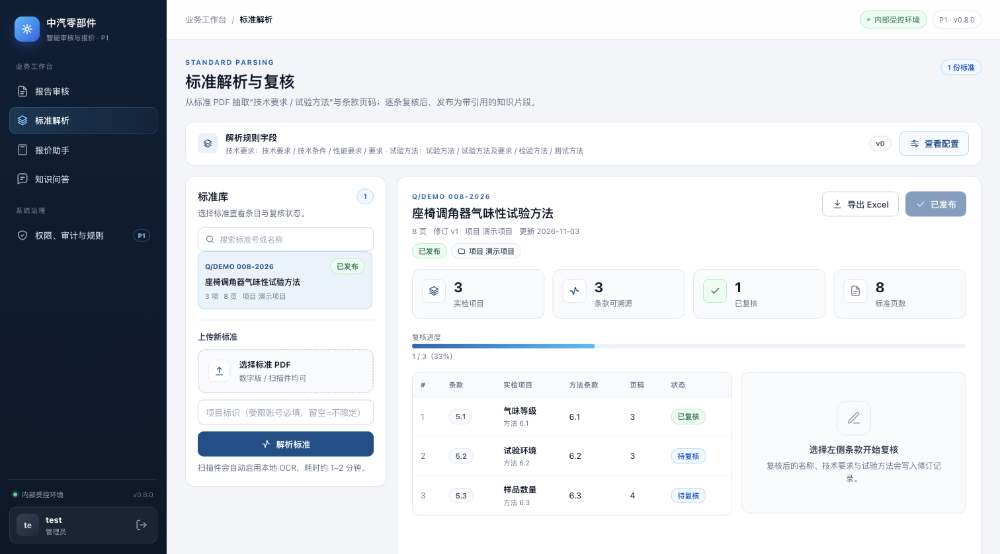
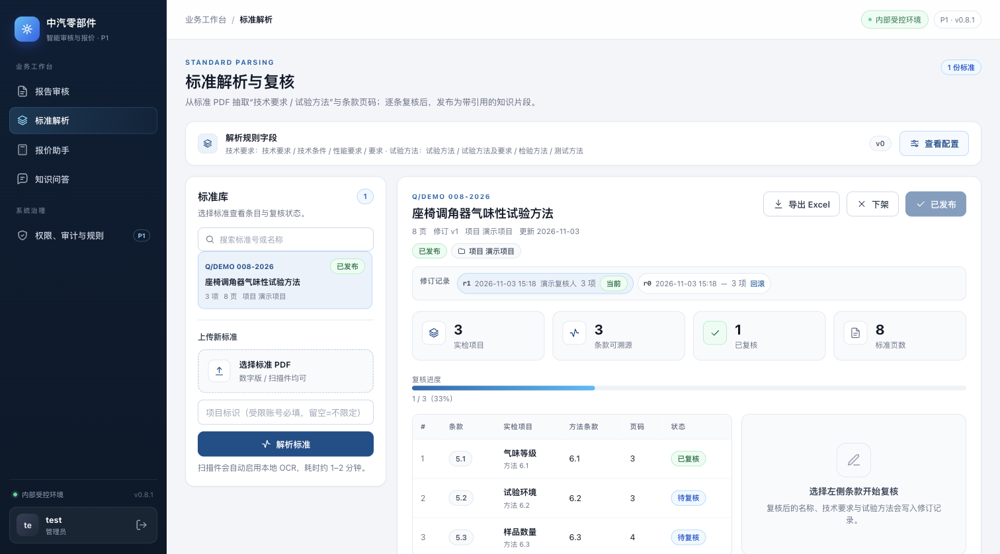
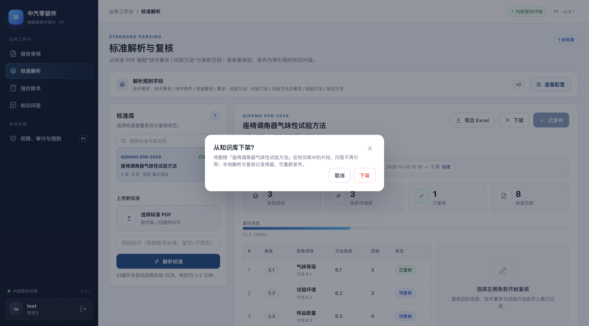
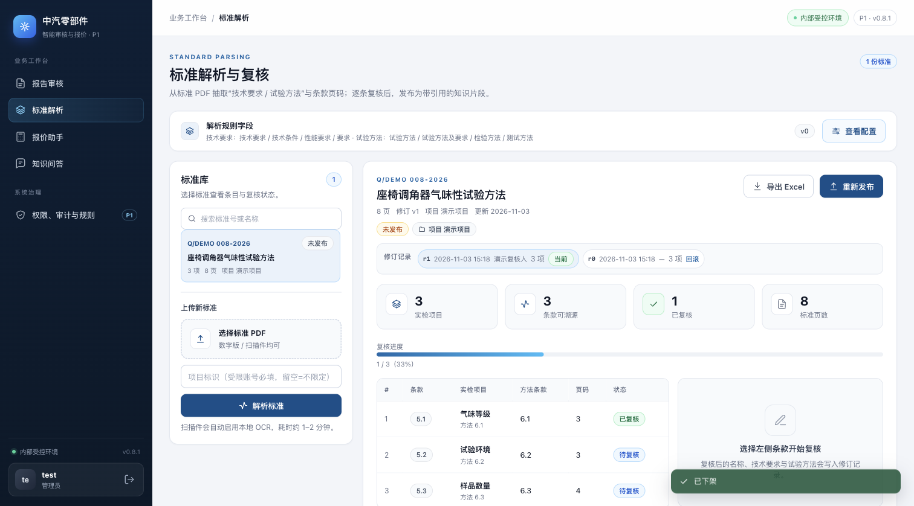
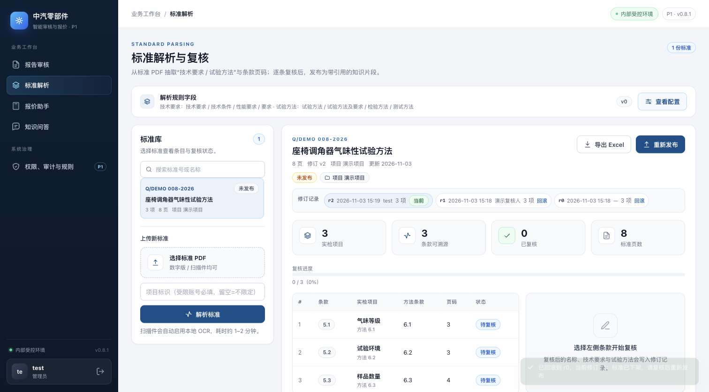

# 标准发布治理：知识库下架、修订记录与回滚（0.8.1）

> 基线：`main` @ `183048e`（0.8.0，报告审核台增量）。本增量补齐
> `docs/p1-plan.md` §3.5「标准复核台：发布/回滚」中尚缺的发布治理能力：
> 已发布标准可以下架，复核修订可以查看并回滚。

## 1. 为什么需要

之前标准一旦发布到 WeKnora，只能再次覆盖发布；如果复核口径发现错误，无法把标准从知识库里撤下，
问答会继续引用错误内容。复核修订也只留下逐字段的 `review_history`，没有可恢复的快照。

## 2. 改动

### 下架（unpublish）

`POST /api/v1/standards/{id}/unpublish`（`standard:publish`，按项目授权）：

1. 读取已发布的知识条目；WeKnora 已配置时逐条删除（删除失败且 `P0_WEKNORA_REQUIRED=1` 时返回 502，不做半套下架）；
2. 删除本地 `kb.json` / PostgreSQL `standards.kb`，问答不再引用该标准；
3. 记录标记 `published=false`、`unpublished_at/by`；解析结果与复核历史保留；
4. 审计事件 `standard_unpublished`（含删除的知识条数）。重复下架幂等。

下架后「重新发布」走原有发布接口，重新生成知识片段。

### 修订记录与回滚

- 文件模式：每次创建/复核写入 `data/standards/<id>/versions/<revision>.json` 快照；
- PostgreSQL：复用既有 `standard_versions` 表（无需迁移）；
- `GET /api/v1/standards/{id}/versions`（`standard:read`）返回修订号、时间、复核人、条款数、是否当前、是否可回滚；
- `POST /api/v1/standards/{id}/rollback`（`standard:review`）把指定修订的条款恢复为**新修订**，保留复核历史；
  回滚前若标准已发布，先自动下架（避免知识库与本地内容不一致），回滚后需复核并重新发布；
- 审计事件 `standard_rolled_back`（from_version / 新 revision / 是否触发下架）。

回滚只恢复条款内容（`items`），标准号、名称、项目、来源文件不变。

### 前端

标准详情页：

- 已发布时显示「下架」按钮（`standard:publish` 可见），二次确认说明会从知识库移除；
- 标题下新增「修订记录」条：`rN · 时间 · 复核人 · 条款数`，旧修订可点「回滚」；无快照的旧数据标注「无快照」；
- 下架后「发布到知识库」变为「重新发布」，左侧标准库列表的发布状态同步刷新。

## 3. 接口与存储

| 方法/路径 | 权限 | 说明 |
| --- | --- | --- |
| `GET /api/v1/standards/{id}/versions` | `standard:read` | 修订列表（项目隔离） |
| `POST /api/v1/standards/{id}/unpublish` | `standard:publish` | 删除知识库条目与本地 kb；幂等 |
| `POST /api/v1/standards/{id}/rollback` | `standard:review` | 恢复旧修订为新修订；已发布则先下架 |

文件模式新增 `versions/<revision>.json`；PostgreSQL 使用 `standard_versions`。旧标准没有历史快照时，
只能看到当前修订、不能回滚（列表标记「无快照」），不阻塞下架和重新发布。

## 4. Before / After 视觉证据

- **Before**：`main` @ `183048e`（0.8.0），`before-standard.png`；
- **After**：本分支（0.8.1），`after-standard.png`；同一份已发布标准、同一 1512×838 视口、浅色主题，
  截图来自实际启动的应用，使用合成演示标准（`Q/DEMO 008-2026`），不含客户材料。

| Before（0.8.0） | After（0.8.1） |
| --- | --- |
|  |  |

下架确认、下架后与回滚后（0.8.1）：







## 5. 验证

```bash
cd p0
pytest -q
# 带临时 PostgreSQL 时额外覆盖 standard_versions 往返
P0_TEST_DATABASE_URL=postgresql+psycopg://postgres@127.0.0.1:55432/p0_test pytest -q
```

覆盖：

- `tests/test_standard_governance.py`：复核快照、修订列表、下架（含本地 kb 与 WeKnora 删除）、重新发布、
  回滚恢复旧条款为新修订、接口 409/404/幂等；
- `tests/test_store_postgres.py::test_standard_versions_unpublish_and_rollback`：PostgreSQL 快照、下架与回滚；
- `tests/test_ui_standard_governance.py`：下架按钮、修订条、回滚入口与样式的静态断言。

浏览器实测：已发布标准（r1）→ 下架（未发布、列表同步）→ 回滚 r0（当前 r2，条款恢复为 r0 内容）；
截图见上。全量结果：带 PostgreSQL `123 passed, 2 skipped`。

## 6. 限制与后续

- 回滚只恢复 `items`，不恢复当时的知识库发布状态；回滚后必须人工复核并重新发布；
- 旧标准在升级前没有版本快照，无法回滚到升级前的修订（只能从本版本起继续积累）；
- WeKnora 删除为同步调用；若删除失败且未强制 WeKnora，会记录 `weknora_error` 并继续本地下架，
  生产建议保持 `P0_WEKNORA_REQUIRED=1` 让失败可见；
- 版本列表未做分页与保留期清理；修订很多时一次返回全部（数量通常为个位数）。
