# P1 功能页面可视化与可操作性优化（2026-11-02）

## 范围

本次只改前端静态页面，不改 API、权限矩阵或业务规则：

- `p0/static/index.html`：应用外壳、五个功能页签、弹窗与无障碍语义；
- `p0/static/ui.css`：新的视觉系统、布局、响应式与组件样式；
- `p0/static/ui.js`：页面渲染、文件上传、表单、审计查询与交互状态。

覆盖页面：报告审核、标准解析、报价助手、知识问答、权限与审计（用户与角色 / 审计日志）。登录页未改动，沿用 P0 的登录视觉。

## 主要改动

### 1. 统一工作台外壳

- 顶部页签改为左侧深色导航，按「业务工作台 / 系统治理」分组，当前页高亮；
- 统一页面标题、说明、面包屑、版本与环境标识；
- 移动端导航折叠为抽屉，内容区自适应。

### 2. 从“程序输出”到“业务结果”

- 报告审核不再把 JSON 作为主结果：显示通过 / 提示 / 失败汇总、逐条问题卡片、证据与修改建议，原始 JSON 收进「查看原始 JSON」；
- 标准解析改为「标准库 + 标准详情 + 复核面板」主从结构，显示复核进度、条款状态、复核历史；
- 报价助手显示最终价格、金额构成、金额自检结果和下载入口，原始数据收进折叠区；
- 知识问答显示带标准号 / 条款 / 页码的引用卡片、检索方式与本地回退状态；
- 批量记录校验收进 `details` 折叠区，保留能力但不再抢占首屏。

### 3. 可操作性

- 文件上传改为拖拽区，显示文件名、大小和重新选择；
- 报告、标准、报价的关键操作有加载态、完成反馈和错误提示（toast）；
- 管理员的新增用户、项目授权、重置密码改为应用内弹窗，替代 `prompt()` / `confirm()` / `alert()`；
- 重置密码在弹窗内显示一次性临时密码并支持复制；
- 审计日志支持用户 / 事件 / 结果 / 日期筛选、分页、导出 CSV、行点击查看完整字段；
- 按当前角色隐藏或只读化无权限操作（报告审核、标准解析/复核/发布、报价），避免演示时点出 403。

### 4. 可视化

- 新增用户总数、启用账号、项目受限、角色数量 KPI；
- 角色卡片可点击筛选账号列表；
- 审计日志新增近 7 天成功 / 异常请求柱状图、异常请求数、活跃用户数和平均耗时；
- 标准详情新增复核进度条与条款状态标签。

## Before / After 视觉证据

- **Baseline**：P1-S1 0.6.0 分支 `457e93b`（PR #7 head）。
- **Changed**：本分支（`agent/ui-polish-p1-6b3c7b6480ad`）。
- **口径**：同一管理员账号、1512×838 视口、浅色主题、同一套合成演示数据；截图来自实际运行的应用，不是 mockup。
- **数据**：`EPB 制动钳` 与 `座椅调角器` 标准、报告、DVP、用户与审计事件均为本地合成演示数据，不含客户真实数据。

### 报告审核

| Before | After |
| --- | --- |
| 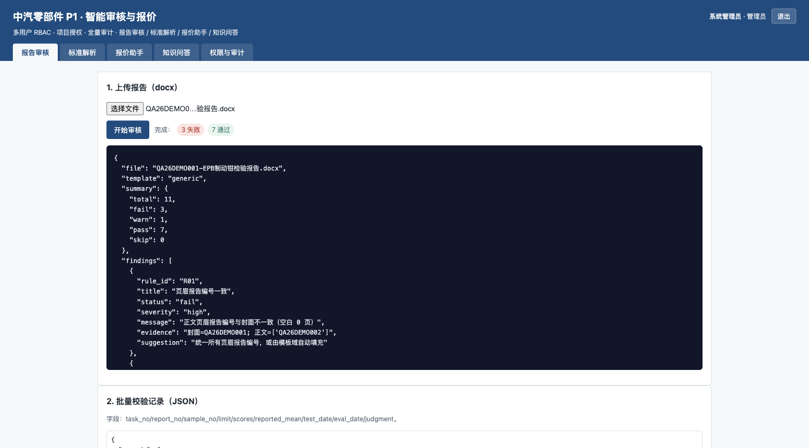 | 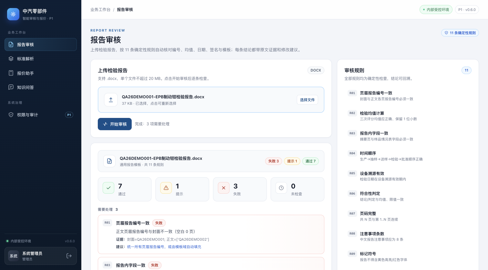 |

### 标准解析

| Before | After |
| --- | --- |
| 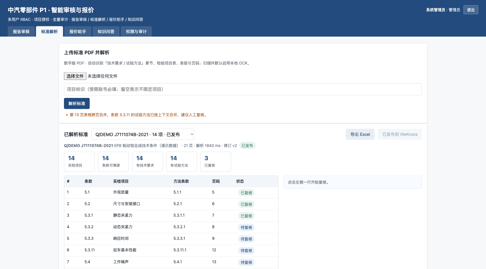 | 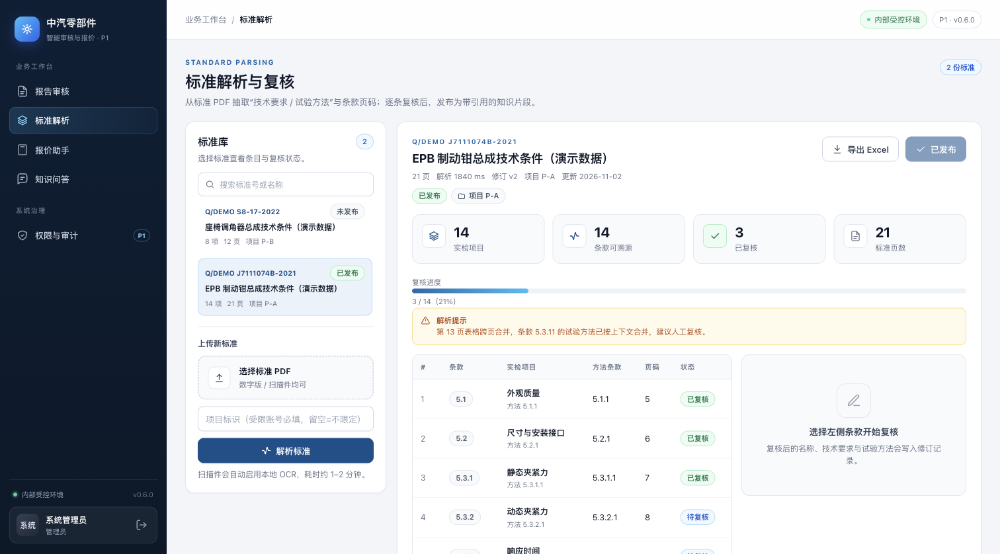 |

### 报价助手

| Before | After |
| --- | --- |
| 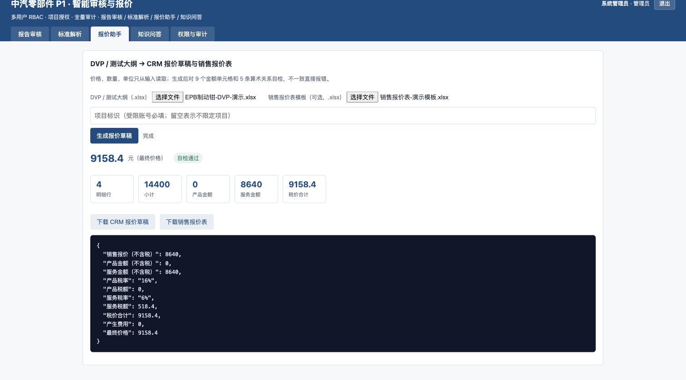 | 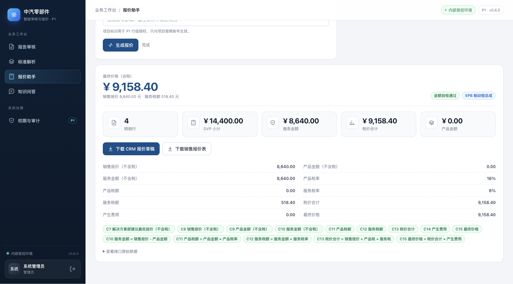 |

### 知识问答

| Before | After |
| --- | --- |
| 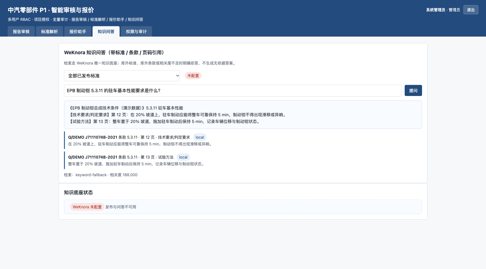 | 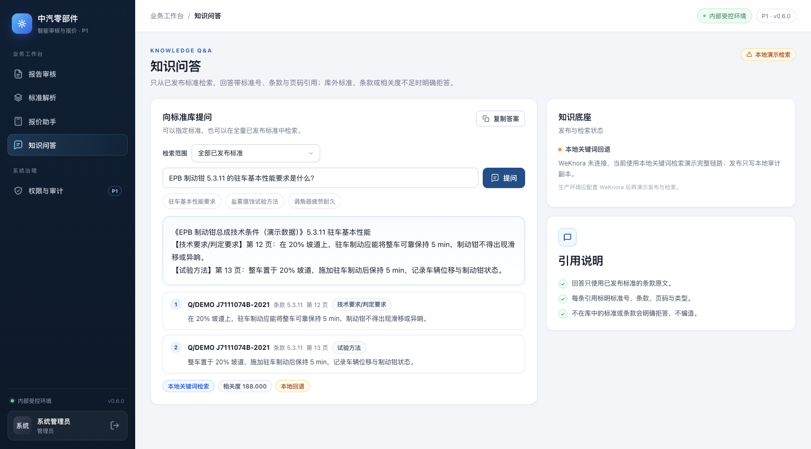 |

### 权限与审计 · 用户与角色

| Before | After |
| --- | --- |
| 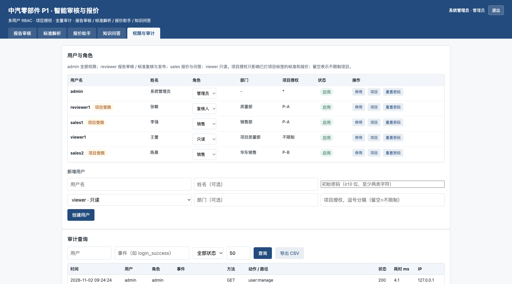 | 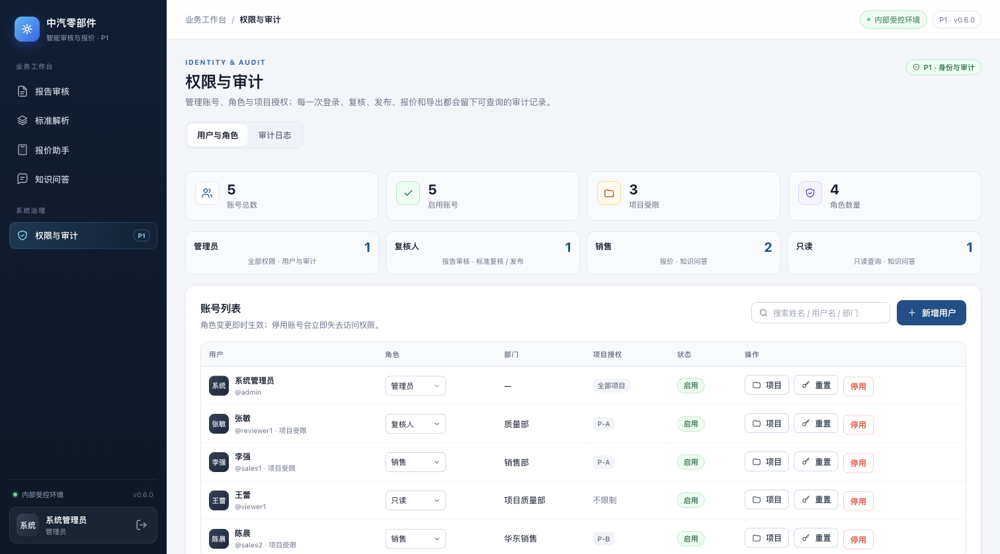 |

### 权限与审计 · 审计日志

| Before | After |
| --- | --- |
| 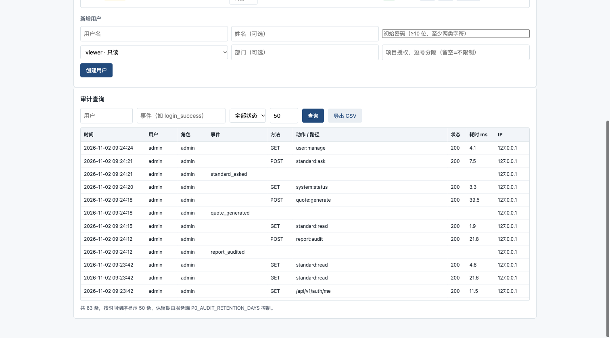 | 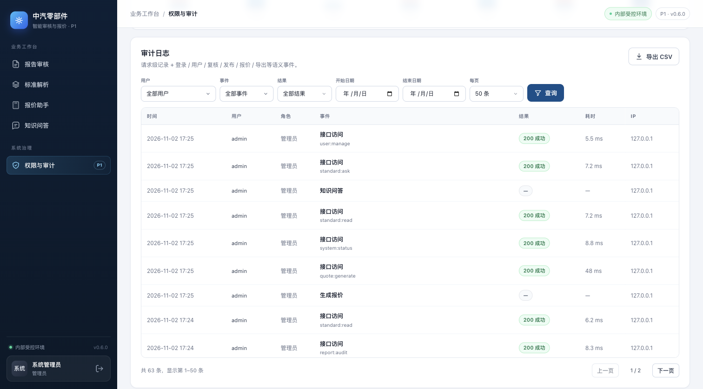 |

新增的审计概览可视化：

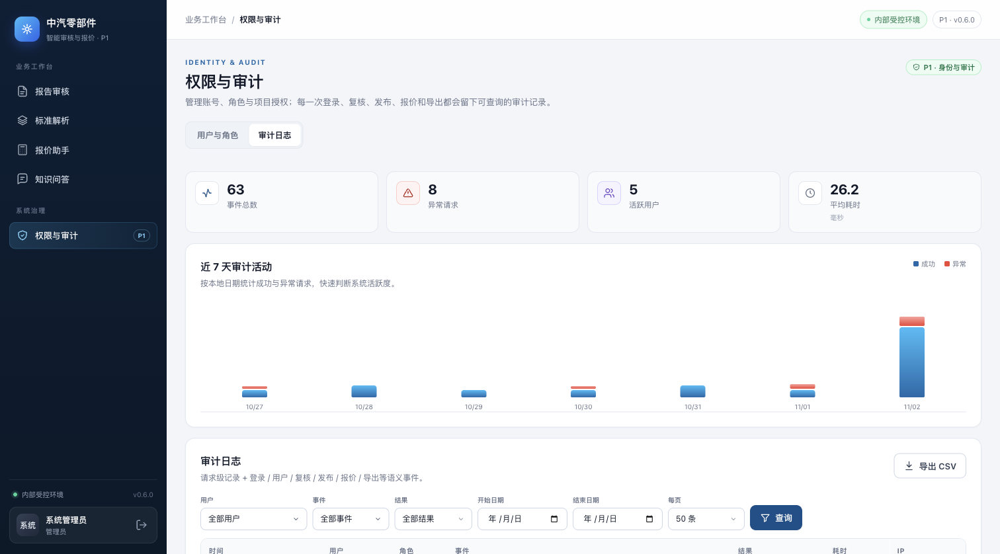

## 验证

```bash
cd p0
pytest -q
# 46 passed, 2 skipped
```

手工在本地实例验证：

- 管理员登录后五个页签均可打开，报告审核、报价生成、知识问答、标准详情与审计查询正常；
- 上传报告得到 3 失败 / 1 提示 / 7 通过，问题卡片与证据可展开；
- 标准库选择、条款复核保存、发布确认、导出入口正常；
- 报价生成得到最终价格 9,158.40，自检通过，下载按钮可用；
- 知识问答返回 2 条带页码引用；库外问题显示拒答样式；
- 新增用户、项目授权、重置密码弹窗可打开，取消/关闭不改变数据；
- 只读账号访问时，报告上传、标准解析/复核/发布、报价入口被隐藏或只读化，管理台导航不可见；
- 审计筛选、分页、导出按钮与行详情弹窗正常。

## 限制

- 本地截图时 WeKnora 未配置，因此知识问答显示「本地关键词回退 / 本地演示索引」；生产环境配置 `P0_WEKNORA_*` 后会显示 WeKnora 已配置。截图为真实的本地回退状态，不是伪造的 WeKnora 在线状态。
- 本次没有引入前端构建链或端到端测试；验证为本地手工操作 + 后端 pytest 回归。
- 审计图表使用当前筛选结果的前 500 条事件计算，数据量很大时只反映前 500 条。
