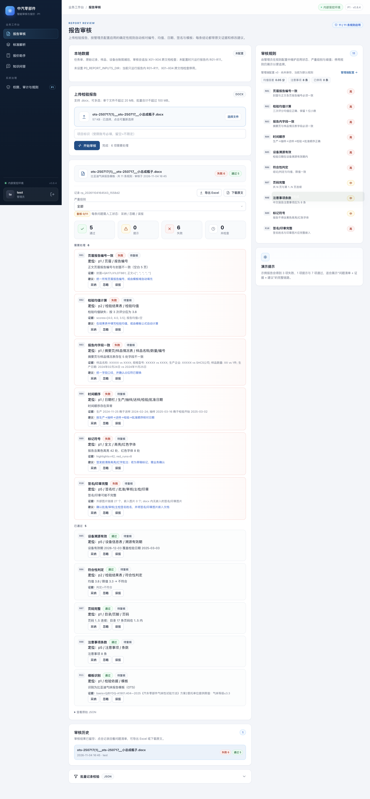
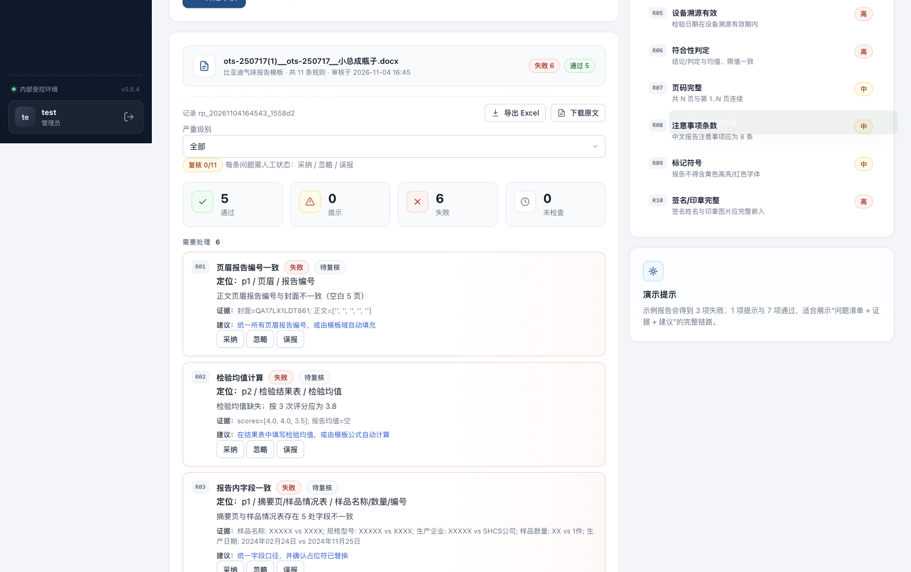
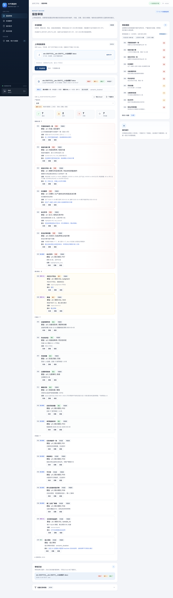
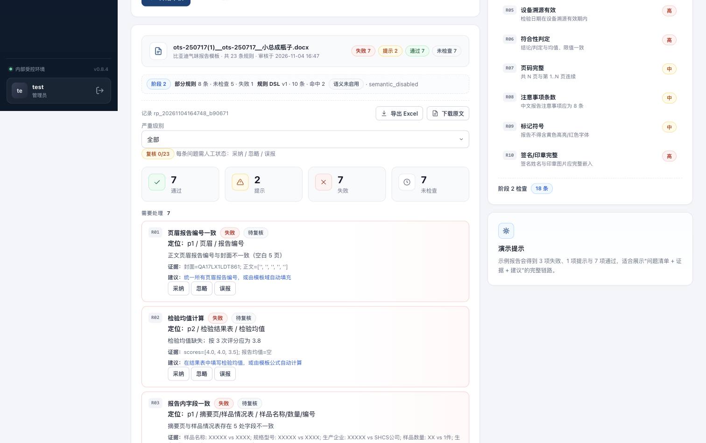
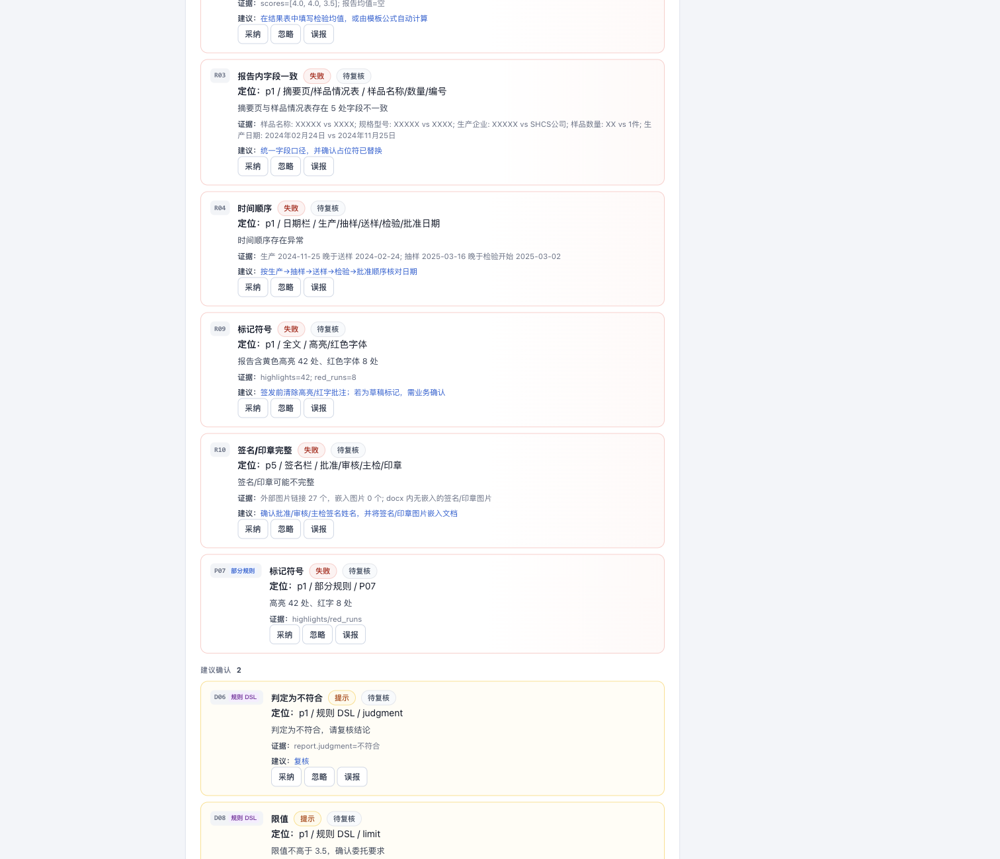
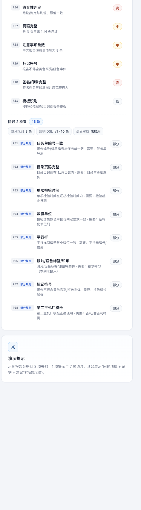

# T202/T203 接入主审核 API 与工作台 — 视觉证据

- **基线（Before）**：`main` @ `5fba4c8`（本 PR 之前）
- **改动（After）**：`agent/integrate-t202-t203-6fee8d6c4230`
- **场景**：本地上传同一份 `samples/byd/ots-250717(1)__ots-250717__小总成瓶子.docx`，执行报告审核
- **视口**：1512 × 838 CSS px；报告审核页
- **环境**：`P0_AUTH_DISABLED=1`、全新 `P0_DATA_DIR`、`P0_SEMANTIC_ENABLED=0`（D5 未确认，语义保持停用）

## Before

`main` 上报告审核只运行 R01–R11：11 条规则，失败 6 / 通过 5，无阶段 2 状态条。

## After

改动后主审核 API 追加 P01–P08、规则 DSL 与语义层；工作台显示阶段 2 状态条、按层标注的 findings，并在右侧「阶段 2 检查」中列出 8 条部分规则和 10 条 DSL 规则。

`P07` 显示「部分规则」，`D06/D08` 显示「规则 DSL」，语义停用时显示「语义 / 未检查」，不再是静默通过：

