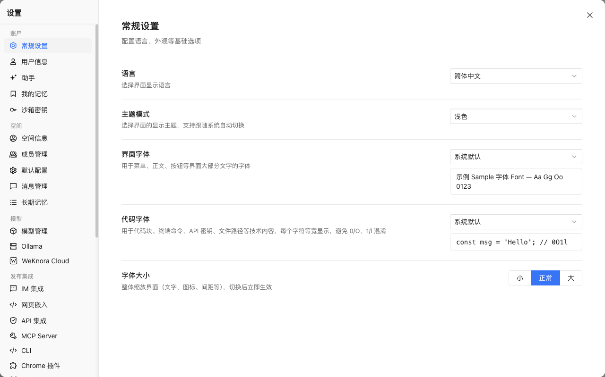
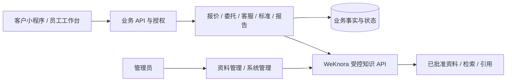

# 中汽零部件项目：WeKnora 功能精简评估与改造设计

评估日期：2026-11-24（北京时间）
评估对象：`https://kb.yunanht.com` 当前部署，以及中汽项目 P0 业务工作台与小程序。
性质：内部评估和实施建议。本轮仅只读检查线上环境，未变更服务、权限、知识数据或配置。

**后续代码溯源补证：** [代码基线与双 Web 整合设计](weknora-source-baseline-and-web-unification-2026-11-24.md) 已按锁定官方 v0.9.0 清单核对 5870 个文件：5868 个相同、2 个配置/部署文件不同；当前后端是官方 18 层加 4 层 YAML 覆盖，前端 214 个覆盖文件均与保留构建输入一致。因此本报告中“dirty tree”和平台功能较多不代表底层算法被我方重写；应从干净官方基线移植必要定制，恢复可复现源码后再做中汽功能裁剪。

## 1. 结论

建议将通用知识平台收敛为“中汽业务工作台 + 受控知识服务 + 管理后台”。用户按工作任务进入；知识库在后台支撑标准资料、业务说明、认可清单的解析、检索与证据引用。

角色以用户提供的需求表为准，仅设新客户/小微客户、业务经理、系统管理员、技术部门。业务经理负责不限金额的内部 AI 辅助报价、委托审核、具体报价/折扣调整、客户沟通与主动跟进、CRM 报价数据维护；技术部门只负责排期调整、加急规则制定维护与技术支持；系统管理员管理知识库、排期库、资质库、名称映射、黑白名单、加急/折扣规则、统计和中介风控，以及账号和运行配置；新客户/小微客户使用小程序注册、上传需求、获取价格/排期/资质、填写提交委托，按条件转人工。部门/项目/客户归属是数据范围，不另设角色。

中汽项目默认关闭通用智能体创建、自动化、Skills/MCP 工具安装、用户浏览器连接、通用代码沙箱、终端/桌面、通用产物库、长期记忆、开放式互联网搜索、Cloud 服务和扩展推广入口。保留受控 API 和必要的内部助手执行机制。文档解析、混合检索、引用、鉴权与审计属于核心依赖，不能随界面一起删除。

先完成项目专属功能策略与页面改造，再按实际依赖停用服务。若 kb 站点仍服务其他项目，应以独立项目实例或经验证的租户策略隔离，不能直接关闭全站能力。

## 2. 证据、范围和限制

### 2.1 本轮已核实

| 证据 | 本轮结果 | 能支持的判断 |
|---|---|---|
| 客户附件正文 | 已读取《AI智能客服系统建设方案-V3.docx》；正文仍写 V2.0、2026 年 7 月 | 客服四大基础库、报价、注册、委托、经理工作台与集成需求；版本冲突仍需核对 |
| 项目需求与实现 | 已读取 `requirements.yaml`、V3 规划、客服验收矩阵、WeKnora 客户端 | 评估覆盖 RA 报告审核、SP 标准解析、CS 客服报价，避免只保留聊天后影响原项目 |
| 浏览器登录页 | DeepKnow 品牌；展示 RAG、ReAct、Wiki、混合检索、图谱等术语；出现“中交路桥南方·制度问答”浮动入口 | 登录页与中汽项目任务和品牌不一致；进一步检查运行容器 `/usr/share/nginx/html/brand-login.js:334` 确认标题硬编码，脚本加载 `/weknora-widget.js`；渠道和租户归属待登录核实 |
| 运行容器 | 前端 `yunan/kb-ui:deepknow-26`；后端 `yunan/kb-app:cn-prompt-5`，healthy；docreader `wechatopenai/weknora-docreader:v0.9.0` | 旧 brand3/rc8.2 状态文件不能代表当前版本 |
| 前端运行镜像 ID | `sha256:dfe962147c644e325e2212f0f1ddf83c44f72f5201693dfa48809ee4ef9d01d4` | 以后复现界面和回滚应锁镜像，不只记标签 |
| 后端运行镜像 ID | `sha256:958eded08b6bf44d8f8650462e2f732ba4db3920eadb584b45c00c8239289636` | 同上 |
| 当前部署归属 | Compose 项目 `weknora`；使用 `/opt/weknora/docker-compose.yml` 与 `docker-compose.override.yml` | 修改和回滚必须同时考虑 override；不能只替换一份主配置 |
| 服务器侧源码 | `/opt/weknora/frontend/src`；Git HEAD `3e22822c1d2397be730c458c7539d0eb8c113a24`，存在大量未提交修改 | 可定位功能和依赖；HEAD 不等于运行镜像源码版本，不能拿该目录直接重建覆盖线上 |
| 菜单/设置注册 | 7 类一级功能；设置注册 24 个固定条目及 7 类集成；工具箱 3 类入口；部署能力 15 个键 | 这是源码注册项数量，不代表任一登录角色都显示全部项目，也不是线上全部功能统计 |
| 资源单点观察 | Neo4j 约 1.143 GiB，Ollama 约 1.15 GiB；其余服务也在运行 | 可将图谱依赖作为后续资源评估项；单点快照不能证明性能瓶颈或估算节省比例 |

### 2.2 登录后补充核实（同日）

用户完成登录后，已恢复同一浏览器任务，只读走查知识库列表、中汽库详情/设置、全局新对话、中汽库内新对话、智能体、自动化、工具箱、全局设置及账号菜单。

| 实际观察 | 评估影响 |
|---|---|
| 当前账号显示空间角色“所有者”，并可见系统管理 | 当前可见入口属于高权限账号；不能外推普通经理/技术人员也看到全部功能 |
| 当前空间可见 5 个库，覆盖其他项目、通用资料和中汽资料 | 共用空间已经实证，应按中汽专属入口/范围进行隔离，不能直接裁掉全站其他项目能力；未据此判定越权泄露 |
| 中汽库 ID `ab605440-4e28-4e31-81ad-c8cf1425600e`，13 个文档，均显示“已完成” | 当前是标准 PDF 资料库；“已完成”仅是页面处理状态，不代表准确率、业务批准或已满足价格/排期/资质全部资料要求 |
| 中汽库仅勾选 RAG，Wiki 未勾选；类型和索引开关均禁用，提示已有内容须先清空才可调整 | 中汽库无需先做 Wiki 迁移即可保留现有 RAG；禁止为精简而清空。其他库的索引依赖另查 |
| 中汽库主视图是“文档/画廊”，文档表主要列文件名、标签、状态 | 保留文档；画廊退出默认工作路径。标准号/年代/适用范围/发布状态需来自业务治理数据，页面当前未展示这些专用字段 |
| 库设置有基本信息、模型、向量、解析、分块、图像、音频、图谱、高级、存储、数据源、共享及活动记录 | 将模型/引擎移至 IT 高级配置；普通资料维护不应逐项理解这些选项 |
| “添加文档”含上传文档、上传文件夹、导入网页、在线编辑 | 上传保留；中汽默认关闭任意网页导入；在线编辑作为受控发布能力保留，不交给客户直接写正式知识 |
| 全局新对话推荐非中汽的工程制度问题；库内新对话推荐汽车标准问题并带“中汽零部件”范围标签 | 项目范围入口可以复用；默认首页应指向项目限定问答，不先进入跨库通用对话；推荐内容偏离是体验问题，不能单凭此认定权限缺陷 |
| 对话框展示“快速问答”、`deepseek-flash`、`1M` 和“思考强度：自动” | 模型/上下文和思考选项可收起；仅凭模型显示名不能判断是本地还是公网，需核实实际服务绑定 |
| 智能体页显示 8 个：4 个内置、4 个自建，包含其他项目及通用文档生成助手 | 中汽只暴露固定业务入口；保留其他项目既有资源及必要内部问答能力 |
| 自动化页突出“新建自动化”；工具箱显示技能 6、MCP 0、浏览器连接离线 | 当前只有高权限页面观察；不删除现有技能或任务，不推断执行权限。中汽项目策略应隐藏并阻止无需求的创建/执行 |
| 全局设置实际展示平台模型、Cloud、长期记忆、沙箱密钥、7 类发布集成等大量选项 | 上轮源码盘点与当前高权限界面相符；普通用户设置应收敛到个人资料/外观/帮助，角色效果待低权限验收 |

已目视检查全局设置截图：左侧选项列表需要滚动，常规设置同时展示代码字体、示例代码等通用偏好。这些配置对本项目业务任务优先级很低。截图证据仅保留设置弹窗裁剪，避免收录背景中的个人会话。

### 2.3 尚未取得的证据

- 所有者账号已完成上述页面走查；新客户/小微客户、业务经理、系统管理员、技术部门四角色的目标授权仍未实测。
- 未创建知识库、上传文件、发送新问题或启动任务；问答引用正确性、上传成功率和接口耗时未在本轮验证。
- 只读了知识库/文档列表元数据、界面设置和导航，未读取客户名单、报价明细和其他项目会话正文；未清点各租户 Wiki/图谱索引及自动化、沙箱、渠道的实际使用量。
- 未验证项目 P0 当前运行实例所用的 KB ID、服务账号和允许知识范围；代码依赖不代表已经连接当前站点。
- 未跑线上压测、上传、问答或写入试验；本评估不引用 P0 单测通过数字作为本次 WeKnora 现场验收结果。
- 服务器源码可能与当前编译产物存在差异；后台界面项一律按“源码发现、待角色实测”解释。

因此本报告给出完整功能取舍和实施方案，所有者界面已有现场证据，但低权限角色验收、完整数据依赖清点与发布验证尚未完成。

## 3. 需求决定功能边界

| 项目流程 | WeKnora 应提供 | 业务服务应提供 |
|---|---|---|
| 标准上传、解析、人工复核和发布（SP） | 文档解析/索引、来源记录、已发布片段检索 | 标准结构化字段、条款/公式复核、版本有效性、发布批准 |
| 报告审核（RA） | 授权标准与规则说明的证据检索 | 报告/任务/样品/设备事实对账、确定性计算和审核结论 |
| 客服问答（CS-3.3/3.6） | 经审核 FAQ、流程说明、标准资料和引用 | 客户归属、会话状态、转人工、经理分配、通知回执 |
| 辅助报价（CS-3/4） | 从大纲和资料中寻找标准/项目候选及证据 | 当前有效价格、数量、税/折扣/加急、阈值、正式报价与 Excel 模板 |
| 排期、资质、名称映射（CS-1） | 原文解析、候选召回、证明材料检索 | 排期时效、标准级/项目级认可范围、批准映射和版本 |
| 注册、委托、规则和外部系统（CS-2/5/7/8） | 必要的帮助资料 | 身份、风控、委托状态机、规则签署与发布、CRM/微信/企查查/邮件适配 |

四大“知识库”不应统一变成四个向量库。价格、排期、审批后的资质结论、已确认映射应以业务结构化记录为准，原文资料进入 WeKnora 提供依据。名字相似与语义召回只产生候选，不能直接批准映射或承诺金额、周期和资质。

## 4. 功能取舍矩阵

处理含义：**保留**为项目必需；**简化**为保留能力并降低操作复杂度；**管理端**为仅授权维护人员可见；**项目停用**为中汽项目不提供该功能、后端和工具同样限制；**条件保留**须先确认使用依赖。以下均为建议目标状态。

| 编号 | 功能 | 建议 | 具体设计与理由 |
|---|---|---|---|
| F01 | 登录/首页/品牌 | 简化 | 项目名称、角色入口、三项业务任务；默认中文；替换平台技术宣传及其他项目浮窗 |
| F02 | 自由新对话 | 简化 | 改为“知识问答”；默认范围为当前项目已批准资料；无依据时提示缺失并提供业务转人工 |
| F03 | 聊天历史、检索历史 | 保留 | 保留本人授权记录，精简来源分类；业务客服记录仍由业务会话服务负责 |
| F04 | 文档检索、标准号精确查询 | 保留 | 支持标准号/年代、项目、资料类型过滤；高频入口不藏在键盘快捷键里 |
| F05 | 引用、原文、页码/条款 | 保留 | 答案一键查看原文、版本和定位；定位不足时显示实际粒度，不伪称精确引用 |
| F06 | 文档库列表/详情 | 简化 | 普通员工只看已授权资料；减少个人/共享/跨空间概念；管理员能看解析状态和失败原因 |
| F07 | 文件上传与解析 | 保留/管理端 | 系统管理员管理知识入库与发布；业务经理及客户的大纲走各自业务上传入口，不混淆临时分析与正式发布；技术部门不因角色名自动获得正式知识发布权 |
| F08 | 人工知识/Markdown 发布 | 保留/管理端 | P0 标准发布链路直接依赖，不能因用户看不懂 Markdown 而删除接口 |
| F09 | FAQ 知识库 | 简化 | 提供客服问答维护模板、标准问/同义问/批准答案/来源；具体可用字段以现有类型与权限核实后实现 |
| F10 | OCR、图片文字、表格解析 | 保留 | 标准、认可清单、大纲均用得到；模型/引擎选择放管理员高级设置 |
| F11 | 通用图片理解/VLM | 条件保留 | 解析扫描件所必需的能力保留；开放式图片创作/理解不默认开放；现场资源验证后配置 |
| F12 | 音视频/语音 ASR | 项目停用 | 当前需求无音视频采集或转录；若后续增加语音客服重新评估 |
| F13 | 分块、索引策略、阈值、Rerank | 管理端 | 使用经样本验证的预设；保留技术能力，普通人员无须选择参数 |
| F14 | Wiki 生成/编辑/相关专用助手 | 项目停用（先清点） | 中汽现有库已确认 Wiki 关闭、RAG 开启；隐藏中汽 Wiki 新建/助手入口即可保留当前链路。其他库仍有 Wiki 标识，不得全站停任务；若有迁移再验证原文引用 |
| F15 | 知识图谱抽取/浏览/图谱工具 | 项目停用（先清点） | 当前必需链路是原文、条款和受控检索；先确认无图谱依赖与其他租户使用，再评估停 Neo4j |
| F16 | 知识库/文档版本与状态 | 保留并补治理 | 检索只消费批准且适用的版本；标准业务有效状态由 P0 决定，不把上传完成等于业务生效 |
| F17 | 任意网页 URL 导入/爬取 | 项目停用 | 标准、价格和资质的正式来源受控；未来特定官方来源采集须独立审批和隔离任务 |
| F18 | 公网搜索/Web fetch | 项目停用 | 客户报价与资质不能被网上搜索结果替代；内部知识缺失进入补录或人工流程 |
| F19 | 通用智能体市场/创建/编辑 | 项目停用 | 普通用户只面对标准问答、辅助报价、客服工作台等业务任务；必要内部助手由管理员固定维护 |
| F20 | 智能体运行与上下文 | 条件保留 | 当前 P0 使用基础 REST 检索；如内部知识问答仍依赖 agent-chat，保留最小受控执行器及搜索工具 |
| F21 | 模型/思考强度/提示词选择器 | 简化/管理端 | 角色预设模型及预算；普通员工无需挑模型；保留中断、失败、截断与无依据提示 |
| F22 | Skills 安装与技能市场 | 项目停用 | 业务 Excel、报告输出已有受控业务服务，关闭通用技能安装和来源下载入口 |
| F23 | MCP 服务/对外 MCP Server | 项目停用 | 已有 P0 REST 适配；本项目暂不需要用户接工具或对外发布通用工具服务 |
| F24 | 浏览器扩展/用户浏览器控制 | 项目停用 | 未出现在需求；不能作为 CRM 集成的默认替代路径 |
| F25 | Docker/远程/Host 沙箱及终端桌面 | 项目停用（先查依赖） | 关闭通用代码执行；业务导出保留在业务服务；docreader 与通用沙箱分开，不能误停 OCR |
| F26 | 通用产物库/PPT/网页生成 | 项目停用 | 用户从报价、委托、审核任务下载对应文件；相关既有文件需保留授权访问与留存路径 |
| F27 | 用户自建定时自动化 | 项目停用 | CRM 同步、过期提醒等交给受控后台任务，不让用户自行写通用 Agent 定时任务 |
| F28 | 长期记忆/个人记忆管理 | 项目停用 | 客户档案、跟进记录归业务数据库；保留必要短期上下文与合规会话历史 |
| F29 | 多空间切换/共享空间/邀请码 | 简化/管理端 | 用户自动进入所属项目，资源授权继续生效；部门隔离保留，关闭任意建空间/跨项目分享 |
| F30 | 成员、角色、项目/部门权限 | 保留/管理端 | 身份权限不可因菜单变少而弱化；P0 的经理归属仍需与 WeKnora 授权作明确映射 |
| F31 | 模型管理/Ollama/默认模型 | 管理端 | 合并为“模型与解析服务”；仅显示已批准并经现场验证的模型配置 |
| F32 | WeKnora Cloud | 项目停用 | 当前项目按本地知识/模型边界建设；保留原有数据配置的安全迁移过程 |
| F33 | 存储引擎/向量引擎/解析引擎选择 | 管理端 | 部署时确定，日常只显示健康/状态；引擎迁移是运维变更，不给普通员工切换 |
| F34 | API/服务账号与接口凭据 | 保留/管理端 | 给 P0/业务网关授权的最小接口；凭据不放浏览器或小程序；隐藏界面不能切断现有 API |
| F35 | IM/Embed 发布渠道 | 条件保留/管理端 | 微信/企微是项目需求，但须由业务渠道绑定客户身份、授权和人工接手；不默认开放匿名全库聊天 |
| F36 | CLI/Chrome/Claw 集成推广 | 项目停用 | 项目用户无需安装通用开发入口；服务器必要运维 CLI 不随前端推广入口一起删除 |
| F37 | 环境变量/技能凭据自助页面 | 项目停用 | 普通用户不维护执行脚本的秘密；业务系统凭据交 IT 受控保管 |
| F38 | 管理助手/第二悬浮助手/新手引导 | 简化 | 保留一份中汽任务指引；隐藏能管理知识库/工具/基础设施的通用助手；避免双聊天入口 |
| F39 | 审计、错误告警、队列与监控 | 保留/管理端 | 普通用户看任务状态；IT 看系统队列与审计；权限不与业务员混用 |
| F40 | 备份恢复、留存、导出与删除治理 | 保留 | 精简功能不等于删除数据；资料、引用、业务关联、会话与现有文件都要有迁移与恢复依据 |

## 5. 建议的页面和角色

### 5.1 中汽项目统一工作台

| 角色 | 建议主入口 | 日常不显示 |
|---|---|---|
| 新客户/小微客户 | 注册登录、上传大纲/咨询报价（含排期/资质）、我的委托、条件触发的转人工 | WeKnora 原生后台、模型、知识库全量目录、工具/技能 |
| 业务经理 | 不限金额的内部辅助报价、报价/折扣调整、客户与咨询、主动对话、委托审核、CRM 报价数据维护 | 通用 Agent/自动化/产物库、沙箱/模型/引擎配置 |
| 系统管理员 | 知识/排期/资质/映射库、黑白名单、加急/折扣规则、数据统计、中介风控，以及账号/运行管理 | 不提供绕过业务规则的操作；不默认访问其他项目资料 |
| 技术部门 | 排期项目库维护、加急规则制定维护、系统技术支持 | 客户风控名单、全局报价规则、平台账号管理；不默认授予报告审核或标准复核 |

用户已确认只保留以上四角色，名称和职责按其需求表执行；技术部门按人员开户，部门是归属属性。知识治理与系统运维由系统管理员负责；具体报价/折扣调整不等同于折扣规则管理；报告审核和标准复核的角色归属未在本表定义，不默认划给技术部门。现有 WeKnora owner/admin 等技术角色经适配层映射，不作为项目新增角色展示。

### 5.2 WeKnora 自身的精简导航

普通员工：**知识问答、资料查询、历史记录**；账户菜单只保留个人资料、帮助、退出。管理员增加“资料管理”和“系统管理”。后台先按角色呈现上述少量任务页，再进入高级配置。

辅助报价、委托审核、客户队列、价格/排期/资质维护仍使用 P0 的业务页面。两套系统统一身份与入口后避免重复创建客户、工单或资料生命周期。

### 5.3 高频动作简化

- 问答：打开知识查询 → 输入标准号或问题 → 看回答和原文。知识范围和模型由岗位预设。
- 入库：选资料类型 → 选文件并补业务版本/范围 → 解析与人工复核 → 发布。引擎/分块放高级设置。
- 报价：上传大纲 → 核对提取项 → 看价格/排期/资质来源 → 保存内部草稿或转人工。导出在任务内完成。
- 失败：解析失败可查看原因并重试；无标准/无依据进入缺失清单和人工路径；不以通用 AI 文本填空。
- 普通用户看到“资料正在处理/待复核/可查询”，而不是引擎名称、嵌入模型、token、索引策略。

## 6. 技术改造要点

### 6.1 增加项目功能策略，不复用部署能力表达所有开关

现有 `deploymentCapabilities` 表达“后端注册了哪些能力”，不足以表达“中汽项目允许哪些功能”。`automations`、`toolbox` 注册项没有 `requiredCapability`，现有 `settings` 策略也没有覆盖 Wiki、记忆、ASR、完整工具执行边界。

新增版本化项目策略，例如 `project_profile=cnz_parts`，明确功能白名单、角色范围和资料范围；实现位置和字段名需在开发时对齐当前镜像对应的源码。有效权限取交集：

`部署支持 ∩ 项目启用 ∩ 用户角色权限 ∩ 项目/部门/文档授权`

策略应由后端提供且后端执行；不可用 localStorage 或前端常量授予业务能力。策略读取失败时不开放项目禁用入口/工具；保留帮助和状态提示，避免菜单闪现又消失。现有源码多数部署能力缺失时默认可见，应在新策略中明确加载失败语义。

### 6.2 同时控制四个入口层

1. 菜单、全局搜索、快捷入口、设置页与助手中的推荐项。
2. 直接 URL、旧书签、设置 section aliases、分享链接和嵌入入口。
3. 对应 API 和服务账号授权，包括创建/运行/恢复自动化、技能安装、浏览器连接、沙箱创建及工具调用。
4. Agent 工具白名单、后台调度和既有运行任务，防止“前台不显示，但历史任务/助手仍能执行”。

隐藏入口适合减少认知负担；停用业务能力必须后端拒绝。源码中的前端路由守卫不是安全边界。停用任务要先盘点所有者与用途，不能把平台内部 CRM 同步等受控任务一并停掉。

### 6.3 必须保留的 P0 API 契约

来源为本项目 `p0/app/weknora.py` 当前实际调用；不是假设的接口清单。

| 接口 | 当前用途 | 精简约束 |
|---|---|---|
| `GET /api/v1/knowledge-bases/{kb}` | 读取库与配置 | 保留服务账号访问及范围校验 |
| `GET /api/v1/models` | 维护/摘要模型检查 | 服务端运维使用；不需在普通用户页列模型 |
| `GET /api/v1/knowledge-bases/{kb}/knowledge` | 列表、同名去重和运营核对 | 不能删除后迫使标准重复发布 |
| `GET /api/v1/knowledge/{id}` | 解析状态轮询、内容状态 | 保留已发布知识引用兼容 |
| `POST /api/v1/knowledge-bases/{kb}/knowledge/manual` | 发布标准 Markdown | 保留；界面可改业务名称 |
| `PUT /api/v1/knowledge/manual/{id}` | 更新既有标准 | 保留 ID 与版本关联 |
| `PUT /api/v1/knowledge/{id}` | 更新 custom_metadata | 保留标准/项目/修订元数据，不覆盖其他系统字段 |
| `DELETE /api/v1/knowledge/{id}` | 撤销/清理关联知识 | 仅受控维护，不因前端隐藏而废弃 |
| `POST /api/v1/knowledge/{id}/regenerate-summary` | 运营重建摘要 | 保留受控维护；避免与聊天答案预算混淆 |
| `POST /api/v1/knowledge-bases/{kb}/hybrid-search` | 当前默认混合检索 | 核心必保；不因停用图谱或 Wiki 一起关闭 |
| `POST /api/v1/knowledge-search` | 可选 Rerank 检索 | 后台可保留，默认是否启用按质量与延迟评测决定 |

WeKnora 自身问答可能使用 `/knowledge-chat` 或 `/agent-chat/:session_id`；须在后台实测后确认当前入口和执行工具，不能只凭 P0 未调用而删除。知识引用要同时保留知识 ID、chunk ID、原标准号/条款/页码与已发布版本关联。

### 6.4 受控数据集设计

- 正式标准与认可资料：区分部门、项目、适用产品和版本状态，只让授权角色查询。
- 客服 FAQ 与服务说明：仅使用经业务批准可对客发布的内容，不混入内部价格、名单和经理备注。
- 临时询价/委托/客户附件：按企业和任务隔离，默认不变成全员可检索的长期知识。
- 原始资料库与确认知识库可采用库级、文档级或服务层状态过滤；采用哪种方式取决于当前部署支持，开发前核实，不声称已有发布审核能力。
- 不允许按用户选择任意 KB ID、Agent ID 直接改变项目授权范围。小程序凭据只访问业务网关。

## 7. 线上修改前必须确认的部署问题

1. **共用站点**：登录页存在其他项目入口，已确认由运行镜像内的 `brand-login.js` 注入；服务器也运行多个业务栈。先确认当前租户、渠道、资料与使用者归属，再决定中汽独立域名/实例或项目策略；这不是“全站所有功能都可以删除”的证据。
2. **代码可复现**：`/opt/weknora` 有大量修改，运行前后端是不同自定义标签。应保存现有镜像/Compose/配置清单，找回对应构建来源；不能直接从 HEAD 重新构建后声称只改菜单。
3. **通用沙箱依赖**：app 挂载 Docker socket，运行中有沙箱容器。先确定是否承载其他任务，关闭中汽执行权限后再评估专用实例不挂载 socket；不在共用宿主上直接停止其他容器。
4. **图谱/Wiki 迁移**：中汽库已确认采用 RAG 且 Wiki 关闭，不必为它重建或清空；其他库 Wiki、图谱与 Neo4j 的依赖仍须盘点。确认所有服务消费者无依赖后才讨论全站停调度、停 Neo4j；不直接删卷。
5. **现场模型边界**：模型运行位置、WeKnora 下游出网与供应商配置尚未检查；本次看到 Ollama 容器不能证明项目已全部本地推理。

## 8. 实施顺序与验收

以下为工作量初估，按一名熟悉现有 Vue/Go 与部署的工程师计算；登录实测、源码冻结与数据盘点后细化。不是交付承诺，不包含客户 API 开发与 UAT 等待。

| 阶段 | 工作与交付 | 验收条件 | 初估 |
|---|---|---|---|
| A 当前评估补证 | 登录后按角色走查；确认共享项目、实例与构建版本；取正式使用量和依赖清单 | 每项标明保留理由、角色和证据；后台未验证项不混为实测 | 1–2 人日 |
| B 项目功能策略 | 后端功能白名单、角色策略、前端统一消费；覆盖路由、API、工具和任务 | 不同角色/未知策略/直接 URL/API/历史任务均按策略处理；其他租户回归 | 4–7 人日 |
| C 页面精简 | 登录、项目首页、知识查询、资料维护预设、设置重组、帮助 | 普通用户完成知识查询无需选模型/Agent；页面与禁用功能一致 | 3–5 人日 |
| D 核心链路联调 | P0 标准发布、元数据、混合检索、引用、文件解析与业务导出 | 既有 API 契约保持；无权限和错误路径可解释；引用可回读 | 3–5 人日 |
| E 专属部署裁剪 | 盘点/迁移 Wiki/图谱/文件与任务；条件满足后关闭额外服务 | 无引用断链、无其他项目影响、备份恢复通过；实际资源对比 | 2–4 人日 |
| F 试用与发布 | 新客户/小微客户、业务经理、系统管理员、技术部门四角色验收，隔离验证、切换和回滚演练 | 角色试用记录、质量/性能达标、签署发布记录 | 2–3 人日 |

合计约 **15–26 人日**，团队并行后的自然周期另排；若仅隐藏几个菜单，工作量会更少，但不满足“仅保留项目可用功能”的完整边界。

### 8.1 具体任务验收

- 业务经理能从项目首页直接进入辅助报价和客户待办，无需先理解智能体/工具箱。
- 技术部门能维护授权排期及加急规则，无权因该角色自动管理名称映射、客户名单、系统账号或凭据。
- 查询可定位标准号/年代/条款及来源；未批准、作废和未授权资料不进入正式结果。
- OCR 失败/解析失败/无引用/索引未就绪可见，不能把失败显示为回答成功。
- 无资料、未知资质、价格失效时保留项目既定人工路径；停用公网搜索不影响该降级。
- 禁用功能的菜单、命令搜索、直接 URL、API、工具调用与历史自动化均被验证，兼容旧入口。
- 用真实授权样本对比改造前后：正确引用、漏项、误答、越权拒绝、任务完成步骤、首字时间/总响应时间；先测基线再确定目标，不编造“提速百分比”。
- 导出的报价/委托/审核材料仍可下载，且能回溯业务任务和版本；通用产物菜单消失不影响业务下载。
- 管理员能完成成员权限、知识维护、模型健康、审计和恢复；普通角色看不到平台设置。
- 共用站点的其他项目若仍存在，应有独立回归及影响确认后再发布。

### 8.2 发布与回滚

修改先在可恢复的项目环境验证。发布前记录前后端镜像 digest、主/override Compose、配置版本，备份 PostgreSQL、原文文件与引用关联、必要索引；确认恢复可用且不包含明文凭据的发布记录可以审查。策略/前后端分别可回退；数据库变更需向后兼容。停用服务先停任务、保留数据，经过观察期再讨论清理。

上线后的验收包括 P0 核心链路、登录/角色、已知文档引用、业务导出与其他项目探活。仅浏览器看起来菜单减少不作为发布成功证据。

## 9. 本轮交付与下一步

本轮已完成部署和源码层的整体盘点、所有者账号后台现场走查、40 项功能取舍、角色入口设计、P0 核心 API 依赖清单及实施/回滚设计。未实施线上裁剪；界面操作只关闭引导、打开页面和取消设置，没有保存知识或系统配置。

下一步可将 B/C 拆成首个具体开发切片：中汽专属首页/默认知识范围、3 个知识导航、精简模型选择器、项目设置白名单，同时保留现有知识 ID/引用和其他项目入口行为。后台功能策略必须由服务端实施，不能只写前端隐藏。发布前补低权限角色、构建来源与共享项目影响验证。上述事实调查不需要客户补写一份全新需求才能开始。

## 附录：本轮查阅定位

- 中汽项目：`docs/requirements.yaml`、`docs/customer-service-acceptance-matrix.md`、`p0/docs/customer-service-v3-plan.md`、`p0/app/weknora.py`、`docs/p1-weknora-ops/README.md`。
- 参考材料：交付工程状态记录、品牌中性化实现、企业版功能预设回读和 v0.9.0 用户手册。这些是历史/源码参考，不代替当前部署验证；本分支不依赖其本机路径。
- 当前服务器源码：`frontend/src/stores/menu.ts`、`components/menu.vue`、`components/UserMenu.vue`、`router/index.ts`、`config/deploymentCapabilities.ts`、`config/settingsAccess.ts`、`config/settingsRoute.ts`、`config/integrations.ts`、`config/toolbox.ts`、`stores/deploymentCapabilities.ts`、`views/settings/Settings.vue`、`views/knowledge/KnowledgeBaseEditorModal.vue`。
- 后端源码：`internal/handler/deployment_capabilities.go`；运行环境：容器镜像、mount、Compose labels 与有限的无密钥开关读取。
- graphify 现有项目图查询：定位到 `weknora.py` 的发布、索引、检索、元数据与业务调用关系；图快照来自此前索引，结论已回到当前源文件核对。
