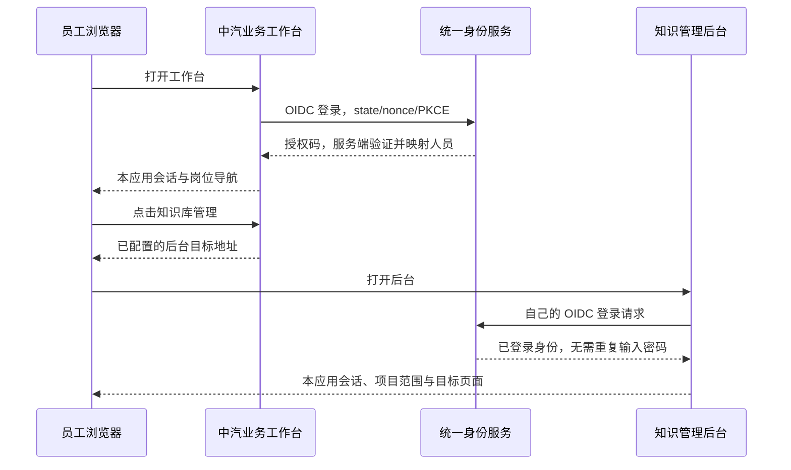

# WeKnora 代码来源核查与中汽双 Web 端整合设计

日期：2026-11-24。范围：线上 kb.yunanht.com、服务器 `/opt/weknora`、当前中汽 P0/P1 仓库。仅只读核查与本地设计文档，无线上配置、账号、资料或镜像切换。

角色口径：以用户提供的需求表为准，中汽项目仅设 **新客户/小微客户、业务经理、系统管理员、技术部门** 四类角色。后文账号对比中的 reviewer/sales/viewer、owner/contributor 等是现有系统技术角色，不是拟新增的中汽角色。技术部门按人员开户并记录部门归属，不使用部门多人共用账号。此次修订只更新设计，尚未迁移运行中的账号或权限。

## 1. 决策建议

1. 当前线上知识库是在官方 WeKnora v0.9.0 上叠加提示词、内置助手、品牌和前端编译资源的版本。已有证据不支持“检索/鉴权/解析 Go 核心被重写”。当前运行后端继承官方完整镜像层，增加的 4 层只覆盖 YAML。
2. 不从服务器当前 Git 分支直接开中汽分支。该目录 HEAD 仍是 v0.8.3，实际文件已基本被 v0.9.0 覆盖；从它开分支会混入上游升级、散落文件与运行态差异。
3. 新的中汽知识服务开发基于干净、锁定 commit 的官方 v0.9.0；当前线上版保留为运行基线及回滚资产，将需要的定制还原为可审阅补丁再移植。不要从当前企业 V2 候选目录或临时 build 目录冒充正式源码基线。
4. 两个 Web 端可以整合用户入口和业务导航。以中汽业务工作台（P0/P1）为产品主平台，WeKnora 作为知识服务；后端保留 Python 业务服务与 Go 知识服务边界。资料维护高级后台可继续独立部署、通过统一身份单点跳转。
5. 即使普通用户入口合并，管理员仍有两套服务的访问场景，因此统一身份仍然需要。推荐同一身份提供方、两个 OIDC 客户端、显式账户映射和各自权限，不共享密码库或会话签名密钥。

## 2. 对比基线与数量口径

### 2.1 为什么不能看 `git diff HEAD` 就下结论

服务器 HEAD 为 `3e22822c1d2397be730c458c7539d0eb8c113a24`，标签 v0.8.3，处于 detached HEAD；工作树相对该基线有 1008 个已跟踪修改文件，约 140712 行增加、47246 行删除，793 个未跟踪条目。这批差异混入上游从 v0.8.3 到 v0.9.0 的升级，不能归因为我方定制。

v0.9.0 的官方 commit 对象不在该 Git 对象库，不能直接在该目录运行准确的 `git diff v0.9.0`。本轮改用交付工程已锁定的官方归档逐文件 SHA-256 清单，先验证清单本身哈希，再对线上目录逐文件核对。

| 项目 | 已核实的值 |
|---|---|
| 官方源码 commit | `f17ee8a8da901bd658a4cb25f40b5fd41adbfdd7` |
| 官方归档 SHA-256（锁文件记录） | `4d5f8f93298a049ea9a35163d8317af7c918e62411a0a2573dce8ddbb2d6f831` |
| 文件清单 SHA-256（本轮重新验证） | `4cb9cb25cea93c2d26c55497935abc2e4c7c2d93c675b4b7858f45fe7518ac48` |
| 官方清单文件数 | 5870 |
| 线上目录字节完全一致 | 5868 |
| 线上目录不同 | 2：`config/builtin_agents.yaml`、`docker-compose.yml` |
| 官方文件缺失 | 0 |
| 指定代码目录额外源码 | 1：`internal/application/service/image_action_loop.go` |

额外源码扫描范围为 internal、frontend/src、config、migrations、cmd、client、docreader、pkg 的指定源码后缀，排除依赖/缓存；不包含运行数据、秘密、用户文档和所有临时文件。清单锁来自既有交付材料，本轮没有重新下载官方 117MB 归档。

`image_action_loop.go` 内有图像动作调度/OCR 逻辑，但搜索调用方只命中自身。它不在官方清单，当前镜像也没有替换官方二进制的层；应作为未纳入正式构建的残留源码调查，不能算已上线功能。未来不能把它顺手带入构建，否则可能产生编译冲突或改变处理逻辑。

### 2.2 运行镜像与源码目录要分开看

| 运行组件 | 当前版本与证据 | 结论 |
|---|---|---|
| 后端 | `yunan/kb-app:cn-prompt-5`，镜像 ID `sha256:958eded08b6bf44d8f8650462e2f732ba4db3920eadb584b45c00c8239289636` | 定制配置镜像 |
| 后端官方基底 | `wechatopenai/weknora-app:v0.9.0`，镜像 ID `sha256:25b20959b7456f7842ef55ed4feff3694dbd0c6f8af4117c1fb3c5dec6bdf14d` | 18 个文件系统层全部是当前镜像的相同前缀 |
| 后端定制层 | 当前共 22 层；增加 4 层，history 均为 COPY YAML | 未重编译或替换官方 Go 可执行文件 |
| 可执行文件 | `/app/WeKnora` SHA-256 为 `cfe6e40a8f3113f4615a8a7210de6bdf7b8604ec37d9ae7c456cf20eb5ad8619` | 已记录现网指纹；容器 writable diff 未显示该文件修改 |
| 文档解析 | `wechatopenai/weknora-docreader:v0.9.0`，镜像 ID `sha256:8c71ec3cc2e291829c3938d2c7dc5f921c1d10551c8774bf844c83bc4aa3cb84` | 当前运行的是锁定官方镜像，不应套用旧 brand3 OCR 补丁已上线的历史说法 |
| 前端 | `yunan/kb-ui:deepknow-26`，镜像 ID `sha256:dfe962147c644e325e2212f0f1ddf83c44f72f5201693dfa48809ee4ef9d01d4` | 自定义静态资源镜像 |
| 前端构建输入 | `/tmp/kbui-build26/Dockerfile` 从 `yunan/kb-ui:v0.9.0-brand3` 继承，COPY 品牌/登录/编译资源 | 不是一份干净 Vue 源码直接构建的可追溯项目分支 |
| 前端回读 | 本轮逐字节核对该 Dockerfile 复制的 214 个文件，现网全部一致，0 差异 | 临时目录可定位现网覆盖物，但必须归档到正式版本控制后再作为开发资产 |

### 2.3 已确认改过哪些内容

**后端配置/回答行为：**

- `config/prompt_templates/system_prompt.yaml`：当前镜像覆盖；保留的 patch 脚本包含简体中文输出约束。
- `config/prompt_templates/agent_system_prompt.yaml`：当前镜像覆盖；保留脚本包含中文说明、精简思考/避免重复复述工具结果的规则。
- `config/builtin_agents.yaml`：当前镜像先后两次覆盖；保留脚本包含数据分析师回答预算调整，例如 32768。具体各 agent 的最终有效参数仍以镜像内 YAML、数据库覆盖和请求参数优先级为准，不能用脚本计划值代替最终运行值。
- `docker-compose.yml` 与现网 override：当前镜像选择、运行依赖、挂载与代理相关部署配置；未把其中凭据内容导出。

**前端界面与编译资源：**

- `index.html`：应用入口与 `assets-v2` 引用、品牌资源与登录脚本加载。
- `brand.css`、`brand-login.css`、`brand-login.js`、favicon：DeepKnow 品牌、布局、登录文案；`brand-login.js` 内硬编码另一项目制度问答 Widget。
- `assets-v2`：208 个编译资源。保留 build 目录中的 assets 与 assets-v2 比较，195 个同名资源字节相同、7 个同名资源不同、6 个当前文件未匹配原始同名文件；7 项包含 KnowledgeBase、KnowledgeBaseEditorModal、PdfSourceViewer、SandboxBackendBadge、Toolbox、一个 index chunk、Markdown 样式。
- 上述资源差异可能只是品牌或 import 重写，不能根据文件名推断某个底层功能被改。两个保留 assets 目录也未证明都是官方原始产物，故这不是正式官方前端差异数量。

当前 `frontend/src` 在官方清单内的文件均一致，说明 Vue/TS 原始源码未承载现网所有品牌/资源补丁。进一步开发前，需要将实际必要补丁回到 Vue/TS/CSS 源文件，建立源码→构建→镜像的可复现链条。

**没有发现我方改动的官方核心源码：**清单内的检索、向量、Go 鉴权/租户、标准数据库迁移、Agent 执行与 docreader 源文件均匹配 v0.9.0。现网模型配置、租户、渠道、资料等数据库内容未作完整差异盘点；这些运行数据会改变行为，但不应混称源码修改。

## 3. 中汽从哪个分支开始

建议建立以下明确边界，以下名称为设计建议，尚未创建分支/仓库：

```text
官方 WeKnora v0.9.0 / f17ee8a...
  └─ 云安可复现基线（移植审查后的提示词/品牌及必要修复）
       └─ codex/cnz-knowledge-profile（中汽功能精简与身份适配）

现有中汽业务仓库 deepseekagent
  └─ codex/cnz-unified-workbench（工作台入口与知识模块整合）
```

现网 deepknow-26/cn-prompt-5 是**兼容与回滚基线**；官方锁定源码加可追溯定制是**开发基线**。不要直接在 `/opt/weknora` 编辑、提交或 build 后切生产；也不从 v0.8.3 的 dirty tree 创建项目分支。

冻结清单应包含：官方源码锁；当前镜像 ID；Compose 主/override 的脱敏结构；3 份覆盖 YAML 的受控版本；前端 214 个覆盖文件及 hash；对应 Dockerfile；必要数据库迁移版本；不含明文秘密的配置项说明。临时目录只是证据来源，归档后才能成为发布来源。源码重建验证引用、解析、检索和 P0 接口后，再执行中汽裁剪。

当前项目工作树另有多项历史未提交修改，应先区分中汽业务切片，保留现有私有小程序配置；本轮不创建新开发分支或提交推送。

## 6. 2026-11-25 基线更新与 SSO 适配实施

复核期间官方已发布 v0.9.1，故新建中汽开发栈的基线调整为官方 tag `v0.9.1`（commit `71c32af9273482e0dad013d0e3bea2f4d719516c`），不再继续以 v0.9.0 作为新部署基线。v0.9.0 仍保留为线上历史核查与回滚参照。v0.9.1 归档 SHA-256 为 `183b0538d895b85906da030b8b62a93bd884cd1967d10bcb38020b549b3bc5cd`，逐文件锁定清单为 `ci/upstream-v0.9.1.json`；准备脚本对清单和归档做哈希校验，逐文件校验后才应用本项目补丁。

检查发现 v0.9.1 官方 OIDC 路径仍以邮箱查找账号，并在找不到时自动创建本地用户；UserInfo 响应还会覆盖 ID Token 的同名 claims。该行为不能满足中汽逐账号确认和四角色固定的约束。本分支新增 `weknora/patches/0001-cnz-explicit-oidc-identity.patch`：

- 认证身份改为已验证 ID Token 的 `(issuer, sub)`，UserInfo 的 `sub` 必须与已验证 ID Token 一致；没有可验证 ID Token、subject 不一致或账号未绑定时拒绝登录。
- 新增 `users.oidc_issuer` / `users.oidc_subject` 唯一绑定字段与 PostgreSQL/SQLite 迁移；邮箱只作资料字段，不参与 OIDC 认证匹配。
- 仅由 SystemAdmin 路由组提供绑定/解绑接口，绑定需要给出已有 `user_id` 和 IdP `subject`；没有自动建号逻辑，原有 WeKnora 用户角色不被改写。
- OIDC 登录返回的 `is_new_user` 恒为 false；现有系统不应对客户客户端开放自助注册。中汽四角色到 WeKnora 角色的映射仍由业务工作台授权层实现，不把两边角色直接等同。

当前改动仍是**源码适配与可复现构建准备**，尚未部署至 `testkb`，也未迁移账号、变更注册配置或接收资料。历史 reviewer 的报告审核/标准复核能力按用户决定逐账号确认；确认前维持原权限隔离，不自动并入业务经理、技术人员或管理员。准备部署时使用新的 Compose 项目名、数据库、Redis、原文卷、容器名和端口，严禁挂接或迁移 `yunan-persist` 的既有存储。

## 4. 两个 Web 端能否合并

### 4.1 真实差异

| 维度 | 中汽业务工作台（P0/P1） | WeKnora / DeepKnow |
|---|---|---|
| 前端 | HTML/JS/CSS 静态工作台 | Vue/TypeScript 通用知识平台 |
| 后端 | Python/FastAPI | Go 服务 |
| 主要职责 | 报告审核、标准复核、报价、规则、CRM、客户/委托/客服流程 | 资料解析/索引、检索、引用、知识问答与平台管理 |
| 员工账号 | admin/reviewer/sales/viewer；项目授权 | 用户/空间成员 owner/admin/contributor/viewer；知识资源权限 |
| 会话 | P0 签名 HttpOnly cookie | 本地 JWT access/refresh；前端存储 |
| 客户身份 | 小程序登记/业务能力凭证；真实微信身份尚待接入 | 通用平台用户/空间；不能直接当客户企业身份 |
| OIDC | 已有代码，默认可关闭 | 官方 v0.9.0 已有 OIDC；现网公开配置实测 enabled=false |

工作台现有文档描述 `/p0/` 路径部署；`bin/deploy.py` 默认目标是另一业务主机，非当前 kb 主机。kb 主机没有 `/opt/cq-ai-p0`。这只是代码/路径核查，不证明业务站点的实时部署版本或可用性；本轮没有把默认主机值当现网事实。

### 4.2 方案比较

| 方案 | 可行性 | 主要代价 | 建议 |
|---|---|---|---|
| 把全部中汽业务迁进 WeKnora Go/Vue | 技术上可行 | 迁移已写的 Python 业务逻辑/测试，业务状态侵入知识平台，上游升级耦合显著增加 | 不选 |
| 以 P0/P1 工作台为统一产品入口，知识功能通过 API 融入，WeKnora 高级后台按需 SSO 跳转 | 可渐进实施；现有发布/检索适配已提供基础 | 补资料浏览/引用/权限映射；统一前端交互；保留少量服务适配 | **推荐** |
| 保留两个完整平台，统一账号、品牌和入口互跳 | 改动较小，适合作为过渡 | 仍有两套导航、权限与上下文，用户可能在两个地方找任务 | 过渡或管理员专用 |
| 复制数据库/密码或 iframe 嵌入整站 | 表面上容易 | 身份授权不一致、重复状态；iframe 还受站点安全头和令牌模式限制 | 不选 |

“以业务平台为主”是产品与业务责任划分，不要求永远保留现有静态页面技术。近期复用当前页面，后续若统一到 Vue，可逐页迁移展示层，但继续调用既有 FastAPI 业务接口；不把迁移前端顺手变成重写全部业务后端。

### 4.3 统一后的导航

员工看到一个中汽工作台：报告审核、标准与知识、辅助报价、客户与咨询、委托待办、基础数据、规则与管理；按岗位呈现，不要求每个人看到全部入口。

- 标准与知识：标准复核/发布继续用业务流程；资料查询与引用调用 WeKnora；不维护两份相互独立的知识记录。
- 业务经理：内部 AI 辅助报价金额不限；审核委托、调整具体报价/折扣、维护 CRM 报价数据，查看所属客户与咨询记录并主动沟通。
- 技术部门：维护所属业务范围的排期、制定维护加急规则，提供系统技术支持；不默认分配报告审核、标准复核或名称映射管理。
- 系统管理员：管理知识库、排期、资质、名称映射、黑白名单、加急/折扣规则、数据统计与中介风控，以及账号和运行配置；需要高级处理时通过“知识库管理”单点跳转。
- 新客户/小微客户：通过小程序注册登录、上传大纲/描述需求、获取价格/排期/资质、填写提交委托；满足业务条件时才出现转人工入口。

## 5. 统一账户与单点跳转设计

### 5.1 现有实现的兼容缺口

P0 的 `oidc.py`、`main.py` 使用 code+PKCE、nonce、ID token 校验，回调后按 preferred_username/email 查找已存在的启用账户，不自动建号。没有基于稳定 subject 的正式账户关联；退出仅清本地会话。

WeKnora 官方 `internal/application/service/user.go` 中 LoginWithOIDC 按 email 查找账户；未找到时会调用 provisionOIDCUser；服务内部有空间初始化模式。虽然会读取 Subject，但此处未用 `(issuer, sub)` 作为主关联。默认授权 URL 逻辑与 P0 也不同，应对齐组织的 IdP 要求后联调。现网 OIDC 当前关闭。

因此两套 OIDC 代码可以复用，但还不能宣称已单点登录。尤其不能用“同邮箱自动合并 + 首次登录自动建个人空间”作为中汽人员开通机制。

### 5.2 统一身份模型

优先复用客户已有企业 IdP；没有时再部署专属身份服务。该角色必须由成熟身份服务承担，不把 P0 本地登录临时变成自研 OIDC 服务端。

```text
identity_account：人员唯一 ID、状态、组织、认证来源
external_identity：(issuer, subject) → identity_account_id，唯一约束
application_account：统一人员 → P0 用户 / WeKnora 用户（分别唯一）
project_membership：人员、项目、部门、有效期
role_grant：人员、四类角色之一、授予人、版本
kb_resource_grant：项目/职责 → WeKnora 租户/库/文档及动作
```

以上是拟新增/对接的数据模型，当前未实现。邮箱/工号用于首次核对或展示，正式绑定以 `(issuer, subject)` 为准；邮箱变更不能变成新用户，也不能把他人的同名账户合并。历史账号迁移先建立对应表并审核，不复制密码。

统一人员身份，应用内保留本地账户和权限投影；不要求共享用户表。拟议角色编码为 business_manager（业务经理）/ technical（技术部门）/ admin（系统管理员）/ customer（新客户/小微客户），仅此四项。部门、项目、客户归属和知识范围属于数据范围，不增设“资料管理员”“复核人”“IT”“审计员”等角色。授予 WeKnora contributor 不能自然推导出报价审批权；业务经理也不能自然推导出知识库 owner。

### 5.3 四角色映射（用户已确认）

| 项目角色 | 业务工作台授权 | WeKnora 所需授权 |
|---|---|---|
| 新客户/小微客户 | 小程序注册登录、上传大纲/描述需求、获取报价（含排期和资质）、填写提交委托；转人工入口按条件触发；仅本人企业业务数据 | 不建立原生后台账号，不进入 WeKnora Web；知识通过业务 API 授权后返回 |
| 业务经理 | 内部 AI 报价辅助金额不限、审核委托、调整具体报价/折扣、与客户沟通、查看所属客户与咨询记录、主动发起对话、维护 CRM 报价数据 | 查询项目内已批准资料；报价数据通过业务维护接口处理，不授予全空间管理 |
| 系统管理员 | 知识库、排期库、资质库、名称映射、黑白名单、加急/折扣规则、数据统计、中介风控，以及账号/系统运行管理 | 管理中汽对应空间/知识库及必要平台设置；不自动获取其他项目资料 |
| 技术部门 | 根据业务数量维护排期项目库、制定维护加急规则、系统技术支持；限所属部门/项目 | 按业务需要读取授权资料；不默认授予知识库全量管理、标准复核、报告审核或平台账号管理 |

P0 现有 admin/reviewer/sales/viewer 是历史实现，不能直接当作目标四角色：sales 的相应业务职责可迁入业务经理，admin 对应系统管理员；reviewer/viewer 必须逐账号确认归属和既有授权，不能自动映射成技术部门或外部客户。本次客服角色表没有定义报告审核/标准复核的角色归属，迁移时保留记录、单列待确认权限，不凭技术部门身份自动授予，也不影响现有线上授权。WeKnora 技术角色仅在适配层投影，项目界面只显示上述四角色。

业务经理“调整报价/折扣”指具体业务单据操作，系统管理员“折扣规则配置”指规则管理，两者分开；技术部门负责排期/加急规则业务维护，系统管理员负责同一模块的配置治理，使用同一份版本化数据与审计，不各建一套规则。客户侧金额门槛不限制业务经理内部辅助报价，但具体审批、计价与对外发布仍按业务规则执行。

现有 `crm:write` 仅管理员可用，不能因本次文档修订就宣称经理已经能维护 CRM。实施时须拆分“报价数据维护”与“资质/排期/映射等全库管理”，按以上四角色逐接口调整，避免把所有 crm:write 管理动作一并开放给业务经理。

### 5.4 SSO 与跳转



业务工作台与知识后台注册不同 OIDC client，分别校验自己的回调和受众。应用链接只携带允许的目标路径/资源标识；**不携带密码、access token、长期 API key，不复制 localStorage**。目标站先认证再检查资源权限。

所有跳转目标由服务端配置白名单；资源不存在或无权限时统一拒绝，不显示其他项目是否存在。继续使用 top-level 浏览器跳转，不把 IdP 静默登录建立在第三方 iframe Cookie 上。

推荐产品域与知识管理域分开，例如 `work.<项目域>`、`kb-admin.<项目域>`、`sso.<项目域>`，这些是拟议域名。不同域使用各自的 host-only Cookie，避免全父域 Cookie；授权码只用于标准回调并及时清理回调参数，不成为业务链接令牌。若短期用同域路径，必须验证 Cookie 路径、反向代理、静态资源 base、WeKnora localStorage 命名与跨路径脚本访问风险；同一域名路径不是可靠的应用安全隔离。

### 5.5 开通、停用和退出

- 统一开通：只开通已批准的员工，在两端建立账户投影和项目范围；未知身份拒绝或进入申请，不自动给 owner 或个人空间。
- 调岗/撤权：版本化同步权限；失败时收紧权限，不让旧授权一直有效；需要对两端现有会话做失效处理。
- 停用：统一身份停用，同时撤销 P0 会话、WeKnora access/refresh 会话及授权投影。只禁 IdP 登录不足以使已签发的本地会话失效。
- 退出：分别定义“退出当前应用”与“退出全部系统”。当前 P0 无 IdP 联动退出，完整全局退出需要增加会话撤销与 IdP 支持的退出通知/流程，并实测两个已打开标签页。
- 本地应急账号单独保管，仅限受控运维；普通员工日常通过统一登录，不保留两套自助注册路径。
- 小程序凭证和外部企业身份与员工 SSO 分离；真实客户身份不能使用当前演示登记凭证替代。

### 5.6 服务调用身份

业务平台后台调用 WeKnora 使用限定项目和动作的服务账号；发布和维护凭据与只读检索凭据分离，是否支持所需细粒度范围须对当前版本接口验证。业务网关仍按当前人校验项目、知识和文档，过滤后再返回结果，不能因服务账号能读全库就返回全部结果。

审计同时记录统一人员 ID、应用账号、服务账号、项目、请求关联号和业务动作，避免所有业务操作只显示“系统账号”。不得将 WeKnora 管理员 key 放入浏览器或小程序。

## 6. 分步实施及验收门

| 顺序 | 具体交付 | 通过条件 |
|---|---|---|
| 1 | 冻结现网覆盖物与配置结构、干净官方源码与补丁清单 | 官方 SHA/镜像/前端 214 文件可回读，补丁有正式来源；不依赖临时目录发版 |
| 2 | 决定项目专属实例/空间；梳理账号与现有库归属 | 其他项目资料、渠道、会话保留；所有者账号不作为普通岗位基准 |
| 3 | 接统一 IdP、稳定身份绑定、双端账号投影 | 两端同一人员可登录、未知/停用拒绝、首次不自动授予管理权 |
| 4 | 项目主导航与知识模块统一 | 业务经理/技术部门日常操作留在统一工作台；系统管理员可 SSO 到高级后台；新客户/小微客户仅见本人企业业务 |
| 5 | 项目功能裁剪与角色范围 | 菜单、直接 URL、API、工具、任务都执行项目策略；防跨库/跨项目 |
| 6 | 迁移演练、引用与业务回归、双端会话与退出验收 | 标准发布/更新/检索/引用/业务下载可用；改邮箱、调岗、停用、退出、并发回调、重放和回滚均验证 |

SSO 先做两端互跳可作为入口融合的过渡。只有统一品牌或在两页放导航链接不算统一账户；只有 OIDC 登录成功不算全局退出和权限同步完成。实施工期需在客户 IdP、历史账号数量、字段和资料迁移范围明确后排，不沿用上一份功能精简估算直接相加。

## 7. 本轮证据与剩余限制

### 7.1 新版基线复核门（2026-11-25）

官方发布页现将 v0.9.1 标为 Latest，发布时间为 2026-11-24。发布说明包含 OIDC PKCE S256、请求体大小限制、知识检索及解析修复等改动。PKCE 与本项目双 Web SSO 直接相关；因此 v0.9.0 仍是已完成溯源的比较基线，但在创建中汽部署栈前必须比较 v0.9.1 的源码/镜像并生成独立锁文件。没有 v0.9.1 的已验证归档与文件清单前，不得将 v0.9.1 镜像或源码当作已审查基线，也不得仅因 v0.9.0 有清单就跳过这道比较。

- 官方发布页：[Tencent/WeKnora Releases](https://github.com/Tencent/WeKnora/releases)。
- 本地已锁定的 v0.9.0 清单：[ci/upstream-v0.9.0.json](../ci/upstream-v0.9.0.json)。

- 机器可读结果：[官方源码与镜像溯源核对](weknora-assessment-assets/source-v090-comparison-20261124.json)。
- 可复跑脚本：`scripts/audit_weknora_source_readonly.py`；锁定的 5,870 项官方文件清单已随项目保存为 `ci/upstream-v0.9.0.json`，SHA-256 为 `4cb9cb25cea93c2d26c55497935abc2e4c7c2d93c675b4b7858f45fe7518ac48`。脚本要求显式提供 SSH 目标，只做远程只读核验并把结果写到本地；未执行任何项目部署脚本。
- 业务身份来源：`p0/app/auth.py`、`p0/app/oidc.py`、`p0/app/main.py`、`docs/p1-sso/README.md`。
- 知识身份来源：官方匹配源码 `internal/application/service/user.go`、`internal/handler/auth.go`、`internal/router/routes_auth_tenant.go`；公开 OIDC 配置在标准 HTTPS 与实际 :8090 入口均返回 enabled=false。
- 未重建镜像、未执行真实 IdP 登录或会话停用实验、未修改数据库、未逐行恢复 214 个前端编译资源为源码。本轮结论是已核实范围内的架构决策，不是宣称 SSO 或融合已实现。
- 旧的企业 V2 / brand 交付材料含其他补丁与候选分支；不得将这些功能未经当前镜像验证就记作本次现网改动。
