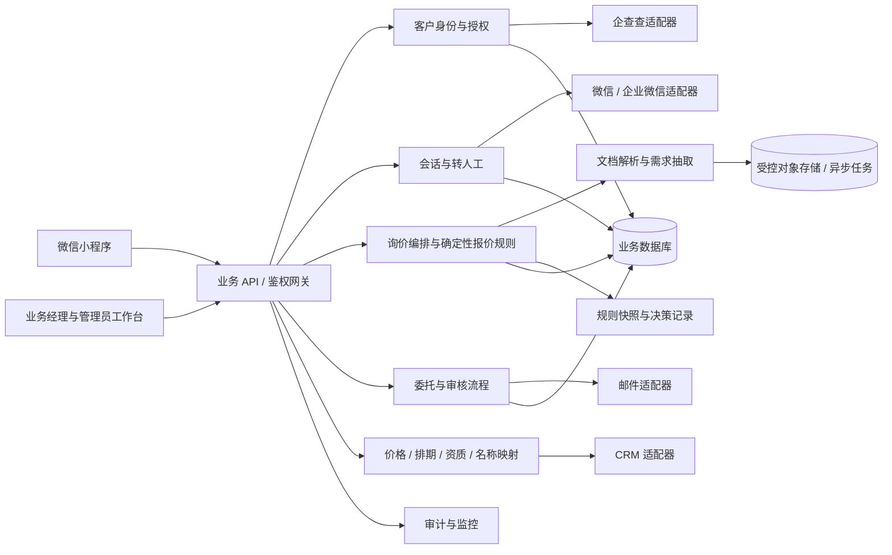
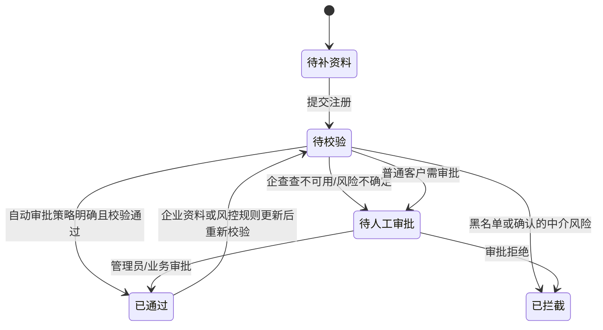
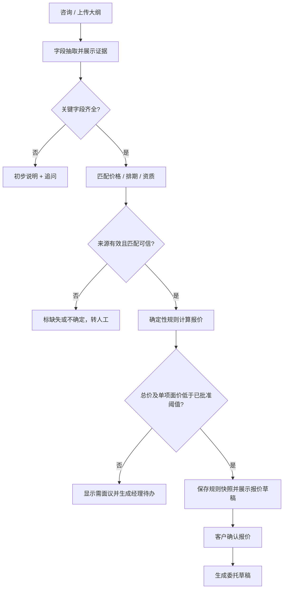

# 中汽零部件智能客服与报价系统建设规划

## 1. 规划结论

本规划依据客户提供的《AI智能客服系统建设方案-V3.docx》正文、仓库需求清单与当前代码整理。建议按“内部报价助手和受控知识底座先行，客户小程序分阶段开放”的路线推进。现有报价解析、CRM 文件适配、规则管理与小程序离线演示可以复用；真实客户身份、自动报价、下单审核、客服转接和消息触达仍依赖客户的规则签字、数据、接口与账号，不能以模拟数据替代生产验收。

附件文件名为 V3，但文档正文标题为“AI智能客服系统建设方案 V2.0”，编制日期为 2026 年 7 月。下文暂按所给正文作为本轮需求基线；版本号、审批状态和客户确认状态需项目负责人核对。方案的“系统接口与集成”章节只有概要表，规则配置章节也未提供字段、权限及审批细节，因此本文是研发设计基线，不代表接口或业务规则已获客户签字。

## 2. 建设目标与角色

目标业务链路为：客户咨询/上传试验大纲 → 结构化需求 → 查询价格、排期和资质 → 根据确定性规则报价或转人工 → 客户选定报价并填写委托单 → 业务经理审核 → 客户邮件确认 → 进入后续业务系统。

主要角色：

| 角色 | 核心工作 | 权限边界 |
|---|---|---|
| 新客户/小微客户 | 小程序注册登录、上传大纲/描述需求、获取报价（含排期和资质）、填写提交委托、条件触发的转人工 | 只能访问自己的企业、会话、报价和委托；不进入知识库后台 |
| 业务经理 | 不限金额的内部 AI 辅助报价、委托审核、具体报价/折扣调整、客户沟通、客户与咨询记录查询、主动对话、CRM 报价数据维护 | 按片区/客户/项目授权；具体报价调整与全局折扣规则管理分开 |
| 系统管理员 | 知识库、排期库、资质库、名称映射、黑白名单、加急/折扣规则、数据统计、中介风控和系统管理 | 管理操作留痕；不绕过报价规则；不默认读取其他项目资料 |
| 技术部门 | 根据业务数量维护排期项目库、制定维护加急规则、系统技术支持 | 仅维护授权业务分区；不自动获得报告审核、标准复核、全库或账号管理权 |

以上四角色按用户提供的职责表作为设计依据。部门人员分别开户；部门/项目/客户归属限制数据范围，不新增角色。现有模拟实现的管理员专用写入口和固定历史角色仍需按本表逐接口改造，本表不表示对应权限已上线。

## 3. 现有项目能力映射

| 需求域 | 现有实现 | 状态判断 | 可复用/缺口 |
|---|---|---|---|
| 报价解析与文件输出 | DOCX/Excel/PDF/图片解析与逐行复核、来源校验、匹配 CRM 只读快照后导出带审计的内部复核 Excel、报价历史 | 内部辅助链路可用 | 客户标准模板、金标准、CRM 字段映射和对客报价规则未确认；合成测试不代表识别准确率 |
| CRM/基础数据 | Excel/CSV/base 适配、基础库校验/版本回滚、项目范围隔离、只读预览 | 本地适配可用，生产 API 未接 | CRM API、客户字段、资质/排期语义和写入授权待提供 |
| 规则配置 | 分区权限、规则校验、只读候选预览、规则草稿/差异/过期检查/固定输入重放 | 内部草稿与候选预览可用 | 正式发布/停用/回滚、审批人、生效期和部门作用域待签署 |
| 客户注册与风控 | 默认关闭的注册演示 API、小程序 opt-in、管理员审核闭环；管理员队列只读展示当前本地名单/关键词候选 | 本地模拟可用 | 候选固定转人工、不自动审批；微信身份、企查查、签署后的风险语义和业务经理归属无真实链路 |
| 客户询价与报价 | 内部询价状态流、CRM 只读候选、转人工与管理员接手 | 内部模拟链路可用 | 不计算未签署的价格规则，不生成正式客户报价，不写 CRM |
| 委托下单 | 小程序 opt-in 演示委托、本人隔离查询、管理员审核/补件/重提 | 本地模拟可用 | 正式模板、客户确认、邮件和 CRM/任务系统写入未接 |
| 会话工作台 | 服务端演示存档、本人会话隔离、管理员队列/接单/转交/归档 | 本地模拟可用 | 业务经理角色、未读提醒、企微/客服消息及通知未接 |
| 系统集成 | CRM API 明确保持关闭；四类集成契约边界、7 类故障验收矩阵和纯进程内故障模拟器已归档 | 设计与本地故障分类可用，生产适配器未接 | 客户/供应商接口契约、凭据、网络、安全授权和验收样例待提供 |

台账依据：`docs/BACKLOG.yaml`；生产项 `CS_REG`、`CS_QUOTE`、`CS_AIQUOTE`、`CS_ORDER`、`CS_DESK`、`CS_RULE_PUBLISH`、`CS_INTEG` 仍为 waiting，关联的本地模拟/草稿/契约子项单独记录为 done。需求定义见 `docs/requirements.yaml` 的 CS-1 至 CS-8。小程序当前边界见 `p0/docs/miniprogram-demo.md`。

按 `requirements.yaml` 机器统计，CS-1 至 CS-8 共 29 项；截至 2026-11-23，覆盖脚本显示 29 项有本地 partial 切片、0 项达到完整需求验收。CS-2.6 目前仅有默认关闭的精确地区/备用经理候选预览，不代表真实指派或通知。CS-8.1 至 CS-8.4 的本地故障分类模拟不代表真实系统连接，生产任务 `CS_INTEG` 仍 waiting。全仓 90 项统计为 56 done、29 partial、5 waiting、0 todo。统计命令为 `PYTHONPATH=<PyYAML 缓存目录> <Codex Python> scripts/coverage.py --detail`；默认环境缺少 PyYAML，使用本机已缓存依赖运行，未安装新包。详细逐项证据和外部责任方见 `docs/customer-service-acceptance-matrix.md`；另有不计入需求条目的 `BLOCK_PROD` 本地模型路由硬阻塞。

## 4. 目标架构

采用模块化业务服务加外部适配器。先把领域边界和接口契约稳定下来，再按实际部署要求拆分服务，避免仅为“微服务”名义提前引入分布式事务和运维成本。

### 4.1 领域模块与数据责任

| 模块 | 主要对象 | 关键约束 |
|---|---|---|
| 客户身份 | 企业、联系人、授权、风险命中、业务归属 | 微信身份由服务端验证；客户与企业关系不能由客户端自报；隐私同意与用途留痕 |
| 会话服务 | 会话、消息、分派、未读、转交、状态 | 消息幂等；转接携带获授权的上下文；微信发送失败不丢内部待办 |
| 知识与基础数据 | CRM 价格、项目、排期、资质、名称映射 | 每条事实保留来源、导入批次、生效期、更新时间和审核状态 |
| 报价编排 | 询价单、解析行、匹配结果、报价、规则快照 | LLM 只抽取/解释；金额、折扣、阈值与拦截由确定性代码计算 |
| 委托流程 | 委托草稿、客户提交、经理审核、客户确认、业务系统回写 | 明确状态机；外部副作用使用幂等键和可重试 outbox |
| 规则管理 | 折扣、加急、阈值、风险、映射和模板规则 | 版本化、审批、生效时间、回滚、权限隔离及变更审计 |
| 集成适配 | CRM、企查查、微信/企微、邮件、任务/样品系统 | 统一超时、重试、限流、错误码、降级和对账；模拟适配器与生产适配器分离 |

生产数据建议使用 PostgreSQL 保存客户、会话、报价、委托、规则与审计索引；原始上传文件放受控对象存储；OCR/文档解析、邮件和外部同步走异步任务。当前 P0 JSON/文件存储适合测试及迁移输入，不应直接承载多人生产写入。

## 5. 核心流程与规则

### 5.1 客户注册与风险识别

企查查不可用、企业主体匹配不确定、黑白名单冲突时进入人工复核，不因超时默认放行。客户界面是否显示异常提示按方案要求区分：白名单/重点客户后台预警，不向客户暴露命中原因；黑名单/中介处理提示文案需安全与业务共同确认。

### 5.2 询价、报价与转人工

1. 输入可来自自然语言或 Word/Excel/图片；解析结果形成可编辑的标准化明细，保留原文页码/单元格等证据位置。
2. 每一行分别匹配标准、项目、数量单位、有效价格、排期、资质和来源。名称相似只生成候选，不直接等同于标准号精确命中。
3. 只有必填字段齐全、价格有效且来源可追溯、规则版本有效、项目/标准匹配达审批阈值、风险检查通过时，才允许按规则生成客户可见报价。
4. 任何缺价、过期价、低置信匹配、未知资质、CRM 不可用、黑名单/重点客户策略触发或模型解析不确定，都需追问或转人工；不得用模型补造价格、排期或资质。
5. 高价判断先由确定性服务计算总价和单项面价，再执行拦截。方案存在“金额小于 10000 自动”与“总价超过 10000 拦截”的边界不一致；在客户签字前按保守策略将 **总价或单项面价达到 10000 元**转人工，且不向客户输出自动报价。
6. 报价保存当时的数据来源版本、规则版本、币种/税口径、计算步骤与操作者，确保可以解释和重放。

“信息不足时先给初步结论”只能展示已核实的部分，不应展示猜测金额。小额订单也应保留客户确认、报价有效期及异常降级，不让大模型直接执行折扣或确认订单。

### 5.3 委托审核与会话交接

建议的委托状态为：`draft → submitted → manager_review → customer_confirmation → accepted`，拒绝、补件、撤回、过期和外部同步失败为显式分支。客户提交委托后必须生成业务经理任务；审核通过并生成最终版后才能发送客户确认邮件。邮件失败保留待重试状态，不回滚已审内容，也不将委托误标为客户已确认。

转人工条件（标准不在库、高价、客户要求帮助/AI无法回答、重点客户策略、提交委托审核）统一生成内部待办并携带客户授权范围内的上下文。首选经理离线时转备用经理；微信/企微通知失败不能丢失工作台任务。业务经理主动发起外部对话需遵守微信/企微允许的会话规则和客户授权。

## 6. 分阶段研发计划

| 阶段 | 目标与主要交付 | 前置条件 / 门禁 |
|---|---|---|
| S0 需求基线与口径冻结 | 把方案拆成可验收故事；确定报价边界、默认资质口径、客户审批、隐私、状态机与接口契约；形成风险/决策日志 | 核实附件版本；业务、技术、信息安全责任人认可规则；真实接口可暂缺，接口先用契约桩 |
| S1 内部报价助手加固 | 使用合成及脱敏样例，提升大纲抽取可修正性；展示价格/排期/资质来源与置信状态；确定性报价规则、缺失项与人工接手；导出 CRM 标准表 | 不向真实客户开放；合成价格醒目标“仅演示”；规则无签字时仅解释不自动报价 |
| S2 模拟客户闭环 | 小程序对接本地演示 API/模拟适配器；贯通咨询→模拟报价→模拟委托→经理审核→模拟客户确认；构造高价、缺价、未知标准、接口失败等演示分支 | 明确模拟环境标识和清数机制；无真实客户资料；现有离线页面逐步替换，不混淆生产/模拟状态 |
| S3 生产底座与外部适配 | 身份/RBAC、PostgreSQL/对象存储、审计、异步任务、CRM/企查查/微信/企微/邮件适配器、监控备份 | 客户提供接口文档/账号/网络策略、数据授权、隐私与安全审批；迁移/恢复与权限评审通过 |
| S4 内部试用 | 经理工作台、真实数据只读核对、内部报价辅助、真实转人工和审核；收集准确率、覆盖率、响应和降级数据 | 金标准与真实业务专家可用；规则、价格、资质、排期签字；安全测试和UAT通过 |
| S5 小范围客户试点与推广 | 限定客户/项目开放小额自动报价；逐步放开委托与通知；持续审计、运营与知识库治理 | 试点指标、风险处置、客服值守、回滚开关、资质/合同/监管要求确认；内测达到门禁后再开放 |

工期暂不估成承诺：方案没有确认人数、接口复杂度、合规边界和部署形态。S0 完成接口尽调与资源评估后，再给人员、排期和预算估算。S3/S4/S5 不能因模拟流程顺畅而视为已验收。

## 7. 可立即推进的研发切片

接下来优先做 **S1 的报价事实与降级演示契约**，不等待客户接口：

1. **已完成 S1 基础**：建立独立、带版本和来源标签的合成目录与询价样例，覆盖价格、有效期、排期、标准级/项目级资质、精确已审映射及数据源失败；报价预览契约禁止模型生成金额。
2. **已完成本地匹配首版**：服务端按项目、经审核的精确名称映射、标准号、单位、数量下限和有效期逐项返回价格/排期/资质状态与来源；内部工作台显示匹配、缺项和合成水印。总价、阈值和折扣不计算。
3. **已接入内部解析明细**：工作台可调用现有本地报价解析器，将项目、标准、数量、单位、来源行与解析置信度交给演示匹配接口；不发送原始文件、不保存解析明细、不消费文件内价格。低于解析器 0.85 置信度复核线的行保留人工复核动作。
4. **已接入既有 CRM 本地只读适配器**：在显式开关开启并配置 `excel`、`csv` 或 `base` 模式时读取当前快照；`off`、预留 `api` 模式或读取失败时关闭预览，不回退合成数据。响应携带内容版本指纹和行级来源编号，不泄露本地路径。
5. **已保留来源字段的未知状态**：样品名称现在随解析明细进入匹配；优先精确匹配样品名、检验项目和标准，未命中时沿用现有 CRM 对账兼容回退并要求人工确认。重复有效价格行会展示来源候选供人工消歧，不自动挑选；即便两行字段完全相同，也分配不同快照内编号。CRM 价格行的数量仅展示为来源记录数量，不推断为最低起订量或报价适用范围。当前适配器未提供结构化资质范围、名称映射审批状态、价格币种和税口径；这些信息不作推断，相关记录进入待确认/人工复核，资质提示不显示全库候选数量。CRM 来源预览仍不计算总价、折扣、阈值，不对客户出价，也不写回 CRM。
6. **本轮安全与演示修正**：CRM 预览和人工复核在读取快照前检查项目名称/编号授权；受限用户的项目 token 必须在 CRM 项目清单中唯一映射，重名/交叉冲突即拒绝。预览只保留该项目的价格与排期，资质和名称映射因缺少范围/审批元数据而不提供给受限账号；这些隐藏数据或其他项目的变化不会改变返回版本号和候选编号。无结构化范围的资质统一返回“未知、需人工核验”，不泄露全库记录有无或数量。内置演示价格从 2000 年起生效到 2999 年，另保留截至 2020 年的过期样例，避免把未来生效记录误当作当前有效价；项目资质样例带项目名称以供解析器按项目匹配。
7. 先复用现有文件解析、CRM 对账、规则配置与 Excel 输出；通过适配层消费 CRM/规则，不让前端直读本地文件或把规则拷贝进页面。
8. 为失败分支准备模拟开关：未知标准、无有效价、排期过期、资质只到项目层、规则过期、CRM 超时、单项/总价触发面议、文档解析低置信。

在当前小程序中，已有离线咨询快捷指引、需求保存、报价上下文带入、演示委托与本地对话。之前分支未提交的快捷指引改动可以保留作为 S2 的一部分；开发者工具本地配置文件不得纳入共享源码。

## 8. 需要客户/业务确认的决策

以下不是首轮合成开发的阻塞项，但是真实自动报价、客户开放和验收前必须确认：

| 决策 | 方案中的冲突/缺项 | 建议的默认处理 |
|---|---|---|
| 10000 元阈值 | `<10000` 自动、`≥10000` 转人工；另一处写“超过 10000” | 未签字前 `总价 ≥ 10000` 或 `任一单项面价 ≥ 10000` 转人工 |
| 金额计算口径 | 含税/未税、折扣前/后、运费/加急费是否计入阈值不明 | 先确认人民币、税率/折扣顺序与阈值所用金额；页面显示计算明细 |
| CRM 项目默认资质 | 方案称 CRM 已有项目默认具备资质，同时又要求独立认可清单 | 暂不自动作标准级资质承诺；需业务/质量负责人确认依据和粒度 |
| 信息不足的初步结论 | “结论性内容”可能被误读成报价承诺 | 只显示已证实项目和缺失项，不给猜测价/周期/认可结论 |
| 客户审批与中介识别 | 企业审核、风险信号权重、误判解封时限未定义 | 风险不确定进入人工复核；拒绝和解封必须可审计 |
| “AI持续自学习” | 风险章节提出自动优化，但没有反馈审核/发布控制 | 采用人工审核的离线评测和版本发布；不在线自动改价或改规则 |
| 微信和企微消息 | 主动触达能力取决于账号类型、平台规则、模板/会话权限 | 先核实官方允许的消息通道与用户授权，再设计通知和主动会话 |
| 委托生效时点 | 经理审核、客户邮件确认、进入实验系统的顺序需业务确认 | 状态分开记录，不把“邮件已发送”视为“客户已确认” |
| 数据保留与隐私 | PII、上传文件、对话、审计的留存/删除周期未给 | 上线前由客户安全/法务确定；设计可按客户/会话执行保留与删除 |

## 9. 验收与运行原则

- 演示数据、脱敏样例、客户真实数据分环境和目录；所有指标注明数据类型、样本量、日期与环境。合成测试只能建立功能基线，不能替代客户验收。
- 报价每一行可追溯到价格来源、版本、单位、有效期和规则快照；无依据就是缺失或转人工，不允许生成“看起来合理”的金额。
- 外部调用失败时按保守策略降级：报价不自动确认、注册不默认放行、消息不丢、委托状态不伪造。
- 对客户开放前完成权限隔离、隐私同意、日志脱敏、上传安全、备份恢复、限流、审计查询、回滚和人工值守演练。
- “内部可用”“模拟链路可演示”“真实系统集成”“客户验收通过”是不同状态，报告中必须分别标注。

## 10. 参考资料

- 客户方案：`AI智能客服系统建设方案-V3.docx`（正文标注 V2.0，2026 年 7 月；原文件在项目仓库外）
- 需求定义：`docs/requirements.yaml`，CS-1.1 至 CS-8.4
- 状态台账：`docs/BACKLOG.yaml`，CS_BASE 至 CS_INTEG
- CRM 适配现状：`docs/p1-crm-adapter/README.md`
- 规则配置现状：`docs/p1-business-rules/README.md`
- 小程序演示边界：`p0/docs/miniprogram-demo.md`
- 客户侧数据/接口前置：`docs/data-request-checklist.md` 与 `docs/p1-plan.md`
