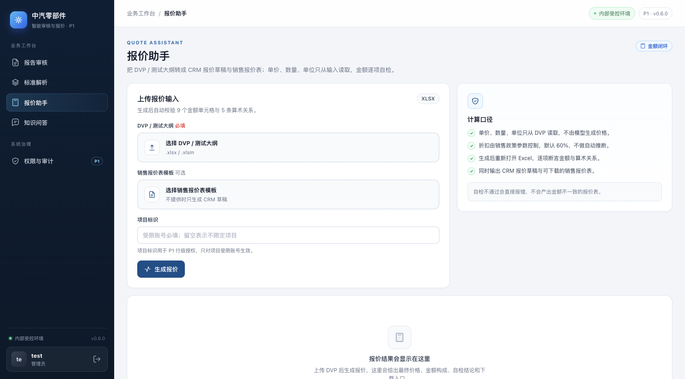
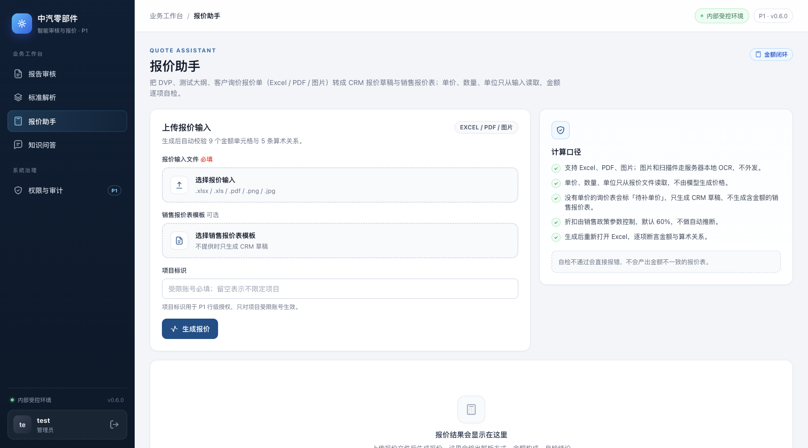
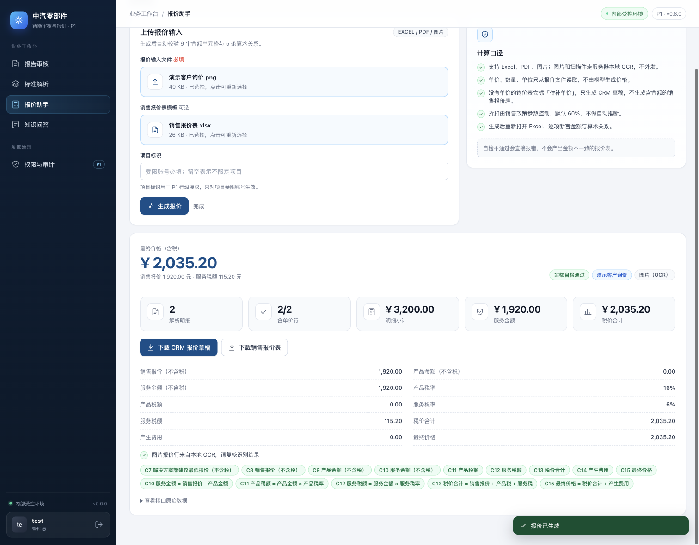
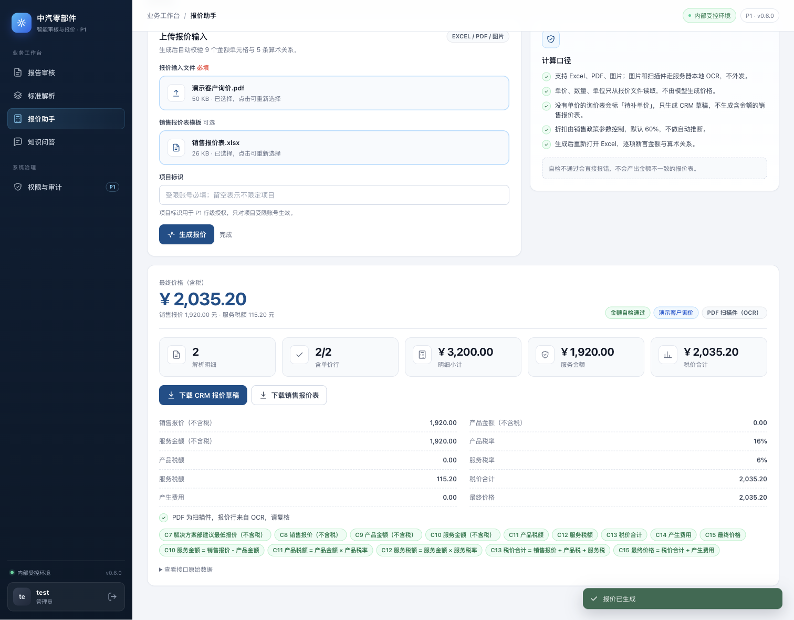
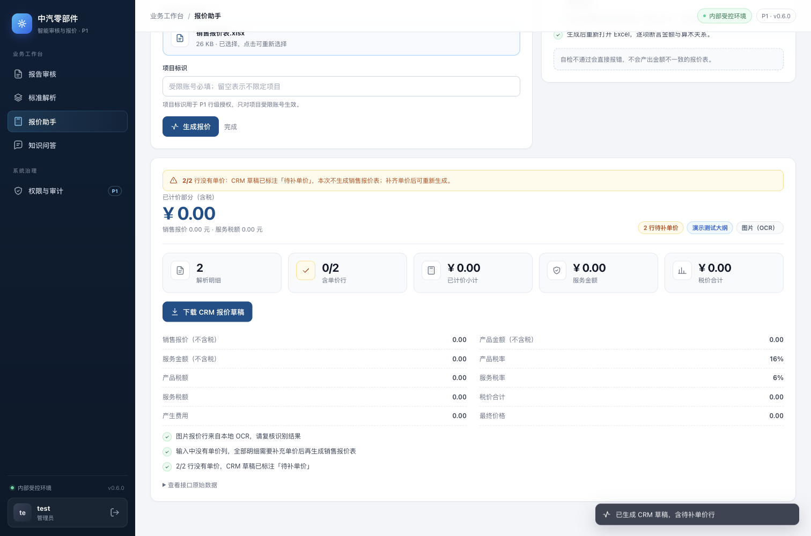

# 报价助手多格式输入（Excel / PDF / 图片）与真实案例自测

日期：2026-11-02
基线：`main` @ `2c08ffc`（0.6.0）
范围：报价助手的输入解析、缺单价处理、API 与页面提示；不改 CRM 写回、不改折扣/税率口径。

## 1. 为什么改

真实客户询价并不总是「带单价的 DVP Excel」：

- 客户可能给 **Excel 测试大纲 / 旧版 `.xls` DVP**；
- 也可能给 **PDF 测试大纲**、**扫描盖章报价单**；
- 还可能只发 **图片/截图询价**（试验项目 + 标准 + 数量，没有单价）。

原实现只接受 `.xlsx/.xlsm`，并且要求 `试验项目 + 单价/数量/单位` 表头，导致上述材料在页面上传不了或解析失败。

## 2. 现在支持什么

| 输入 | 解析方式 | 真实案例中的形态 |
|---|---|---|
| `.xlsx` / `.xlsm` / `.xls` | Excel 表格 | DVP（表头可不在首行、章节内重复出现单价/数量/单位表头）、报价单、测试大纲 |
| `.pdf` | PDF 文本表格；无文本层时本地 OCR（前 3 页） | 文本版报价单/测试大纲、扫描盖章报价单 |
| `.png` / `.jpg` / `.jpeg` / `.webp` / `.bmp` | 本地 OCR（RapidOCR） | 手机截图/图片询价 |

表头识别不依赖固定列号：按语义找 `试验项目/检验项目/测试项目`、`试验标准/检验标准/来源`、
`单价/收费标准`、`数量`、`单位`、`样品名称`、`备注`，允许两行表头与合并单元格；
`测试项目 + 测试子过程` 的层级大纲按子过程拆行。

### 缺单价时

客户测试大纲、图片询价通常没有单价。实现不会填默认价或让模型猜价：

- 明细照常解析，行上标 `needs_price=true`；
- CRM 草稿保留项目/标准/单位/数量和「待补单价」备注，含税单价留空；
- 只要存在缺单价行，就**不生成**销售报价表，API 返回 `sales_quote_skipped_reason`；
- 页面显示「N/M 行含单价」「N 行待补单价」和 OCR 复核提示。

## 3. 真实案例自测

脚本（不包含客户数据，路径由参数传入）：

```bash
cd p0
.venv/bin/python scripts/run_quote_multiformat_demo.py \
  --files <DVP.xlsx> <旧版大纲.xls> <测试大纲.pdf> <报价单.pdf> <扫描报价单.pdf> \
          <图片询价1.png> <图片询价2.png> <层级测试大纲.xlsx> <Excel内嵌图片.xlsx> \
  --out-dir data/quote-multiformat-selfcheck
```

本地真实材料（不提交仓库）结果，9 个文件：

| 案例 | 格式 | 解析方式 | 明细行 | 含单价 |
|---|---|---|---|---|
| 闭口合同 DVP（前排座椅） | `.xlsx` | Excel 表格 | 18 | 18/18 |
| 旧版 Excel 测试大纲（储气罐） | `.xls` | Excel 表格 | 29 | 17/29（12 行源表无价） |
| PDF 测试大纲（方向盘） | `.pdf` | PDF 文本表格 | 26 | 0/26（源表无价） |
| 文本版报价单（开口合同） | `.pdf` | PDF 文本表格 | 1 | 1/1 |
| 扫描盖章报价单（非标试验） | `.pdf` | PDF 扫描件（OCR） | 11 | 11/11 |
| 图片询价 A（双语密集表） | `.png` | 图片（OCR） | 4 | 0/4（源图无价） |
| 图片询价 B（测试要求） | `.png` | 图片（OCR） | 6 | 0/6（源图无价） |
| 非标试验大纲（层级子过程） | `.xlsx` | Excel 表格 | 14 | 0/14（源表无价） |
| Excel 内嵌图片（局部片段） | `.xlsx` | — | — | 失败：内嵌图是表体片段，没有表头 |

**结论**：9 个真实文件中 8 个可解析出报价行；3 个源文件自带单价，金额闭环自检通过；
其余 5 个源文件本身没有单价，按「待补单价」草稿输出，不伪造金额。
唯一失败项是「Excel 中只嵌了一张没有表头的表体照片」，页面会明确提示需要带表头的表格。

### 已知限制

- 图片/扫描件的行来自本地 OCR，可能把相邻单元格文字并入项目名/标准；页面与 API 都会返回
  `OCR 结果请复核` 与低置信度提示，不能当作免复核的最终报价。
- PDF 扫描件只 OCR 前 3 页；超过 3 页会提示截断。
- Excel 中只有图片且图片没有表头时无法定位报价行（如上）。
- OCR 在 `async` 请求内同步执行，单实例并发为 1；扫描件解析慢于文本表格，这是 P1 已记录的异步化事项。

## 4. Before / After 视觉证据

- **Before**：`main` @ `2c08ffc`，本机 8091，1512×838，浅色主题，`?tab=quote`。
- **After**：本分支，本机 8092，同一浏览器、同一视口、同一主题、同一合成演示数据。
- 截图来自实际运行的应用，不是 mockup；演示数据为合成 DVP/询价图片，不含客户真实数据。

| Before（仅 XLSX） | After（Excel / PDF / 图片） |
|---|---|
|  |  |

图片输入的实际结果（本地 OCR 解析 2 行、金额自检通过、显示解析方式与复核提示）：



PDF（扫描件）输入的实际结果：



没有单价的询价（只生成「待补单价」的 CRM 草稿，不生成销售报价表）：



## 5. 验证

```bash
cd p0
.venv/bin/python -m pytest -q       # 61 passed, 2 skipped
```

单元/API 覆盖：报价单 Excel 布局、章节内重复单价表头、无单价大纲、PDF 表格分派、
OCR 行解析、格式校验、缺单价时跳过销售报价表、金额自检。
